# Web Tricks

## Resources

- <https://1loc.dev/>
- <https://csslayout.io/>
- <https://shortcode.dev/css-cheatsheet>
- <https://shortcode.dev/html-cheatsheet>
- <https://shortcode.dev/javascript-cheatsheet>
- [`valentinog`](https://www.valentinog.com/blog/jsdoc/)
- [`cloudhadoop`](https://www.cloudhadoop.com/2018/09/jsdoc-javascript-documentation-function.html)

## Advanced Examples

- <https://htmldom.dev/drag-and-drop-table-row/>
- <https://htmldom.dev/drag-and-drop-table-column/>
- <https://htmldom.dev/drag-and-drop-element-in-a-list/>
- <https://htmldom.dev/drag-to-scroll/>
- <https://htmldom.dev/create-a-custom-scrollbar/>
- <https://htmldom.dev/create-a-range-slider/>
- <https://htmldom.dev/create-an-image-comparison-slider/>
- <https://htmldom.dev/create-resizable-split-views/>
- <https://htmldom.dev/make-a-draggable-element/>
- <https://htmldom.dev/make-a-resizable-element/>
- <https://htmldom.dev/resize-the-width-of-a-text-box-to-fit-its-content-automatically/>
- <https://htmldom.dev/print-an-image/>
- <https://htmldom.dev/paste-as-plain-text/>
- [`Custom Right-Click (Context) Menu`](https://codepen.io/knyttneve/pen/YzxEBew)
- <https://htmldom.dev/paste-an-image-from-the-clipboard/>
- <https://htmldom.dev/highlight-an-element-when-dragging-a-file-over-it/>
- <https://htmldom.dev/allow-to-enter-particular-characters-only/>
- <https://htmldom.dev/show-a-custom-context-menu-at-clicked-position/>
- <https://developer.mozilla.org/en-US/docs/Web/API/File/Using_files_from_web_applications>
- <https://github.com/lukehoban/es6features>
- <https://dev.to/afzalimamias/add-tags-input-box-in-html-css-javascript-3i12>

## Tips

### Always pass the radix to `parseInt`

```js
parseInt('50', 10); // 50
```

### Move code into a function

```js
var width = (value - 0.5) * 16;

// WIll Be
var width = emToPixels(value);

function emToPixels(ems) {
  return (ems - 0.5) * 16;
}
```

### Replace conditional expression with function

```js
if(!el.offsetWidth || !el.offsetHeight) {
  // ...
}

// Will Be
function isVisible(el) {
  return el.offsetWidth && el.offsetHeight;
}

if(!isVisible(el)) {
  // ...
}
```

The most common use for this method is mathematical expressions:

```js
return a * b + (c / d);

// Will Be
var multiplier = a * b;
var divisor = c / d;
return multiplier + divisor;
```

### Use named constants, avoid magic values

```js
const MEANING_OF_LIFE = 42;
```

### Always use `noopener` or `noreferrer` for links opened in new tabs

```js
window.opener.location = 'http://fake.website.here';
```

```html
<!-- Don't -->
<a target="_blank">...</a>

<!-- Do -->
<a target="_blank" rel="noopener">...</a>

<!-- Or -->
<a target="_blank" rel="noreferrer">...</a>
<a target="_blank" rel="noopener noreferrer">...</a>
```

### Some Rule While Coding JS

- `variable` and `function` are in **camelCase**
- `global` and `constant` are in **UPPERCASE**
- `filename` are in **lowercase**
- make `space` between **separator** like `+, - ...`
- short statement can be in one line
- `let i, len = arr.length;` best in performance than `for(i=0; i< len; i++)`
- avoid using `new` word it's bad in performance
- if we using `html` element more it's better put it into variable like `let`, `var` it effect on performance
- `onload`, `onunload` ues to deal with cookie and browser type
- there are two type of event
  - bubbling propagation(default)
  - capturing propagation
- `selector.addEventListener('event', function, false|true)` by default `false` which mean we are using bubbling propagation
- use try & catch

  ```js
  try{
    throw 'any data type';
  }
  catch (er){
    er.message;
  }
  finally{
    'code execute after try/catch' ;
  }
  ```

# Html Attributes

## block search engine crawlers

```html
<meta name="robots" content="noindex">
```

## html entity codes

```html
1. &amp; 2. &lt; 3. &gt; 4. &laquo; 5. &raquo; 6. &copy; 7. &reg;  8. &trade; 9. &pound; 10. &euro;

<!-- Output: -->
1. & 2. < 3. > 4. « 5. » 6. © 7. ® 8. ™ 9. £ 10. €
```

## lazy loading

```html
<!-- On the image tag -->


<!-- In the picture element with source sets -->
<picture>
 <source media="(min-width: 1024px)" srcset="./assets/icon-512x512.png">
 <source srcset="./assets/icon-144x144.png 1x, ./assets/icon-512x512.png 2x">
 
</picture>
```

## Filter file types of a file input

```html
<input type="file" accept=".png, .jpg, .jpeg" />

<!-- Or -->
<input type="file" accept="image/png, image/jpeg" />
```

## Validate an input value with the pattern attribute

```html
<input type="tel" pattern="^\d{10}$" title="Please enter 10 digits" />
```

## Create a download link

```html
<!-- Download instead of opening it -->
<a href="/assets/document.pdf" download>
 <!-- Download it with new file name -->
 <a href="/assets/document.pdf" download="a copy of document.pdf"></a
></a>
```

## autocomplete list with the datalist element

```html
<input list="demo__list" />
<datalist id="demo__list">
 <option value="..." />
 <option value="..." />
 <option value="..." />
 ...
</datalist>
```

# Tricks

## Section Divider

### Wave Divider

```html
<div class="wave-shape-divider">
 <svg data-name="Layer 1" xmlns="http://www.w3.org/2000/svg" viewBox="0 0 1200 120" preserveAspectRatio="none">
 <path d="M321.39,56.44c58-10.79,114.16-30.13,172-41.86,82.39-16.72,168.19-17.73,250.45-.39C823.78,31,906.67,72,985.66,92.83c70.05,18.48,146.53,26.09,214.34,3V0H0V27.35A600.21,600.21,0,0,0,321.39,56.44Z" class="shape-fill"></path>
 </svg>
</div>

<div class="wave-shape-divider wave-bottom">
 <svg data-name="Layer 1" xmlns="http://www.w3.org/2000/svg" viewBox="0 0 1200 120" preserveAspectRatio="none">
 <path d="M321.39,56.44c58-10.79,114.16-30.13,172-41.86,82.39-16.72,168.19-17.73,250.45-.39C823.78,31,906.67,72,985.66,92.83c70.05,18.48,146.53,26.09,214.34,3V0H0V27.35A600.21,600.21,0,0,0,321.39,56.44Z" class="shape-fill"></path>
 </svg>
</div>
```

```scss
.wave-shape-divider {
 position: absolute;
 top: 0;
 left: 0;
 width: 100%;
 overflow: hidden;
 line-height: 0;

 &.wave-bottom {
 bottom: 0;
 top: auto;
 transform: rotate(180deg);
 }

 svg {
 position: relative;
 display: block;
 width: calc(100% + 1.3px);
 height: 150px;

 /** For tablet devices **/
 @media (min-width: 768px) and (max-width: 1023px) {
  width: calc(100% + 1.3px);
  height: 106px;
 }
 /** For mobile devices **/
 @media (max-width: 767px) {
  width: calc(100% + 1.3px);
  height: 62px;
 }
 }

 .shape-fill {
 fill: #ffffff;
 }
}
```

### Skew Divider

```html
<div class="skew-divider" style='height: 50px;'></div>
```

```scss
%skew {
 content: "";
 background-color: gold;
 z-index: -1;
 position: absolute;
 top: 0;
 bottom: 0;
 right: 0;
 left: 0;
 width: 100%;
 height: 100%;
 transform: skewY(-6deg);
}

.skew-divider {
 position: relative;
 margin-top: 200px;
 margin-bottom: 200px;

 &::before,
 &::after {
 @extend %skew;
 }
 &::before {
 transform-origin: top left;
 }
 &::after {
 transform-origin: bottom right;
 }
}

.skew-divider-top {
 position: relative;
 margin-top: 200px;

 &::before {
 @extend %skew;
 transform-origin: top left;
 }
}

.skew-divider-bottom {
 position: relative;
 margin-bottom: 200px;

 &::before {
 @extend %skew;
 transform-origin: bottom right;
 }
}

.skew-divider-img {
 position: relative;

 &::after {
 @extend %skew;
 background-image: attr(data-image);
 transform-origin: bottom right;
 }
}
```

# Table

## Sort a table by clicking its headers

```html
<table class="table sort-table-by-click-header">
  <thead>
    <tr>
      <th data-type="number"><button class="table-header">#</button></th>
      <th><button class="table-header">First name</button></th>
      <th><button class="table-header">Last name</button></th>
    </tr>
  </thead>
  <tbody>
    <tr>
      <td>1</td>
      <td>Andrea</td>
      <td>Ross</td>
    </tr>
  </tbody>
</table>
```

```scss
.sort-table {
  border-collapse: collapse;
  font-family: Inter, sans-serif;
  border: 1px solid #ccc;
  th,
  td {
    border: 1px solid #ccc;
    padding: 0.5rem;
  }
  th {
    cursor: pointer;
    text-decoration: underline;

    .table-header {
      background-color: transparent;
      border: none;
      cursor: pointer;
    }
  }
}
```

```js
const tables_array = document.querySelectorAll('.sort-table-by-click-header');

Array.from(tables_array).forEach((table) => {
  const headers = table.querySelectorAll('th'),
    tableBody = table.querySelector('tbody'),
    rows = tableBody.querySelectorAll('tr');

  // Track sort directions
  const directions = Array.from(headers).map((header) => {
    return '';
  });

  // Loop over the headers
  headers.forEach((head, index) => {
    head.addEventListener('click', () => {
      sortColumn(index);
    });
  });

  function transform(index, content) {
    // Get the data type of column
    const type = headers[index].getAttribute('data-type');

    switch (type) {
      case 'number':
        return parseFloat(content);
      case 'string':
      default:
        return content;
    }
  }

  function sortColumn(index) {
    // Get the current direction
    const direction = directions[index] || 'asc';

    // A factor based on the direction
    const multiplier = direction === 'asc' ? 1 : -1;

    const newRows = Array.from(rows);

    newRows.sort((rowA, rowB) => {
      const cellA = rowA.querySelectorAll('td')[index].textContent;
      const cellB = rowB.querySelectorAll('td')[index].textContent;

      const a = transform(index, cellA);
      const b = transform(index, cellB);

      switch (true) {
        case a > b:
          return 1 * multiplier;
        case a < b:
          return -1 * multiplier;
        case a === b:
          return 0;
      }
    });

    // Remove old rows
    [].forEach.call(rows, (row) => {
      tableBody.removeChild(row);
    });

    // Reverse the direction
    directions[index] = direction === 'asc' ? 'desc' : 'asc';

    // Append new row
    newRows.forEach((newRow) => {
      tableBody.appendChild(newRow);
    });
  }
});
```

## Show or hide table columns (toggle)

```html
<div class="toggle-table-col-container">
  <table class="toggle-table-col">
    <thead>
      <tr>
        <th data-type="number">No.</th>
        <th>First name</th>
        <th>Last name</th>
        <th>Date of birth</th>
        <th>Address</th>
      </tr>
    </thead>
    <tbody>
      <tr>
        <td>1</td>
        <td>Andrea</td>
        <td>Ross</td>
        <td>1985-12-24</td>
        <td>95945 Rodrick Crossroad</td>
      </tr>
    </tbody>
  </table>

  <ul class="toggle-table-menu hidden">
  </ul>
</div>
```

```scss
.toggle-table-col-container {
  position: relative;
  font-family: Inter, sans-serif;

  .toggle-table-menu {
    position: absolute;

    list-style-type: none;
    margin: 0;
    padding: 0;

    background-color: #f7fafc;
    border: 1px solid #cbd5e0;
    border-radius: 0.25rem;
    padding: 0.5rem;

    &.hidden {
      display: none;
    }
  }
  .toggle-table-col {
    border-collapse: collapse;
    border: 1px solid #ccc;

    th,
    td {
      border: 1px solid #ccc;
      padding: 0.5rem;
    }
    th {
      user-select: none;
    }
  }
}
```

```js
const tables_container_array = document.querySelectorAll(
  '.toggle-table-col-container'
);

Array.from(tables_container_array).forEach((container) => {
  const table = container.querySelector('table'),
    headers = [].slice.call(table.querySelectorAll('th')),
    menu = container.querySelector('.toggle-table-menu'),
    tableBody = table.querySelector('tbody'),
    rows = tableBody.querySelectorAll('tr'),
    thead = table.querySelector('thead');

  // ----------------
  // - Build the menu
  // ----------------
  headers.forEach((th, index) => {
    // Build the menu item
    const li = document.createElement('li'),
      label = document.createElement('label'),
      checkbox = document.createElement('input'),
      text = document.createTextNode(th.textContent);

    checkbox.setAttribute('type', 'checkbox');
    checkbox.setAttribute('checked', 'true');
    checkbox.setAttribute('data-column-index', index);

    checkbox.style.marginRight = '.25rem';

    label.appendChild(checkbox);
    label.appendChild(text);

    label.style.display = 'flex';
    label.style.alignItems = 'center';

    li.appendChild(label);
    menu.appendChild(li);

    // Handle the event
    checkbox.addEventListener('change', (e) => {
      e.target.checked ? showColumn(index) : hideColumn(index);
      menu.classList.add('hidden');
    });
  });

  // ------------------
  // - Toggle the menu
  // ------------------

  thead.addEventListener('contextmenu', (e) => {
    e.preventDefault();

    const rect = thead.getBoundingClientRect();
    const x = e.clientX - rect.left;
    const y = e.clientY - rect.top;

    menu.style.top = `${y}px`;
    menu.style.left = `${x}px`;
    menu.classList.toggle('hidden');

    document.addEventListener('click', documentClickHandler);
  });

  // Hide the menu when clicking outside of it
  const documentClickHandler = function (e) {
    const isClickedOutside = !menu.contains(e.target);
    if (isClickedOutside) {
      menu.classList.add('hidden');
      document.removeEventListener('click', documentClickHandler);
    }
  };

  // ----------------------
  // - Toggle table columns
  // ----------------------
  const numColumns = headers.length;

  const cells = [].slice.call(table.querySelectorAll('th, td'));
  cells.forEach((cell, index) => {
    cell.setAttribute('data-column-index', index % numColumns);
  });

  // To hide all cells in given column, we find all cells based on the data-column-index attribute, and hide each of them:
  function hideColumn(index) {
    cells
      .filter((cell) => {
        return cell.getAttribute('data-column-index') === `${index}`;
      })
      .forEach((cell) => {
        cell.style.display = 'none';
        cell.setAttribute('data-shown', 'false');
      });
    // How many columns are hidden
    const numHiddenCols = headers.filter(function (th) {
      return th.getAttribute('data-shown') === 'false';
    }).length;
    if (numHiddenCols === numColumns - 1) {
      // There's only one column which isn't hidden yet
      // We don't allow user to hide it
      const shownColumnIndex = thead
        .querySelector('[data-shown="true"]')
        .getAttribute('data-column-index');

      const checkbox = menu.querySelector(
        `[type="checkbox"][data-column-index="${shownColumnIndex}"]`
      );
      checkbox.setAttribute('disabled', 'true');
    }
  }

  // By taking the advantage of using data attribute, it's so easy to show the column:
  function showColumn(index) {
    cells
      .filter((cell) => cell.getAttribute('data-column-index') === `${index}`)
      .forEach((cell) => {
        cell.style.display = '';
        cell.setAttribute('data-shown', 'true');
      });

    menu
      .querySelectorAll(`[type="checkbox"][disabled]`)
      .forEach(function (checkbox) {
        checkbox.removeAttribute('disabled');
      });
  }

  cells.forEach((cell, index) => {
    cell.setAttribute('data-column-index', index % numColumns);
    cell.setAttribute('data-shown', 'true');
  });
});
```

## [`Export a table to csv`](https://htmldom.dev/export-a-table-to-csv/)

```html
<table id="exportMe" class="table">
    <!-- ... -->
</table>
<button id="export">Export</button>
```

### Export the table cells to CSV

```js
const toCsv = function (table) {
    // Query all rows
    const rows = table.querySelectorAll('tr');

    return [].slice
        .call(rows)
        .map(function (row) {
            // Query all cells
            const cells = row.querySelectorAll('th,td');
            return [].slice
                .call(cells)
                .map(function (cell) {
                    return cell.textContent;
                })
                .join(',');
        })
        .join('\n');
};
```

### Download the CSV

```js
const download = function (text, fileName) {
    const link = document.createElement('a');
    link.setAttribute('href', `data:text/csv;charset=utf-8,${encodeURIComponent(text)}`);
    link.setAttribute('download', fileName);

    link.style.display = 'none';
    document.body.appendChild(link);

    link.click();

    document.body.removeChild(link);
};

// The last thing is to connect all pieces together. We just need to handle the click event of the Export button:
const table = document.getElementById('exportMe');
const exportBtn = document.getElementById('export');

exportBtn.addEventListener('click', function () {
    // Export to csv
    const csv = toCsv(table);

    // Download it
    download(csv, 'download.csv');
});
```

## Misc

## Heart Animation

```html
<div class='heart-animation-container '>
 <input id="toggle-heart" type="checkbox" class='toggle-heart-input' />
 <label for="toggle-heart" aria-label="like" class='toggle-heart-label'>❤️</label>
</div>
```

```scss
.heart-animation-container {
 .toggle-heart-input {
  position: absolute;
  left: -100vw;

  &:focus + label.toggle-heart-label {
   text-shadow: 0 0 3px white, 0 1px 1px white, 0 -1px 1px white,
    1px 0 1px white, -1px 0 1px white;
  }

  &:checked + label.toggle-heart-label {
   color: #e2264d;
   filter: none;
   will-change: font-size;
   animation: heart 1s cubic-bezier(0.17, 0.89, 0.32, 1.49);

   &:before,
   &:after {
    animation: inherit;
    animation-timing-function: ease-out;
   }

   &:before {
    will-change: transform, border-width, border-color;
    animation-name: bubble;
   }

   &:after {
    will-change: opacity, box-shadow;
    animation-name: sparkles;
   }
  }
 }

 label.toggle-heart-label {
  align-self: center;
  position: relative;
  color: #888;
  font-size: 2em;
  filter: grayscale(1);
  user-select: none;
  cursor: pointer;

  &:before,
  &:after {
   position: absolute;
   z-index: -1;
   top: 50%;
   left: 50%;
   border-radius: 50%;
   content: "";
  }

  &:after {
   margin: -0.1875rem;
   width: 0.375rem;
   height: 0.375rem;
   box-shadow: 0.32476rem -3rem 0 -0.1875rem #ff8080,
    -0.32476rem -2.625rem 0 -0.1875rem #ffed80,
    2.54798rem -1.61656rem 0 -0.1875rem #ffed80,
    1.84982rem -1.89057rem 0 -0.1875rem #a4ff80,
    2.85252rem 0.98418rem 0 -0.1875rem #a4ff80,
    2.63145rem 0.2675rem 0 -0.1875rem #80ffc8,
    1.00905rem 2.84381rem 0 -0.1875rem #80ffc8,
    1.43154rem 2.22414rem 0 -0.1875rem #80c8ff,
    -1.59425rem 2.562rem 0 -0.1875rem #80c8ff,
    -0.84635rem 2.50595rem 0 -0.1875rem #a480ff,
    -2.99705rem 0.35095rem 0 -0.1875rem #a480ff,
    -2.48692rem 0.90073rem 0 -0.1875rem #ff80ed,
    -2.14301rem -2.12438rem 0 -0.1875rem #ff80ed,
    -2.25479rem -1.38275rem 0 -0.1875rem #ff8080;
  }

  &:before {
   box-sizing: border-box;
   margin: -2.25rem;
   border: solid 2.25rem #e2264d;
   width: 4.5rem;
   height: 4.5rem;
   transform: scale(0);
  }
 }
}

@keyframes heart {
 0%,
 17.5% {
  font-size: 0;
 }
}

@keyframes bubble {
 15% {
  transform: scale(1);
  border-color: #cc8ef5;
  border-width: 2.25rem;
 }
 30%,
 100% {
  transform: scale(1);
  border-color: #cc8ef5;
  border-width: 0;
 }
}

@keyframes sparkles {
 0%,
 20% {
  opacity: 0;
 }
 25% {
  opacity: 1;
  box-shadow: 0.32476rem -2.4375rem 0 0rem #ff8080,
   -0.32476rem -2.0625rem 0 0rem #ffed80, 2.1082rem -1.26585rem 0 0rem #ffed80,
   1.41004rem -1.53985rem 0 0rem #a4ff80, 2.30412rem 0.85901rem 0 0rem #a4ff80,
   2.08305rem 0.14233rem 0 0rem #80ffc8, 0.76499rem 2.33702rem 0 0rem #80ffc8,
   1.18748rem 1.71734rem 0 0rem #80c8ff, -1.35019rem 2.0552rem 0 0rem #80c8ff,
   -0.60229rem 1.99916rem 0 0rem #a480ff, -2.44865rem 0.22578rem 0 0rem #a480ff,
   -1.93852rem 0.77557rem 0 0rem #ff80ed, -1.70323rem -1.77366rem 0 0rem #ff80ed,
   -1.81501rem -1.03204rem 0 0rem #ff8080;
 }
}
```

### Doc Wrapper

an wrapper of container for doc like bootstrap

```html
<div class="example-container">
 <div class="example-window">
 <div class="example-window-head">
  <div class="example-window-buttons">
  <div class="example-window-button example-window-button-close"></div>
  <div class="example-window-button example-window-button-min"></div>
  <div class="example-window-button example-window-button-full"></div>
  </div>
  <div class="example-window-title">Put cursor at the end of an input</div>
 </div>
 <div class="example-window-demo">
  <div class="example-window-demo-frame">
  <iframe class="loaded" src="https://github.com/1milligram/html-dom/blob/master/public/demo/resize-columns-of-a-table/index.html"></iframe>

  </div>
  <div class="example-window-demo-toolbar">
  <!--      replace text with icons    -->
  <button class="example-window-demo-toolbar-button" type="button" id='js-demo-btn'>
   code </button>
  <a class="example-window-demo-toolbar-button" target="blank" rel="noopener noreferrer" href="#">
   link </a>
  </div>
  <div class="example-window-demo-code" id='js-demo-code'>
  <div class="example-window-demo-code-body">
   <pre>
   code start here
   </pre>
  </div>
  </div>
 </div>
 </div>
</div>
```

```scss
.example-container {
 margin: 0.5rem 0;
 font-family: Inter, sans-serif;

 .example-window {
 border: 1px solid #e6e6e6;
 border-radius: 0.5rem;
 box-shadow: 0 0 24px rgba(0, 0, 0, 0.1);
 overflow: hidden;

 .example-window-head {
  align-items: center;
  display: flex;
  justify-content: center;
  border-bottom: 1px solid #e6e6e6;
  height: 2rem;
  padding: 0 1rem;
  position: relative;

  .example-window-buttons {
  bottom: 0;
  left: 0.5rem;
  position: absolute;
  top: 0;
  align-items: center;
  display: flex;
  justify-content: center;

  .example-window-button {
   border-radius: 50%;
   height: 0.75rem;
   margin: 0 0.125rem;
   width: 0.75rem;

   &.example-window-button-close {
   background-color: #ff5f56;
   }
   &.example-window-button-min {
   background-color: #ffbd2e;
   }
   &.example-window-button-full {
   background-color: #27c93f;
   }
  }
  }

  .example-window-title {
  font-size: 0.875rem;
  color: #777;
  }
 }
 .example-window-demo {
  .example-window-demo-frame {
  padding: 1rem;
  position: relative;

  iframe {
   border: none;
   height: 100%;
   opacity: 0;
   width: 100%;
   min-height: 300px;

   &.loaded {
   opacity: 1;
   }
  }
  }
  .example-window-demo-toolbar {
  align-items: center;
  display: flex;
  border-top: 1px solid #e6e6e6;
  font-size: 0.75rem;
  padding: 0.25rem;

  .example-window-demo-toolbar-button {
   align-items: center;
   display: flex;
   background-color: transparent;
   border: none;
   border-radius: 0.25rem;
   color: #333;
   cursor: pointer;
   height: 2rem;
   padding: 0 0.75rem;
   text-decoration: none;
  }
  }
  .example-window-demo-code {
  display: none;

  &.opened {
   display: block;
  }
  .example-window-demo-code-body {
   max-height: 40rem;
   overflow: auto;

   pre {
   border-radius: 0;
   margin: 0;
   border-radius: 0.5em;
   font-size: 0.875rem;
   height: auto;
   margin: 1rem 0;
   overflow: auto;
   padding: 1em;
   }
  }
  }
 }
 }
}
```

```js
document.querySelector("#js-demo-btn").onclick = function () {
 document.querySelector("#js-demo-code").classList.toggle("opened");
};
```

### Code Wrapper

```html
<pre class="code" data-lang="Html"><code>&lt;pre class="code" data-lang="HTML"&gt;&lt;code&gt;&lt;/code&gt;&lt;/pre&gt;
</code></pre>
```

```scss
code {
 background: #fcf2f2;
 border-radius: 0.1rem;
 color: #d73e48;
 font-size: 85%;
 line-height: 1.25;
 padding: 0.1rem 0.2rem;
}

.code {
 border-radius: 0.1rem;
 color: #3b4351;
 position: relative;

 &::before {
 color: #bcc3ce;
 content: attr(data-lang);
 font-size: 0.7rem;
 position: absolute;
 right: 0.4rem;
 top: 0.1rem;
 }

 code {
 background: #f7f8f9;
 color: inherit;
 display: block;
 line-height: 1.5;
 overflow-x: auto;
 padding: 1rem;
 width: 100%;
 }
}
```

### Animated Border

```html
<div class="animated-gradient-border">
 Your text here!
</div>
```

```scss
.animated-gradient-border {
 --borderWidth: 3px;
 background: #fafafa;
 position: relative;
 border-radius: var(--borderWidth);

 &:after {
 content: "";
 position: absolute;
 top: calc(-1 * var(--borderWidth));
 left: calc(-1 * var(--borderWidth));
 height: calc(100% + var(--borderWidth) * 2);
 width: calc(100% + var(--borderWidth) * 2);
 background: linear-gradient(
  60deg,
  #ef7f0f,
  #ed421f,
  #ed1b56,
  #c812e6,
  #0c4ac4,
  #027b8e,
  #05dcbe,
  #07dc3d
 );
 border-radius: calc(2 * var(--borderWidth));
 z-index: -1;
 -webkit-animation: animatedGradient 3s ease alternate infinite;
 animation: animatedGradient 3s ease alternate infinite;
 background-size: 300% 300%;
 }
}

@keyframes animatedGradient {
 0% {
 background-position: 0% 50%;
 }
 50% {
 background-position: 100% 50%;
 }
 100% {
 background-position: 0% 50%;
 }
}
```

# Components

## quantity button

```html
<div class="d-flex align-items-center qty-container">
    <button class="btn-qty btn-qty-down"> <i class="fas fa-minus"></i> </button>
    <input class="form-qty" type="number" name="quantity" value="1">
    <button class="btn-qty btn-qty-up"> <i class="fas fa-plus"></i> </button>
</div>
```

```scss
.qty-container .btn-qty {
  background: none;
  color: #042825;
  border: 1px solid #ced4da;
  height: 40px;
  width: auto;
  padding: 0 10px;
  font-size: 13px;
  cursor: pointer;
}

.qty-container .btn-qty.btn-qty-up {
  border-radius: 0 3px 3px 0;
}

.qty-container input.form-qty {
  -moz-appearance: textfield;
  height: 40px;
  border: none;
    border-top-color: currentcolor;
    border-top-style: none;
    border-top-width: medium;
    border-bottom-color: currentcolor;
    border-bottom-style: none;
    border-bottom-width: medium;
  background: #ffffff;
  text-align: center;
  width: 50px;
  border-top: 1px solid #ced4da;
  border-bottom: 1px solid #ced4da;
  color: #042825;
  vertical-align: middle;
}

.qty-container .btn-qty.btn-qty-down {
  border-radius: 3px 0px 0px 3px;
}
```

```js
let qty_container = document.querySelectorAll('.qty-container');
if(qty_container){
    Array.from(qty_container).forEach(item => {
        let qty_plus = item.querySelector('.btn-qty-up'), 
            qty_minus = item.querySelector('.btn-qty-down'),
            qty_input = item.querySelector('.form-qty');

            qty_minus.onclick = function(){
                if(qty_input.value > 1){
                    qty_input.value = parseInt(qty_input.value, 10) - 1;
                }
            }

            qty_plus.onclick = function(){
                if(qty_input.value >= 1){
                    qty_input.value = parseInt(qty_input.value, 10) + 1;
                }
            }
    });
}
```

## Date Counter

```js
// Targeted date
const countDownDate = new Date('Jun 2, 2025 23:59:59').getTime();

// Update the count down every 1 second
let x = setInterval(function () {
  // Get current date and time
  let now = new Date().getTime();

  // Time to the date
  let timeToDate = countDownDate - now;

  // Time calculations for days, hours, minutes and seconds
  let days = Math.floor(timeToDate / (1000 * 60 * 60 * 24)),
    hours = Math.floor((timeToDate % (1000 * 60 * 60 * 24)) / (1000 * 60 * 60)),
    minutes = Math.floor((timeToDate % (1000 * 60 * 60)) / (1000 * 60)),
    seconds = Math.floor((timeToDate % (1000 * 60)) / 1000);

  // Display the result in the element with id="counter"
  document.getElementById('counter').innerHTML =
    days +
    '<small>d</small> ' +
    hours +
    '<small>h</small> ' +
    minutes +
    '<small>m</small> ' +
    seconds +
    '<small>s</small> ';
  // If the countdown is finished, display a message
  if (timeToDate < 0) {
    clearInterval(x);
    document.getElementById('counter').innerHTML = 'Countdown finished';
  }
}, 1000);
```

```html
<div id="counter"></div>
```

## Text Writer Effect

```html
<div class="my-3" id="text_effect">
    <div class="form-group my-3">
        <label for="exampleFormControlTextarea1">write your text</label>
        <textarea class="form-control" id="exampleFormControlTextarea1" rows="3"></textarea>
        <div class="small text-right mt-1">letter <span class="letter_left">0</span></div>
        <button class="btn btn-primary mt-3 done" disabled>Done</button>
    </div>
    <div class="output"></div>
</div>
```

```js
let text_area_input = document.querySelector('#text_effect textarea'), i=0;
let done_btn = document.querySelector('#text_effect .done'), output_write = document.querySelector('#text_effect .output');
text_area_input.oninput = function () {
    document.querySelector('#text_effect .letter_left').textContent = text_area_input.value.length ;
    if(text_area_input.value.length > 0){
        done_btn.disabled = false
    }else {
        done_btn.disabled = true
    }
}
done_btn.onclick = function(){
    text_area_input.disabled = true;
    done_btn.disabled = true
    output_write.textContent = '';
    let text_writer_interval = setInterval(() => {
        if (i > text_area_input.value.length - 1) {
            clearInterval(text_writer_interval);
            text_area_input.disabled = false;
            done_btn.disabled = false
            i = 0;
        }else {
            output_write.textContent += text_area_input.value[i];
            i++;
        }
    }, 100);
}
```

## Resize an image

```html
<!-- Assume that we want to resize an image to a given number of percentages. The image can be determined from a file input: -->
<input type="file" id="upload" />;
```

```js
const image = document.getElementById('upload').files[0];

// The following function scales an image file to ratio of percentages:
const resize = function (image, ratio) {
    return new Promise(function (resolve, reject) {
        const reader = new FileReader();

        // Read the file
        reader.readAsDataURL(image);

        // Manage the `load` event
        reader.addEventListener('load', function (e) {
            // Create new image element
            const ele = new Image();
            ele.addEventListener('load', function () {
                // Create new canvas
                const canvas = document.createElement('canvas');

                // Draw the image that is scaled to `ratio`
                const context = canvas.getContext('2d');
                const w = ele.width * ratio;
                const h = ele.height * ratio;
                canvas.width = w;
                canvas.height = h;
                context.drawImage(ele, 0, 0, w, h);

                // Get the data of resized image
                'toBlob' in canvas
                    ? canvas.toBlob(function (blob) {
                          resolve(blob);
                      })
                    : resolve(dataUrlToBlob(canvas.toDataURL()));
            });

            // Set the source
            ele.src = e.target.result;
        });

        reader.addEventListener('error', function (e) {
            reject();
        });
    });
};

// In the sample code above, after drawing a new image, we have to check if the current browser supports the canvas' toBlob method. If not, we have to get the data URL from canvas.toDataURL() first, and then use the following function to convert it to a Blob:
const dataUrlToBlob = function (url) {
    const arr = url.split(',');
    const mime = arr[0].match(/:(.*?);/)[1];
    const str = atob(arr[1]);
    let length = str.length;
    const uintArr = new Uint8Array(length);
    while (length--) {
        uintArr[length] = str.charCodeAt(length);
    }
    return new Blob([uintArr], { type: mime });
};

// As soon as we have the Blob of the resized image, we can preview it on the front-end or send it to the back-end as a part of FormData:
// Resize image to 50%
resize(image, 0.5).then(function (blob) {
    // Preview
    // Assume that `previewEle` represents the preview image element
    previewEle.src = URL.createObjectURL(blob);
});
```

## Toggle password visibility

```html
<input type="password" id="password" />

<button id="toggle">Toggle</button>
```

```js
const passwordEle = document.getElementById('password');

document.getElementById('toggle').addEventListener('click', function () {
  const type = passwordEle.getAttribute('type');

  passwordEle.setAttribute('type', type === 'password' ? 'text' : 'password');
});
```

## scroll info element on click

```js
Array.from(document.querySelectorAll('#drop-menu a')).forEach((link) => {
  link.onclick = function(e){
    e.preventDefault();
    const href = e.target.getAttribute('href'),
      id = href.substr(1),
      target = document.getElementById(id);
      if(target){
        window.scrollBy({
          top: target.getBoundingClientRect().top - 200,
          behavior: 'smooth'
        });
      }
  };
});
```

```js
const DURATION = 800;

function scrollToTarget(target) {
  const top = target.getBoundingClientRect().top,
    startPos = window.pageYOffset,
    diff = top;

  let startTime = null,
    requestId;

  function loop(currentTime) {
    if (!startTime) {
      startTime = currentTime;
    }

    // Elapsed time in milliseconds
    const time = currentTime - startTime;

    const percent = Math.min(time / DURATION, 1);
    window.scrollTo(0, startPos + diff * percent);

    if (time < DURATION) {
      // Continue moving
      requestId = window.requestAnimationFrame(loop);
    } else {
      window.cancelAnimationFrame(requestId);
    }
  }

  requestId = window.requestAnimationFrame(loop);
}

const clickHandler = function (e) {
  // Prevent the default action
  e.preventDefault();

  // Get the `href` attribute
  const href = e.target.getAttribute('href');
  const id = href.substr(1);
  const target = document.getElementById(id);

  scrollToTarget(target);
};

[].slice.call(document.querySelectorAll('.navigation__item')).forEach((ele) => {
  ele.addEventListener('click', clickHandler);
});
```

## Custom Collapse

```html
<div class="custom-collapse-container">
  <button class='custom-collapse-btn'> title </button>
  <div class="custom-collapse-content"> </div>
</div>
```

```scss
.custom-collapse-container .custom-collapse-content {
  max-height: 0;
  overflow: hidden;
  transition: max-height 0.2s ease-out;
}
```

```js
document.querySelectorAll(".custom-collapse-container").forEach(container => {
  container.querySelector('.custom-collapse-btn').addEventListener("click", function (evt) {
    evt.preventDefault()
    const collapse_content = container.querySelector('.custom-collapse-content');
    if (collapse_content.style.maxHeight) {
      collapse_content.style.maxHeight = null;
    } else {
      collapse_content.style.maxHeight = collapse_content.scrollHeight + "px";
    }
  });
})
```

## Toggle Theme

```html
<button class="theme-change-btn" id='theme-change-btn' role="switch" aria-label="light/dark mode"></button>
```

```scss
.theme-change-btn {
  background-color: gold;
  width: 50px;
  height: 50px;
  border-radius: 50%;
  border: 3px solid gold;
  color: #fff;
  cursor: pointer;
}

:root {
  --text-light: hsl(255, 36%, 17%);
  --bg-light: hsl(0, 0%, 100%);
  --shadow-light: 20px 20px 50px hsl(255, 36%, 17%, 0.35),
    -30px -30px 50px hsl(26, 37%, 96%, 0.15);

  --text-dark: hsl(217, 54.2%, 88%);
  --bg-dark: hsl(218, 15.4%, 10.2%);
  --shadow-dark: 20px 20px 50px hsl(255, 36%, 17%, 0.35),
    -30px -30px 50px hsl(26, 37%, 26%, 0.15);
}

@media (prefers-color-scheme: dark) {
  :root {
    --text: var(--text-dark);
    --bg: var(--bg-dark);
    --shadow: var(--shadow-dark);
  }
}

@media (prefers-color-scheme: light) {
  :root {
    --text: var(--text-light);
    --bg: var(--bg-light);
    --shadow: var(--shadow-light);
  }
}

[color-scheme="dark"] {
  --text: var(--text-dark);
  --bg: var(--bg-dark);
  --shadow: var(--shadow-dark);
}

[color-scheme="light"] {
  --text: var(--text-light);
  --bg: var(--bg-light);
  --shadow: var(--shadow-light);
}
body {
  background-color: var(--bg);
}
```

```js
const theme_btn = document.querySelector("#theme-change-btn");

function getCurrentTheme() {
  let theme = window.matchMedia("(prefers-color-scheme: dark)").matches
    ? "dark"
    : "light";
  localStorage.getItem("theme-color")
    ? (theme = localStorage.getItem("theme-color"))
    : null;
  return theme;
}

function loadTheme(theme) {
  const root = document.querySelector(":root");
  if (theme === "light") {
    theme_btn.textContent = `light`;
  } else {
    theme_btn.textContent = `dark`;
  }
  root.setAttribute("color-scheme", `${theme}`);
}

theme_btn.addEventListener("click", () => {
  let theme = getCurrentTheme();

  theme = theme === "dark" ? "light" : "dark";

  localStorage.setItem("theme-color", `${theme}`);
  loadTheme(theme);
});

window.addEventListener("DOMContentLoaded", () => {
  loadTheme(getCurrentTheme());
});
```

## Password Length Checker

```html
<div id="js-password-input" class="password-input-container">
<input type="password">
<span id="js-show-hide-password" class="show-hide-password-btn">show</span>
</div>

<div id="js-password-strength" class="password-strength-container">
<span id="poor" class="poor-bar"></span>
<span id="weak" class="weak-bar"></span>
<span id="strong" class="strong-bar"></span>
</div>

<div id="js-password-info" class="password-result-message"></div>
```

```scss
.password-input-container {
  width: 30%;
  display: flex;
  position: relative;

  input[type="password"],
  input[type="text"] {
    width: 100%;
    padding: 10px;
    border: 1px solid lightgrey;
    font-size: 15px;
    padding-right: 50px;
  }

  .show-hide-password-btn {
    font-size: 12px;
    font-weight: 600;
    position: absolute;
    color: tomato;
    right: 10px;
    top: 50%;
    transform: translateY(-50%);
    cursor: pointer;
    user-select: none;
  }
}

.password-strength-container {
  width: 30%;
  height: 5px;
  margin: 5px 0;
  display: none;

  span {
    position: relative;
    height: 100%;
    width: 100%;
    background: lightgrey;
    border-radius: 5px;

    &:nth-child(2) {
      margin: 0 3px;
    }

    &.active:before {
      position: absolute;
      content: "";
      top: 0;
      left: 0;
      height: 100%;
      width: 100%;
      border-radius: 5px;
    }

    &.poor-bar:before {
      background-color: #ff4757;
    }

    &.weak-bar:before {
      background-color: orange;
    }

    &.strong-bar:before {
      background-color: #23ad5c;
    }
  }

  .password-result-message {
    font-size: 15px;

    .poor-bar {
      color: red;
    }

    .weak-bar {
      color: orange;
    }

    .strong-bar {
      color: green;
    }
  }
}
```

```js
let password_input = document.querySelector('#js-password-input input[type="password"]'),
    password_strength = document.getElementById('js-password-strength'),
    poor_bar = document.querySelector('#js-password-strength .poor-bar'),
    weak_bar = document.querySelector('#js-password-strength .weak-bar'),
    strong_bar = document.querySelector('#js-password-strength .strong-bar'),
    password_info_message = document.getElementById('js-password-info');


password_input.oninput = function () {

    let poor_password = password_input.value.match(/[a-z]/),
    weak_password = password_input.value.match(/(?=.*?[0-9])/),
    strong_password = password_input.value.match(/(?=.*?[#?!@$%^&*-])/),
    whitespace = password_input.value.match(/^$|\s+/);

    if (password_input.value != "") {

    password_strength.style.display = "block";
    password_strength.style.display = "flex";
    password_info_message.style.display = "block";
    password_info_message.style.color = "black";

    if (whitespace) {
        password_info_message.textContent = "whites paces are not allowed";
    } else {
        check_poor_password(password_input.value.length, poor_password, weak_password, strong_password);
        check_weak_password(password_input.value.length, poor_password, weak_password, strong_password);
        check_strong_password(password_input.value.length, poor_password, weak_password, strong_password);
    }
    } else {
    password_strength.style.display = "none";
    password_info_message.style.display = "none";
    }
}

function check_poor_password(passwordLength, poorPassword, weakPassword, strongPassword) {

    if (passwordLength <= 5 && (poorPassword || weakPassword || strongPassword)) {
    poor_bar.classList.add("active");
    password_info_message.style.display = "block";
    password_info_message.style.color = "red";
    password_info_message.textContent = "Your password is too Poor";

    }
}

function check_weak_password(passwordLength, poorPassword, weakPassword, strongPassword) {
    if (passwordLength >= 8 && poorPassword && (weakPassword || strongPassword)) {
    weak_bar.classList.add("active");
    password_info_message.textContent = "Your password is Weak";
    password_info_message.style.color = "orange";

    } else {
    weak_bar.classList.remove("active");

    }
}

function check_strong_password(passwordLength, poorPassword, weakPassword, strongPassword) {

    if (passwordLength >= 10 && (poorPassword && weakPassword) && strongPassword) {
    poor_bar.classList.add("active");
    weak_bar.classList.add("active");
    strong_bar.classList.add("active");
    password_info_message.textContent = "Your password is strong";
    password_info_message.style.color = "green";
    } else {
    strong_bar.classList.remove("active");

    }
}


document.querySelector('#js-show-hide-password').onclick = function () {
    if (password_input.type == "password") {
    password_input.type = "text";
    this.textContent = "hide";
    } else {
    password_input.type = "password";
    this.textContent = "show";
    }
}
```

## Counter On Scroll

start count when element is in view and check if already count

```html
<span class="counter-number" data-counter="20000" data-is_count="false"> 1059</span>
```

```js
window.addEventListener('scroll', function () {

 document.querySelectorAll('.counter-number').forEach(counter => {
  if (isInViewport(counter) && counter.getAttribute('data-is_count') == 'false') {
   let frame = 0,
    countTo = parseInt(counter.getAttribute('data-counter'), 10);
   let counter_interval = setInterval(() => {
    frame++;
    let progress = (frame / 250) * (2 - (frame / 250));
    let currentCount = Math.round(countTo * progress);

    if (parseInt(counter.textContent, 10) !== currentCount) {
     counter.textContent = currentCount;
    }

    if (frame === 250) {
     clearInterval(counter_interval);
    }
   }, 20);

   counter.setAttribute('data-is_count', true);
  }
 })
});
const isInViewport = function (ele) {
 const rect = ele.getBoundingClientRect();
 return (
  rect.top >= 0 &&
  rect.left >= 0 &&
  rect.bottom <= (window.innerHeight || document.documentElement.clientHeight) &&
  rect.right <= (window.innerWidth || document.documentElement.clientWidth)
 );
};
```

## Text Scramble

```pug
.text
```

```js
class TextScramble {
 constructor(el) {
 this.el = el;
 this.chars = "!<>-_\\/[]{}—=+*^?#________";
 this.update = this.update.bind(this);
 }
 setText(newText) {
 const oldText = this.el.innerText;
 const length = Math.max(oldText.length, newText.length);
 const promise = new Promise((resolve) => (this.resolve = resolve));
 this.queue = [];
 for (let i = 0; i < length; i++) {
  const from = oldText[i] || "";
  const to = newText[i] || "";
  const start = Math.floor(Math.random() * 40);
  const end = start + Math.floor(Math.random() * 40);
  this.queue.push({ from, to, start, end });
 }
 cancelAnimationFrame(this.frameRequest);
 this.frame = 0;
 this.update();
 return promise;
 }
 update() {
 let output = "";
 let complete = 0;
 for (let i = 0, n = this.queue.length; i < n; i++) {
  let { from, to, start, end, char } = this.queue[i];
  if (this.frame >= end) {
  complete++;
  output += to;
  } else if (this.frame >= start) {
  if (!char || Math.random() < 0.28) {
   char = this.randomChar();
   this.queue[i].char = char;
  }
  output += `<span class="dud">${char}</span>`;
  } else {
  output += from;
  }
 }
 this.el.innerHTML = output;
 if (complete === this.queue.length) {
  this.resolve();
 } else {
  this.frameRequest = requestAnimationFrame(this.update);
  this.frame++;
 }
 }
 randomChar() {
 return this.chars[Math.floor(Math.random() * this.chars.length)];
 }
}

const phrases = ["find", "read", "BOOM!"];

const el = document.querySelector(".text");
const fx = new TextScramble(el);

let counter = 0;
const next_word = () => {
 fx.setText(phrases[counter]).then(() => {
 setTimeout(next_word, 1500);
 });
 counter = (counter + 1) % phrases.length;
};

next_word();
```

## Count the number of characters of a textarea

```html
<textarea id="message"></textarea>
<div id="counter"></div>
```

```js
const messageEle = document.getElementById('message');
const counterEle = document.getElementById('counter');

messageEle.addEventListener('input', function (e) {
    const target = e.target;

    // Get the `maxlength` attribute
    const maxLength = target.getAttribute('maxlength');

    // Count the current number of characters
    const currentLength = target.value.length;

    counterEle.innerHTML = `${currentLength}/${maxLength}`;
});
```

## Show a loading indicator when an iframe is being loaded

```html
<div class="container">
    <div class="loading" id="loading">Loading</div>
    <iframe id="frame" style="opacity: 0"></iframe>
</div>
```

```scss
.container {
    /* To position the loading */
    position: relative;
}

.loading {
    /* Absolute position */
    left: 0;
    position: absolute;
    top: 0;

    /* Take full size */
    height: 100%;
    width: 100%;

    /* Center */
    align-items: center;
    display: flex;
    justify-content: center;
}
```

```js
const iframeEle = document.getElementById('iframe');
const loadingEle = document.getElementById('loading');

iframeEle.addEventListener('load', function () {
    // Hide the loading indicator
    loadingEle.style.display = 'none';

    // Bring the iframe back
    iframeEle.style.opacity = 1;
});
```

# `SASS` Tricks

## Helper

### Positions

```scss
@use "sass:meta";

$positions: (fixed, absolute, relative, sticky);
@each $position in $positions{
 .position-#{$position}{
    position: #{$position};
  }
}
```

## Utils

### Text Selection Style

```scss
::selection{
 background: #FFF;
 color: #EB6300;
}
```

# UX/Ui

## Forms

### Forms should be one column

Multiple columns disrupt a user's vertical momentum.

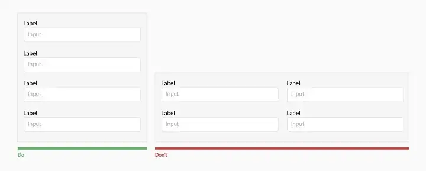

### Top align labels

Users complete top aligned labeled forms at a much higher rate than left-aligned labels. Top aligned labels also translate well on mobile. However, consider using left-aligned labels for large data-set entry with variable optionality because they are easier to scan together, they reduce height, and prompt more consideration than top-aligned labels.

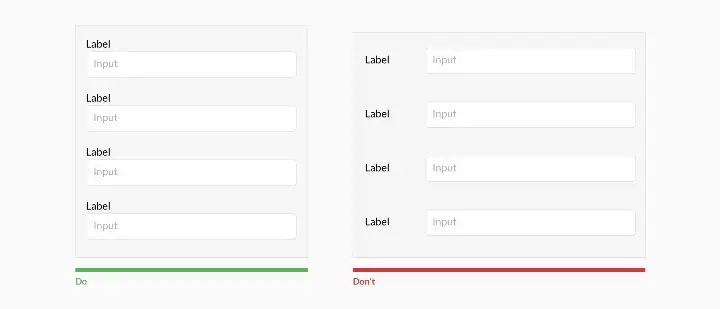

### Group labels with their inputs

Present the label and input close together, and make sure there is enough height between the fields so users don't get confused.

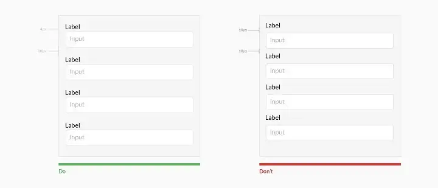

### Avoid all caps

All caps are more difficult to read and scan.

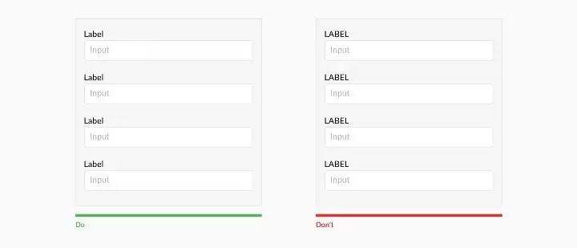

### Show all selection options if under 6

Placing options in a selector drop-down requires two clicks, and hides the options. Use an input selector if there are over 5 options. Incorporate contextual search within the drop-down if there are over 25 options.

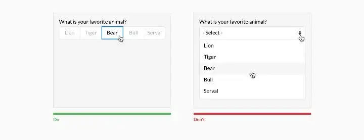

### Resist using placeholder text as labels

It is tempting to optimize space by using placeholder text as labels. This causes many usability issues that have been [`summarized by Katie Sherwin`](https://www.nngroup.com/articles/form-design-placeholders/) of Nielsen Norman Group.

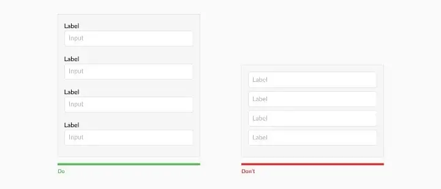

### Place checkboxes (and radios) underneath each other for scannability

Placing checkboxes underneath each other allows easy scanning.

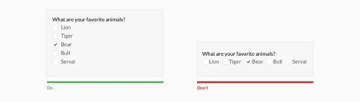

### Make CTAs descriptive

A call to action should state the intent.

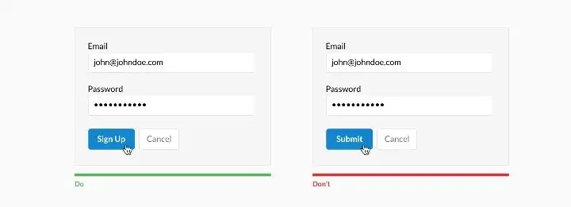

### Specify errors inline

Show the user where the error occurred and provide a reason.

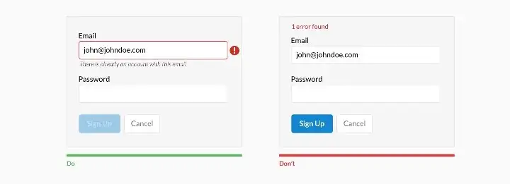

### Use inline validation after the user fills out the field (unless it helps them while in the process)

Don't use inline validation while the user is typing — unless it helps them — like in the case of creating a password, username, or message with a character count.

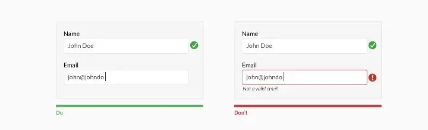

### Don't hide basic helper text

Expose basic helper text wherever possible. For complex helper text, consider placing it next to the input during its focused state.

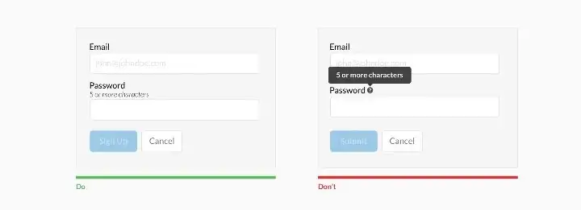

### Differentiate primary from secondary actions

There is a bigger philosophical debate regarding whether a secondary option should even be included.

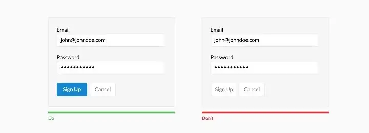

### Use field length as an affordance

The length of the field affords the length of the answer. Employ this for fields that have a defined character count like phone numbers, zip codes, etc.

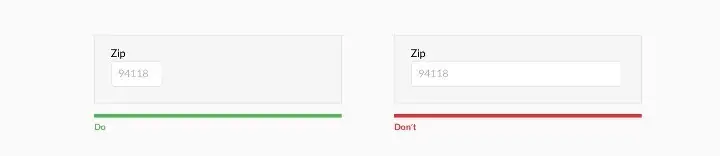

### Ditch the * and denote optional fields

Users don't always know what is implied by the required field marker (*). Instead, it is better to denote optional fields.

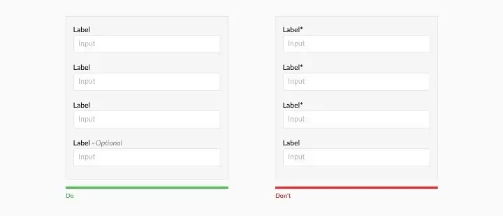

### Group related information

Users think in batches, and long forms can feel overwhelming. By creating logical groups the user will make sense of the form much faster.

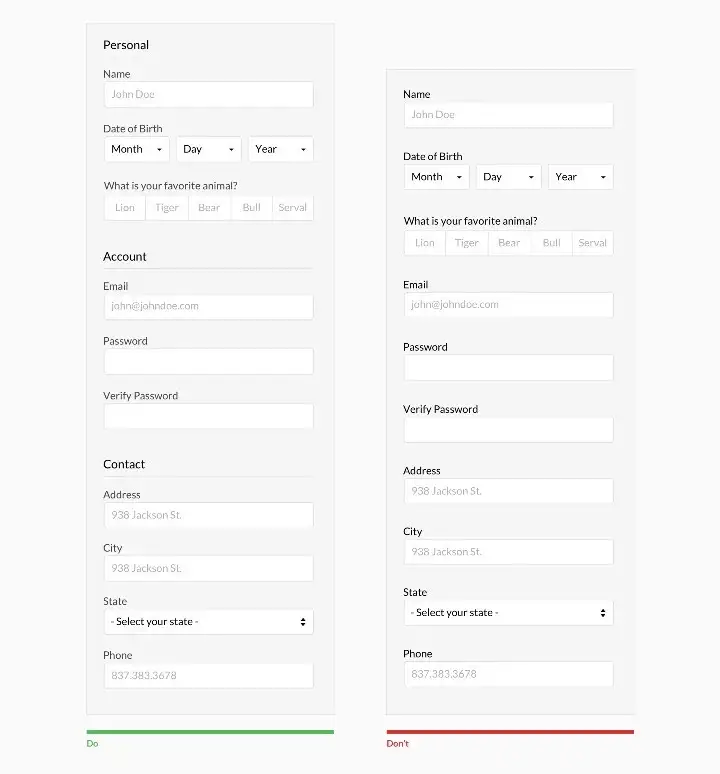

## The Primary Button

### Set a System's Stylistic Tone

A button is the purest atomic expression of a system's visual style. It combines the 'big three' attributes— color, typography, and iconography — into a non-splittable atomic part. Buttons also provoke discussion of space: padding inside (particularly, to a label's left and right) and margin outside (adjacent to other elements). Ultimately, button can even surface more esoteric attributes like roundedness (via border-radius) and lift (via box-shadow).

Takeaway: Embrace the button as a leading representation of a system's style. Bonus points if you align a button's definition with a burgeoning set of token variables for color, size, space, and other fine details.

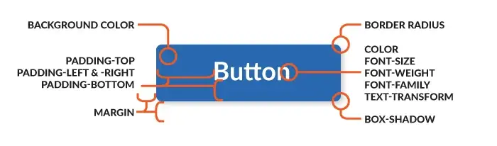
Buttons pack in a wide range of attributes for such a simple element.

### Set a Verbal Tone, Too

Fortunately, 'Click Here' is in our past. But we still need answers: How long can button labels be? Are labels written in the imperative (such as 'Save' or 'Close')? Should I pair a verb ('Save') with an object type ('Document')? Are there preferred labels for common actions? Do we inject a brand voice…or not?

Takeaway: Jumpstart a consistent voice by including label guidance where I find button assets. Sure, a word lists and deep editorial standards can be found in documentation like a Voice and Tone guide. However, buttons are a great place to start bridging guidance together.


### Invert Buttons When Backgrounds Get Complicated

Most buttons work just fine on a white background. But what happens when you place it on a photograph? Or a different, darker background color? Heck, are you even allowed to put it on a light neutral color? Can you use a button anywhere? Can you change the color of a primary button?

Takeaway: Demonstrate viable backgrounds for your primary button, and codify an inverted alternative — white? a different color? semitransparent? — to apply when backgrounds darken. When documenting, show light and dark alternatives on a range of common backgrounds to drive the point home.

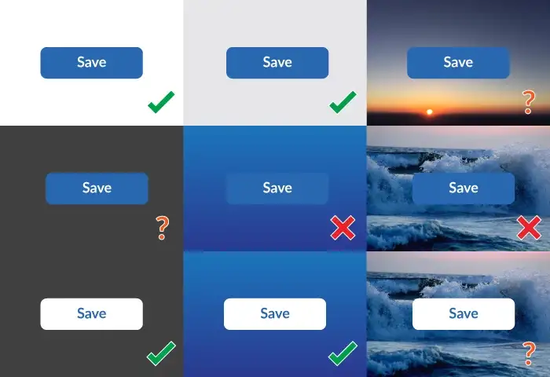
Show buttons a on variety of backgrounds, good and bad

### Limit One Per Page, Unless Repeating a Primary Action

Buttons call for action. We often use a primary button to draw attention to a page's highest priority action. Until, we can't prioritize and there's a bunch of primary buttons littered throughout a page (hopefully they're consistent, right?).

In some cases, using a primary button is appropriate when you must choose from a parallel set of objects (like a stack of media objects in search results) or a settings page layout presents categories of options in equivalent modular regions.

Takeaway: Define when to use — and when to avoid — more than one primary button on a page.

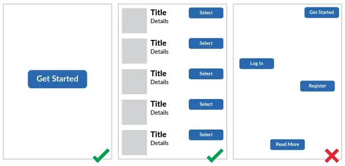

### Design and Build a Button's Arc of Interaction

Buttons are the primitive interaction, and with interaction comes change. It's not good enough to present a developer 'Here's the button design!' by just showing how it looks when a page loads. Instead, it's up to the designer to show how a button appears across many states: default, hover, focused ('haloed'), pressed / active, and even a spinning waiting or animated progression.

Takeaway: Pair a live demo (just embed the button on the page!) with a gallery that shows the states without requiring readers to interact. Documentation isn't a treasure hunt. Bonus points for including a video demo like Material Design does.

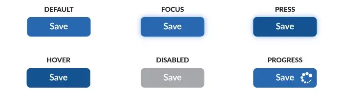

### Be Resilient to Mixed Elements

**Pairing a button label with an icon reinforces meaning and quickens recognition.**

Hold on! I thought buttons were a label in predictably clickable region. When you add an element, even a simple icon, a button layout shouldn't break down. Coping with less predictable elements reveals pesky issues of spacing and alignment inside. You'll wanna smooth these out, particularly if buttons can contain labels, icons, and other stuff.

Takeaway: Craft buttons to be resilient to including additional elements, whether in code or design tools. Users will want to add things — icons, labels, whatevers — and not worry about consequences of space and alignment. Set them up for success by doing that work for them.

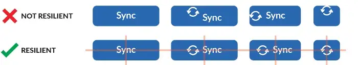

## The Secondary Buttons

### Ensure Secondary `≠` Disabled

No one yearns for gray buttons.

But you may find yourself needing to pair a secondary option with that inviting, saturated primary. You avoid a second saturated color, because that results in two saturated buttons next to one another, like green for Save and blue for Submit. Not even you, let alone your users, know which is more important.

So, you opt for a neutral. And the neutral is nearly or completed gray. And it looks disabled. Worse, when the primary is disabled, it's now also gray. Next to your gray secondary. Sigh.

Takeaway: Solve for the secondary button colors and disabled states in concert. Make sure all your options work well together and none are inaccessible.


### Beware of Ghosts in the Machine

Ghost buttons rely on only a border and label of the same color while lacking a background fill. Behind that label rests an uncertain future. Sometimes the label is on white (yes, that's easy!). However, other times a flat color or visually rich photo make the label difficult to read.

Ghosts allure designers coveting a sophistication absent from chunky, higher contrast primary button. Yet, these are called Ghosts for a reason. They disappear. I've observed ghost buttons donning a cloak of invisibility in usability test after usability test. Participants don't see them or can't read them. This weakens or destroys a button's value in affording action we intend.

Takeaway: Inject Ghost buttons into a system at your own peril. Studies I've observed suggest that ghosts perform poorer than filled counterparts. Plus, you might just avoid hours spent listening to polarizing designer debates on the subject.

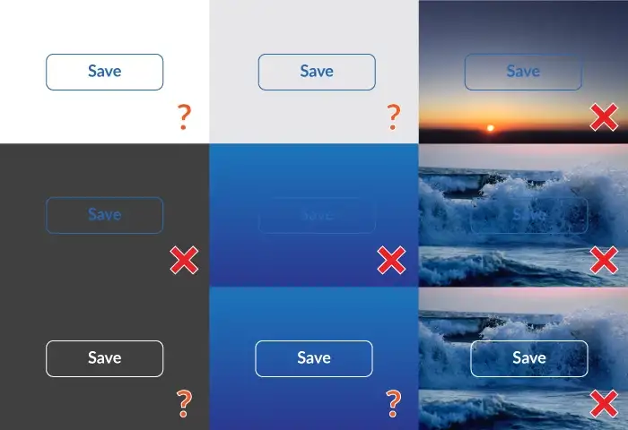

## Additional Button Types

### Vary Size, Both Large (or Mega/Huge/Puffy) & Small (or Micro/Tiny)

Interactions can be found in tight spots like a Card object or sidebar module. Other times, you need a massive button to sit on a full-bleed photo dominating the viewport.

Takeaway: Provide tooling to tune button size down and up as needed, as simple as another CSS class or design software style. Also, consider more memorable names — like 'Puffy' or 'Micro' — rather than a bland 'Large' or 'Small.'


### Distinguish Buttons from Links

In the era of flat designs, systems like Material Design use a 'Flat' button variant for use as in toolbars, dialog action groups, and inline near text. In a default state, there's little to no visual difference from a link. However, a button's states and behaviors bring a whole host of distinct considerations from your simple anchor tag.

Takeaway: If your system offers a flat variant, be sure it's conventional use — in both design and code — is distinguished from links. Additionally, cover all the interactive complexity such as focus & press states, spacing, and alignment.

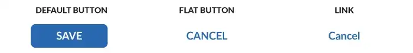

### Enrich Variety with Menus & Zones

Richer buttons can trigger an associated menu panel with options to choose. Many systems offer multiple choices as a UI tightens up, such as menu (or dropdown) and split (or segmented) button.

A menu button either indicates a current selection (such as Arial as font family) or opens to a menu of independent options (such as Share and Print). Add a arrow icon on the right, and you've got an extra segmented zone to drop a menu from the right while the left label fires a separate, primary action.

Takeaway: Enrich your apps with options for button menuing, but cautiously. Such buttons and their zonal segmentation (left for dominant action, right for menuing) support many scenarios, but with a higher cost of code and guidance complexity. For simpler sites, don't distract build priorities with these less-used alternatives.

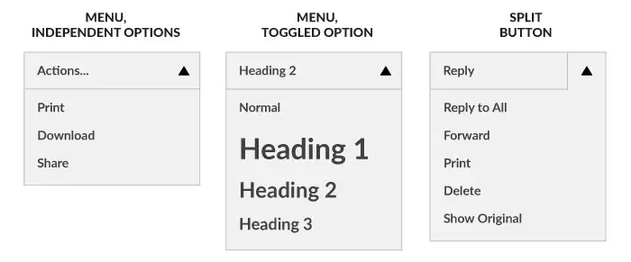

### From Toggles to Toolbars, Make Buttons Play Nice Together

Buttons can come in groups. A button group pairs a primary with one or more secondary options. A toggle button many turn on and off (such as bold) or reveal a choice from a set of options (such as text alignment's options for left, right, center, and justified). At it's most expansive, a toolbar arrange many types, all together: primary, secondaries, toggles, menus, the works.

Takeaway: When expanding button variety, explore and stress-test button sets in compact spaces and with varied combinations. System designers aren't fortune tellers, able to predict the future. But exploring a reasonably diverse scenarios can help you avoid an abomination or two down the road.

### For Buttons, Use `<button>`

There's a treasure trove of good learning about coding buttons correctly. The CSS Tricks article [`When to Use the Button Element`](https://css-tricks.com/use-button-element/) (and it's robust and lively discussion) is a great place to start.

### Location and Order

Mind the order and position of buttons. The order that buttons go in, especially if there are corresponding pairs (such as ‘previous’ and ‘next’) is important. Ensure the design puts emphasis on the primary or most important action.

In example below we use red for the button that performs a potentially destructive action. Notice how the primary action is not only stronger in colour and contrast, but also is on the right hand side of the dialog.

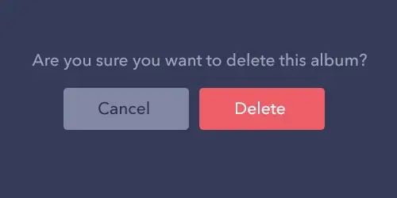
“Delete” button is more prominent than “Cancel” button.

## Input Fields

### Obscure design deters action

The input field is an affordance. Without an explicit visual cue, a user may not understand where the input area is and fail to enter information accurately.

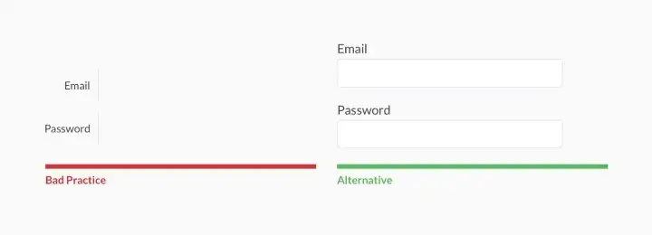

### Field width communicates what’s required

The size of the input communicates the length of the content needed. In the left design in the above illustration, the “Zip Code” field width communicates to the user that the basic version of the zip code is needed. The design on the right presents an arbitrary length, which confuses the user on what is required (ex. 94887–3829 vs. 94887).

The design on the left works well for U.S. addresses and should be localized to other countries. If the country is not known, it is better to use the generic design on the right. For more information on localization and internationalization read, [`Form Internationalization Techniques.`](https://medium.com/ohapollo/form-internationalization-techniques-3e4d394cd7e5)

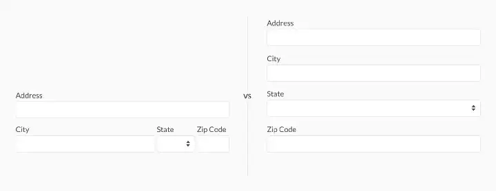

### Structure communicates format

The structure of an input communicates the required format. The designs on the right in the above image makes it clear how the entry should be formatted and guides the user when doing so.

The top design on the right employs an input mask on focus. This implementation benefits from the blank input acting as an affordance and guides entry when a user clicks into the input field. This aids user understanding and reduces the chance of an erroneous entry.

Again, it is important to note that the design on the right is structured for U.S. phone numbers. It should be localized to the user’s respective country. If the country is not known, it is better to use the generic design on the right.

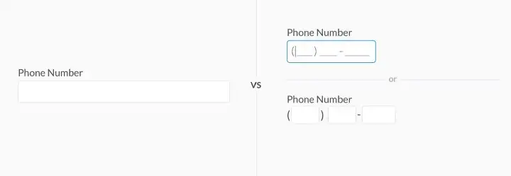

### Placeholder text causes confusion

[`Placeholder text`](https://www.nngroup.com/articles/form-design-placeholders/) diminishes the visual cue for action. It also misleads users to think the placeholder text is an entry. For more thoughts on Placeholder text, read [`Alternatives to Placeholder Text.`](https://uxdesign.cc/alternatives-to-placeholder-text-13f430abc56f#.e1kf5fc45)

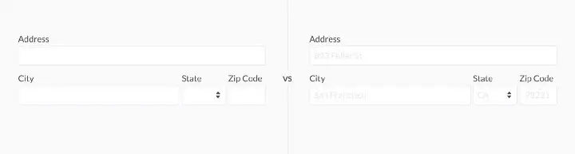
