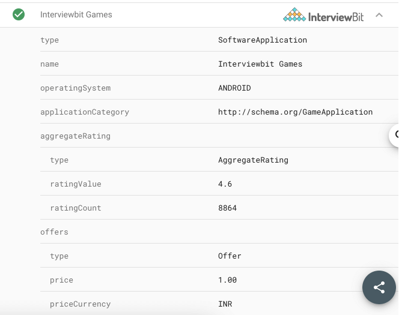
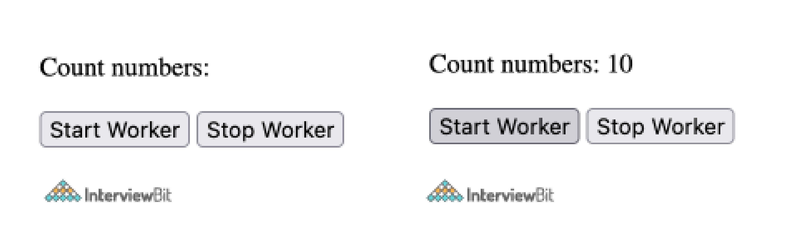

# Interview Guidelines

## HTML

### What is a tag in HTML?

A tag instructs the Browser about how to format the HTML properly. When you write an HTML page, you enter tags for many reasons to change the appearance of text, to show a graphic, or to make a link to another page. HTML uses symbols like `<` and `>` to enclose the tags. And symbol `/` for closing the tag.

Tags are the primary component of the HTML that defines how the content will be structured/ formatted, whereas Attributes are used along with the HTML tags to define the characteristics of the element. For example, <`p align='center'>Interview questions</p>`, in this the `align` is the attribute using which we will align the paragraph to show in the center of the view.

### What are void elements in HTML?

HTML elements which do not have closing tags or do not need to be closed are Void elements. For Example `<br />`, ``, `<hr />`, etc.

### What is the difference between HTML elements and tags?

HTML elements communicate to the Browser how to represent the text. They become HTML tags when enclosed within angular brackets `<>`.

### What is a semantic element in HTML5? Also, explain the difference between semantic and non-semantic elements?

Semantic elements are one of the new features that are part of HTML5. They intend to help the developers in quickly creating the page structure.

A semantic element has its meaning expressed to both the browser and the developer. Also, all the modern browsers support this feature. However, it is possible for a developer to train old browsers to handle unknown elements.

Here is the list of some of the commonly used HTML5 Semantic Elements.

- `<article>`
- `<figcaption>`
- `<figure>`
- `<header>`
- `<footer>`
- `<nav>`
- `<section>`
- `<article>`
- `<aside>`
- `<summary>`

The difference - Semantic Vs. Non-semantic.

Semantic - These elements clearly describe their content like ``, `<form>`, `<table>` etc.

Non-semantic - These elements are without any definition. They don't describe anything about their structure such as `<span>` and `<div>`.

### What are HTML Entities?

In HTML some characters are reserved like `<`, `>`, `/`, etc. To use these characters in our webpage we need to use the character entities called HTML Entities. Below are a few mapping between the reserved character and its respective entity character to be used.

| Character            | Entity Name | Entity Number |
| -------------------- | ----------- | ------------- |
| `<`                  | `&lt;`      | `&#60;`       |
| `>`                  | `&gt;`      | `&#62;`       |
| `&`                  | `&amp;`     | `&#38;`       |
| (non-breaking space) | `&nbsp;`    | `&#160;`      |

### What is HTML5 Graphics?

In HTML5, there are two types of graphics.

#### Scalable Vector Graphics (SVG)

- The HTML5 `<svg>` element is a container for SVG graphics. It provides several methods for drawing boxes, paths, text, circles, and graphic images.
- SVG is beneficial as nowadays, people are using high-resolution devices (iPads and Monitors), so it becomes impressive as designs, logos, and charts scale according to the requirement, maintaining the picture quality.
- SVG is XML based, which means that every element is available within the SVG DOM. It treats every shape as an object. If the user changes the attributes of any SVG object, the browser will automatically re-render the shape.

#### Canvas

- It is a rectangular area on the HTML page for drawing graphics on the fly, using JavaScript.
- The default size of the canvas is 300 PX × 150 PX (width × height).
- The HTML tag `<canvas>` is a container for the Canvas graphics. Canvas gets executed on the pixel by pixel basis.
- In Canvas, browser forgets the graphic, after drawing it. If the user tries to modify it, the entire scene needs to be redrawn, including all the objects present in the graphic.

### Explain the key differences between SVG and Canvas?

- Canvas is resolution dependent while SVG is not.
- Canvas does not provide any support for event handlers while SVG does provide the support for event handlers.
- Canvas is suitable for graphic-intensive games while SVG is not suitable for gaming.
- Canvas is suitable for small rendering areas while SVG is suitable for large rendering areas like Google maps.
- Canvas provides a less interactive animated user interface. Whereas, the interface provided by SVG is very highly interactive.

| SVG                                                                           | Canvas                                       |
| ----------------------------------------------------------------------------- | -------------------------------------------- |
| SVG is a vector based i.e., composed of shapes.                               | It is Raster based i.e., composed of pixels. |
| SVG works better with a larger surface.                                       | Canvas works better with a smaller surface.  |
| SVG can be modified using CSS and scripts.                                    | Canvas can only be modified using scripts.   |
| SVG is highly scalable. So we can print at high quality with high resolution. | It is less scalable.                         |

### Markup validation

Consider the following markup:

```html
<figure>
   <picture>
      <source media="(min-width: 40em)"
      srcset="large.jpg 1024w, medium.jpg 640w, small.jpg 320y">
      
   </picture>
   <figcaption>A landscape of London by night</figcaption>
</figure>
```

Is it valid? If not, can you explain why?

#### Answer 🚩

The markup uses the [picture element](https://www.w3.org/TR/html-picture-element/), which is a pretty new addition to the specification. The code is all valid apart from the last image specified in the `srcset` attribute; `320y` isn't a valid value. If the y is replaced with a w, it becomes valid though.

### WAI-ARIA

Consider the following snippet:

```html
<header>
   <h1>Main title</h1>
   <form action="/" method="get">
      <input type="search">
      <input type="submit">
   </form>
</header>
<ul>
   <li><a href="/">Home</a></li>
   <li><a href="/products">Products</a></li>
   <li><a href="/about">About</a></li>
</ul>
<main>
   <article>
      <h1>Main title</h1>
      <p>This is the content of this section</p>
   </article>
</main>
<footer>
   <small>Copyright &amp;copy; Aurelio De Rosa 2014</small>
</footer>
```

Can you improve its accessibility using [WAI-ARIA roles](https://www.w3.org/WAI/intro/aria.php) where appropriate, taking into account older technologies?

#### Answer 🚩

The code can be rewritten as follows:

```html
<header role="header">
  <h1>Main title</h1>
  <form action="/" method="get" role="search">
     <label for="search">Search:</label>
     <input id="search" type="search">
     <input type="submit">
  </form>
</header>
<nav role="navigation">
  <ul>
     <li><a href="/">Home</a></li>
     <li><a href="/products">Products</a></li>
     <li><a href="/about">About</a></li>
  </ul>
</nav>
<main role="main">
  <article role="article">
     <h1>Main title</h1>
     <p>This is the content of this section</p>
  </article>
</main>
<footer role="contentinfo">
  <small>Copyright &amp;copy; Aurelio De Rosa 2014</small>
</footer>
```

To improve the accessibility, the main navigation list has been wrapped with a nav element. To improve the accessibility in older technologies that don't support the new semantic elements, the role of `header`, `navigation`, `main`, `article`, and `contentinfo` have been added to the `header`, `nav`, `main`, `article`, and `footer` elements respectively.

Other improvements have been made on the search form. First of all the form has been marked using the `search` role. Then, an explicit label element has been added to give context for the `input` field, and it has been associated with the `input` through the use of the `for` attribute.

### Images and accessibility

Is the `alt` attribute mandatory on `img` elements? If not, can you describe a scenario where it can be set to an empty value? Does an empty value affect accessibility in any way?

#### Answer 🚩

The [`alt attribute`](https://www.w3.org/TR/html5/embedded-content-0.html#alt) is mandatory on img elements but its value can be empty (i.e. `alt=""`). An empty value is recommended when the image shown is used for decorative purposes only and therefore isn't part of the content of the page. With regards to accessibility, if the `alt` attribute is empty, screen readers will ignore the image. This is highly recommended because using a value of something like 'Content separator' will only disturb the user when this text is spoken.

### The `time` element

Is it possible to express a date range using a single `time` element?

#### Answer 🚩

No, it isn't possible. The information can be expressed using two [time elements](https://www.w3.org/TR/html5/text-level-semantics.html#the-time-element) though. For example to describe a time interval ranging from November 6, 2014 to November 9, 2014, a developer can write:

```html
<time datetime="2014-11-06">6</time>-
<time datetime="2014-11-09">9 November 2014</time>
```

### `meter` and `progress`

What's the difference between the `meter` element and the `progress` element?

The [meter element](https://www.w3.org/TR/html5/forms.html#the-meter-element) represents a scalar measurement within a known range, or a fractional value. This element isn't a good fit to measure something like external temperature because it doesn't have a fixed range. However, `meter` can be used to describe the occupied memory of a hard disk.

The [progress element](https://www.w3.org/TR/html5/forms.html#the-progress-element) is used to show the completion progress of a task. Unlike the `meter` element, the progress described by `progress` can be indeterminate. For example you could describe that a given task is progressing but that it is unknown when the task will be completed.

### What is datalist in HTML 5?

Datalist element in HTML 5 helps to provide autocomplete feature in a textbox as shown below.

```html
<input list="Country">

<datalist id="Country">
 <option value="India">
 <option value="Italy">
 <option value="Iran">
 <option value="Israel">
 <option value="Indonesia">
</datalist>
```

### What are the new features introduced in HTML5?

HTML5 introduces a number of new elements and attributes that help in building an attractive webSite, that we see nowadays.

It supports following new features.

- **New Semantic Elements** - These are like `<header>`, `<footer>`, and `<section>`.
- **Forms 2.0** - It contains improvements to HTML web forms. It has introduced new attributes for the `<input>` tag.
- **Persistent Local Storage** - With HTML5, it is possible to achieve this, without resorting to third-party plugins.
- **WebSocket** - It facilitates setting up a bidirectional communication for web applications.
- **Server-Sent Events(SSE)** - These events got introduced in HTML5. The direction of the flow of the execution of these events is from the server to the Web Browser.
- **Canvas** - It supports a two-dimensional drawing surface that is programmable using JavaScript.
- **Audio & Video** - It allows embedding audio or video on the web pages without resorting to third-party plugins.
- **Geolocation** - It facilitates the visitors to share their physical location with the web application.
- **Microdata** - It allows building our personal vocabulary beyond HTML5 and extends our web pages with those custom semantics.
- **Drag and drop** - It supports to Drag and drop the items from one location to another location on the same Web page.

### What would happen if the HTML Document does not contain `<!DOCTYPE>`?

It instructs the Web Browser about the version of HTML used for creating the Web page.
If the developer misses declaring the `DOCTYPE` information in the code, then new features and tags provided by **HTML5**, like `<article>`, `<footer>`, and `<header>` will not be supported. Additionally, the Browser may automatically go into Quirks or Strict Mode.

### What is the use of Drag and Drop in HTML5?

Drag and Drop (DnD) is a powerful User Interface concept, which enables the user to copy, reorder and delete any number of items, just with the help of mouse click. To do this, the user has to click and hold the mouse button over an element, drag to the required location, and finally release the button to drop the element there.

With HTML4, developers have to either do complex Javascript programming or use other Javascript frameworks like jQuery to achieve this functionality.

HTML 5 introduced a Drag and Drop (DnD) API that provides the support of all the fundamental DnD operations to the browser. Thus making it easy for the developers to code it.

Latest versions of all the main browsers, like Chrome, Firefox, and Safari, support this DnD API of HTML5.

#### Drag and Drop Events

Many events get triggered during various stages of the drag and drop operation. These events are listed below.

- `dragstart` - it gets triggered when the user starts dragging a draggable object.
- `dragenter` - it gets triggered when the user has dragged the draggable element over the target element.
- `drag` - it gets fired when the object is getting dragged.
- `dragend` - it gets fired when the user releases the mouse button after dragging an object.
- `dragleave` - This event gets triggered when the mouse leaves an element while a drag is occurring.
- `dragover` - This event gets fired when the mouse moves over an element while a drag is occurring.

### What is HTML5 Web Storage?

HTML5 Web Storage, also known as DOM Storage is a way to preserve state on either the client or server which makes it much easier to work against the stateless nature of HTTP. It allows the web pages to store the data locally in the user's browser.

Following are the advantages of HTML5 Web Storage.

- It can store 5 to 10 MB data. That is far more than what cookies allow.
- HTML5 never transfers Web storage data with any HTTP request. Thus creating less overhead than cookies and in turn, increase the performance of the application.
- Apps can work both online and offline.
- This API is easy to learn and use.

### What are the different types of Web Storage provided by HTML5?

There are two types of Web Storage.

#### Session Storage

As its name indicates, it stores data of current session only. The data stored in Session Storage clears on closing the browser.

Following methods are available to access Session Storage.

- Use `setItem()` function to store data in Session Storage, `sessionStorage.setItem ('username','Meenakshi')`
- Use `getItem()` function to retrieve data from Session Storage, `sessionStorage.getItem('key');`
- We can only store String in Session Storage. To save the objects in Session, first, convert the object into `JSON` string and then store this string in Session Storage as in the following. `sessionStorage.setItem ('object', JSON.stringify(object));`
- If JSON string gets stored in Session Storage, then first convert it into an object as follows `var object=JSON.parse(sessionStorage.getItem('object'));`
- Use `removeItem()` function to delete a particular key from Session Storage. `sessionStorage.removeItem('key');`

#### Local Storage

Local Storage is the second type of HTML Web Storage. It stores data as KEY/VALUE pair.

Following functions are available to access Local Storage.

- Use `setItem()` function to store data in Local Storage `localStorage.setItem ('key','value');`
- Use `getItem()` function to retrieve data from Local Storage `localStorage.getItem('key');`

### What is the need of introducing Local Storage in HTML5?

Before HTML5, LocalStores was done with Cookies. They are not very good for large amounts of data, because, with every request, it passes this data to the server, making it very slow and ineffective. However, HTML5 does not pass this data on every server request. It uses the data ONLY when required. In HTML5, it is possible to store large amounts of data without affecting the website's performance. Data for different website gets stored in separate areas. However, a particular website can only access its own data.

### Explain the key differences between localStorage and sessionStorage objects?

Following are the key differences between localStorage and sessionStorage objects.

- The localStorage object stores the data without an expiry date. However, sessionStorage object stores the data for only one session.
- In the case of a localStorage object, data will not delete when the browser window closes. However, the data gets deleted, if the browser window closes, in the case of sessionStorage objects.
- The data in sessionStorage is accessible only in the current window of the browser. But the data in the localStorage can be shared between multiple windows of the browser.

### What is the concept of Application Cache in HTML5? What are its advantages?

HTML5 introduced the concept of Application Cache. It means that a web application is cached, and is accessible without an internet connection.

Following are the key advantages of Application Cache.

- Offline browsing - Users can use the application even when they are offline.
- Speed  - Cached resources load faster as compared to content that gets
- downloaded, directly from the server.
- Reduced server load - The browser will only download updated/modified resources from the server.

### What is a Manifest file?

A Manifest file is a simple text file, that tells the browser what to cache and what not to cache.

A Manifest file contains three Sections as

- **CACHE MANIFEST** - HTML5 performs the caching of files listed under this section after
- They get downloaded for the first time.
- **NETWORK** - Files listed here, always need a connection to the server. The browser can never cache them.
- **FALLBACK** - Files listed here specify the fallback pages, if any page in it is not accessible.

### What is the difference between HTMl5 Application cache and regular HTML browser cache?

Following are the key differences between the two.

- In `AppCache`, we can define all the assets the browser should cache in a manifest file (even the entire site). For fetching this content, it is not necessary for the user to have accessed it previously. In other words, Application Cache can prefetch pages that have not been visited at all and are thereby unavailable in the regular browser cache. However, the browser cache will only store the pages (and associated assets) the user has visited actually.
- The `AppCache` allows web apps (and websites) to be made available offline, that too, with the same speed benefits as the regular browser cache could provide only when the user is online.

### Difference between link tag `<link>` and anchor tag `<a>`?

The anchor tag `<a>` is used to create a hyperlink to another webpage or to a certain part of the webpage and these links are clickable, whereas, link tag `<link>` defines a link between a document and an external resource and these are not clickable.

### What are some of the advantages of HTML5 over its previous versions?

Some advantages of HTML5 are:

- It has Multimedia Support.
- It has the capabilities to store offline data using SQL databases and application cache.
- Javascript can be run in the background.
- HTML5 also allows users to draw various shapes like rectangles, circles, triangles, etc.
- Included new Semantic tags and form control tags.

### What are Semantic Elements?

Semantic elements are those which describe the particular meaning to the browser and the developer. Elements like `<form>`, `<table>`, `<article>`, `<figure>`, etc., are semantic elements.

### Define Image Map?

Image Map lets a developer map/link different parts of images with the different web pages. It can be achieved by the `<map>` tag in HTML5, using which we can link images with clickable areas.

```html


<map  name='workspace'>
  <area shape='rect' coords='34, 44, 270, 350' , href='xyz.html' />
  <area shape='rect' coords='10, 120, 250, 360' , href='xyz.html' />
</map>
```

### What is `Microdata` in HTML5?

It is used to help extract data for site crawlers and search engines. It is basically a group of name-value pairs. The groups are called items, and each name-value pair is a property. Most of the search engines like Google, Microsoft, Yandex, etc follow schema.org vocabulary to extract this microdata.

```html
<div itemscope itemtype="http://schema.org/SoftwareApplication">

  <span itemprop="name">Interviewbit Games</span>
  - REQUIRES
  <span itemprop="operatingSystem">ANDROID</span><br>

  <link itemprop="applicationCategory" href="http://schema.org/GameApplication"/>
  <div itemprop="aggregateRating" itemscope itemtype="http://schema.org/AggregateRating">

  RATING:
    <span itemprop="ratingValue">4.6</span> (
    <span itemprop="ratingCount">8864</span> ratings )
  </div>

  <div itemprop="offers" itemscope itemtype="http://schema.org/Offer">
    Price: Rs.<span itemprop="price">1.00</span>
    <meta itemprop="priceCurrency" content="INR" />
  </div>
</div>
```

- **itemid** - The unique, global identifier of an item.
- **itemprop** - Used to add properties to an item.
- **itemref** - Provides a list of element ids with additional properties.
- **itemscope** - It defines the scope of the itemtype associated with it.
- **itemtype** - Specifies the URL of the vocabulary that will be used to define itemprop.

The above example will be parsed by Google as



### What are Web Workers?

JavaScript will hang the browser if it has to handle UI events, query large amounts of API data for processing, and manipulate the DOM simultaneously.
Web Workers handle this situation by doing all the high computation tasks without interrupting the user interface. They do this by running on separate threads. Thus we can say that.

- A web worker is a script, which runs in the background. It exists in external files.
- The user can perform actions like clicking, selecting things and so on. Meanwhile, the Web worker runs in the background.
- It is appropriate, to use Web worker for CPU intensive tasks.

Since Web workers are in external files, they do not have access to the following JavaScript objects.

- The window object
- The document object
- The parent object

These are added to bring parallelism and async capability. It runs in the background to do the computationally expensive tasks without yielding to make the page responsive. It is achieved by starting a separate thread for such tasks. These are not meant to perform UI operations. There are three types of web workers:

- **Dedicated Workers** - These are workers that are utilized by a single script.
- **Shared Workers** -These are workers that are utilized by multiple scripts running in different windows, IFrames, etc.
- **Service Workers** - These act as proxy servers between web applications, the browser, and the network. Mostly used for push notifications and sync APIs.

```html
<p>Count numbers: <output id="result"></output></p>
<button onclick="startWorker()">Start Worker</button>
<button onclick="stopWorker()">Stop Worker</button>

<script>
  var w;

  function startWorker() {
    if (typeof Worker !== 'undefined') {
      if (typeof w == 'undefined') {
        w = new Worker('demo_workers.js');
      }
      w.onmessage = function (event) {
        document.getElementById('result').innerHTML = event.data;
      };
    }
  }

  function stopWorker() {
    w.terminate();
    w = undefined;
  }
</script>
```



### How does a Web worker work?

A Web worker gets initialized with the URL of a JavaScript file that contains its code. This code sets event listeners and starts communication with the script that invoked the worker from the main page. The Syntax is as follows.

```js
let worker = new Worker("sample_prog.js");
```

If the javascript file specified in the above code exists, the browser spawns a new worker thread.

Once the Web worker gets spawned, it starts the communication with the parent page, using the `postMessage()` method. The Web worker, in turn, returns a message, that gets accessed using the `onmessage()` event on the main page.

Let's take an example, where the script spawns a Web worker to execute a loop having thousands of iterations. After that, the Web worker returns the calculated value to the HTML page.

```js
let worker = new Worker('calculateLoop.js');

worker.onmessage = function (event) {
  console.log("Completed " + event.data + "iterations" );
}; 
```

Below is the code of `calculateLoop.js` file. It makes use of `postMessage()` API, to pass the communication back to the HTML page.

```js
for (let i = 0; i <= 1000000000; i += 1){
  let j = i;
}
postMessage(j);
```

## CSS

- <https://www.careerride.com/Interview-Questions-CSS.aspx>
- <https://www.techrepublic.com/article/css-interview-questions-and-answers/>

### What is CSS?

CSS is a standard for applying style to HTML elements. This styling includes margins, positioning, fonts, colors, and so forth. The styling can apply to the complete document or be granular and apply to a specific element. Theoretically, the use of CSS promotes the separation of content and design, allowing the designer to focus on how a Web application will look while the developer(s) concentrate on the structure and functionality.

The main part of CSS is a rule. A rule consists of a selector (i.e., what will be styled) followed by a declaration (i.e., the style to be applied) that is broken into one or more properties and associated styles.

In the following example, h1 is the selector, followed by the color property and the style of blue.

```scss
h1 {color: blue;}
```

### What does the cascading portion of CSS mean?

Cascading refers to cascading order. It is a system of sorting the various CSS declarations to avoid conflicts. The process begins with a search for all declarations that apply to specific elements; it ends if no match is found. Cascading occurs if multiple styles are defined for an element. In general, values will be applied from the more specific style sheet. This could be its own article, so please refer to [my CSS 101 TechRepublic post](http://www.techrepublic.com/article/css-101-handling-multiple-rules-for-the-same-element/6164216?tag=content;siu-container) for more details.

Note: CSS properties take precedence of HTML attributes, but the HTML attributes will be used when/if a browser does not support CSS.

### What are different ways to integrate a CSS into a Web page?

There are three ways to integrate CSS into a Web page

1. `Inline` : HTML elements may have CSS applied to them via the STYLE attribute.
2. `Embedded` : By placing the code in a STYLE element within the HEAD element.
3. `Linked/Imported` : Place the CSS in an external file and link it via a link element.

### If background and color should always be set together, why do they exist as separate properties?

The reasons for this are as follows:

1. It increases the legibility of the style sheets. The background property is a complex property in CSS. If it is combined with color, the complexity will further increase.
2. Color is inherited, but background isn't. This can further increase the confusion.

### Explain external Style Sheet? How would you link to it?

1. External Style Sheet can be called as a template/document/file which contains style information and can be linked with more than one HTML documents.
2. Using this the entire site can be formatted and styles just by editing one file.
3. The file is linked with HTML documents via the LINK element inside the HEAD element.

```html
<head> 
  <link rel=stylesheet href="style.css" type="text/css"> 
</head>
```

### What are the advantages and disadvantages of External Style Sheets?

The **advantages** of External Style Sheets are:

- Using them, the styles of multiple documents can be controlled from one file.
- Classes can be created for use on multiple HTML element types in many documents.
- In complex situations, selector and grouping methods can be used to apply styles.

The **disadvantages** of External Style Sheets are:

- In order to import style information for each document, an extra download is needed.
- Until the external style sheet is loaded, it may not be possible to render the document.
- For small number of style definitions, it is not viable.

### What are the advantages and disadvantages of Embedded Style Sheets?

The **advantages** of Embedded Style Sheets are:

- It is possible to create classes for use on multiple tag types in the document
- Under complex situations, selector and grouping methods can be used to apply styles.
- No extra download is required to import the information.

The **disadvantages** of Embedded Style Sheets are:

- It is not possible to control the styles for multiple documents from one file, using this method.

### What are the advantages and disadvantages of Inline Styles?

The **advantages** of Inline Styles are:

- It is especially useful for small number of style definitions.
- It has the ability to override other style specification methods at the local level.

The **disadvantages** of Inline Styles are:

- It does not separate out the style information from content.
- The styles for many documents can not be controlled from one source.
- Selector grouping methods can not be used to handle complex situations.
- Control classes can not be created to control multiple element types within the document.

### What are the advantages of the external over inline style methods?

1. External Style Sheets are useful as it keeps the style and content separately and doesn't allow it to mix with each other. It can control the styles for multiple documents, whereas inline style mixes the content with the style and make the code messier.
2. External style sheet allows the creation of various classes in a structured way, whereas inline style sheet can't create or control class elements.
3. External style sheet can use selector and grouping methods to apply styles, whereas inline styles can't use selector and grouping methods.

### What is CSS selector?

1. Basically it is a string that identifies the elements to which a particular declaration or set of declarations will apply.
2. It can also be referred to as a link between the HTML document and the style sheet.
3. It is equivalent of HTML elements.

**For example:**
Here, the selector is A, which is called as type selector.

```scss
a {text-indent: 12pt}
```

### What is Tweening?

1. It is the short form for in-betweening.
2. It is the process of generating intermediate frames between two images.
3. It gives the impression that the first image has smoothly evolved into the second one.
4. It is an important method used in all types of animations.
5. In CSS3, Transforms(matrix,translate,rotate,scale etc) module can be used to achieve tweening.

### Explain RWD

1. RWD is the abbreviation for Responsive web design.
2. In this technique, the designed page is perfectly displayed on every screen size and device, be it desktop, mobile, laptop or any other device. You don't need to create a different page for each device.

### What is the use of CSS sprites?

1. A web page with large number of images takes a longer time to load. This is because each image separately sends out a http request.
2. The concept of CSS sprite helps in reducing this loading time for a web page by combining various small images into one image. This reduces the numbers of http request and hence the loading time.

### How do I combine multiple sheets into one?

Multiple sheets can be combined into by using the `<link>` tag and the with the title attribute. The title value allows one or more `<link>` tags to link with each other. After combination that theme will be applied as combined and will be shown to the user.

The syntax of it will be as follows:

```html
<link rel= 'text/css' href="default.css" title="combined">
<link rel= 'text/css' href="style.css" title="combined">
<link rel= 'text/css' href="para.css" title="combined">
```

Another way to combine the style sheets is the use of import which can be used in the `<style>` tag and the syntax can be given as follows:

```scss
@import url('site_url');
```

### What are the rules in CSS ruleset?

CSS consists of two types of CSS rules, first is for ruleset which identifies the style and the selector. It combines the style and the selector.

1. Ruleset is a combination of CSS rules,
 **For Example** : `h1{text-color: 15pt;}`, where this is the CSS rule.
2. Ruleset is selector + declaration
 **For Example** : `h1 + {text-color: 15pt;}`

### What is the CLASS selectors used for?

Class selectors are the selectors which are stand alone to a specific style that is declared. Class attribute can be used to declare the style and make an association with any HTML element.

The syntax for creation of class selector is: `.classname`.
The name can be from a-z, A-z or in digits.

### What is the difference between class selector and ID selector?

1. Class selector can be given to an overall block. This is sometimes termed as block element as well, whereas ID selector identifies a unique name and a style for a specific element.
2. ID selector declares the style for only one particular element which can be differentiated from other element, whereas Class selector is being given for the whole complete block.

### What is contextual selector?

Contextual selector specifies a specific occurrence of an element. It is combination of many selectors that are separated by white spaces. In this only the element that matches the specified element will be used not all the elements.

For example the syntax of it is being given as:

```scss
p code {color: #000000}
```

### What do you understand by parent-child selector?

Parent-child selector represents the direct relationship between parent element and child element. It is been created by using two or more (`~`) tilde separated selectors.

For example:

```scss
body ~ p {background-color: red; text: #FF00FF;}
```

Here the p element gets declared for a specific element and style only that element but if it has some child element then those elements will also get styled.

One more example to show the parent-child relationship as:

```scss
body ~ p ~ em {background-color: red; text: #FF00FF;}
```

The syntax in HTML will be written as:

```html
<body><p><em> It will show the two colors for em and p</em></p></body>
```

### What is `important` declaration used in CSS?

Important declarations are those declarations which have high weightage then normal declarations. These declarations override other declarations of less importance while executing. If suppose there are two statements from two users and both consist of important declaration then the one of the users declaration will override the another users declarations.

For example:
In this body background has more weight than the color.

```scss
body {background: #FF00FF !important; color: grey}
```

### Is there any provision to include one or more declaration in a selector?

There is a provision to include one or more declaration in a selector by using the semicolon as this shows the separation of the properties.

For example:

```scss
Selector {declaration1; declaration2}
P {background: white; color: black}
```

### What is the purpose of pseudo-elements?

Pseudo elements allow the use of the part of element and not the element itself. They are applied to block level element, which is used for the complete block for which the CSS is being written. This allow the subpart of an element to be styled like paragraphs and headings.

For example:
It adds the style to the first line of the code in the paragraph.

```scss
selector:pseudo-element {property:value;}
p: first-line {text-transform: lowercase;}
```

### How pseudo-classes are different from pseudo-elements?

Pseudo classes are used to add style and special effects to some selectors which is being used inside some class.

The syntax it as follows

```scss
selector:pseudo-class {property:value;}
a:link {color:#FF0000;}
```

pseudo classes can be combined with other classes as well.
The syntax of it will be shown as:

```scss
selector.class:pseudo-class {property:value;}
a.red:visited {color:#FF0000;}
```

### What does cascade and cascading order defines?

Cascade is a method in CSS that defines the importance of particular style rules. This doesn't allow any conflict to occur between other elements that is being defined within the same CSS. Declaration with more importance get executed first then others.

The syntax is as follows:

```txt
Selector{property: value ! important} /* increased weight */
selector (property: value} /* normal weight */
```

Cascading order is a sorting method that consists of some rules of the declarations through which it can be sorted and the conflict can be resolved which might occur between it. In this all the declarations has to be found that apply the selector and properties to a specific elements.

### How to restore the default property value using CSS?

CSS doesn't provide any default values that can be used if the user wants to revert back to the old values. The **only option** which can be performed to restore the default property value is to re-declare the property which you want to revert back to. Rules should be defined for using the selectors like tag name, etc. that you want to override for more specific values.

### What is the purpose of Nesting Selectors?

Nesting selectors are the selectors that define a selector inside another selector.

For Example:

```scss
h1 {
  color: blue;
  text-align: center;
}
.marked {
  background-color: red;
}
.marked h1 {
  color: white;
}
```

In this a particular style is being defined for the element of `h1`, and another is given for all other elements. Here the class is given as `marked` and one more style given for `h1` element within the `h1` style.

### What are the different Media Types included in CSS?

Media types are not case sensitive and it allows you to define different properties in different media.

The different media type that is included in CSS is:

1. **Aural** - Used for speech and sound synthesizers
2. **Print** - Used to show the content as they will look when you will use the print command
3. **Projection** - Used to show the CSS for the projectors
4. **Handheld** - Used for handheld devices Used for screens like computers and laptop

### Why CSS Box Model is used? What are the elements that it includes?

CSS box model defines the design and layout of the styling element. It is a box that shows the elements that will come before others. Like, it consists of margins, borders, padding, and the actual content. It allows a structured way to show the elements in comparison to other elements.

The terms that are used in box model is shown as:

1. **Margin** - It shows the top most layer and it shows the overall structure which consists of border and other elements that is being shown below.
2. **Border** - It shows the padding and content option and keep a border around it. Border can be affected by background color.
3. **Padding** - It shows the space between the content blocks. It is affected by the background color.
4. **Content** -. It shows the actual content like text and images. These all are essential terms that allows you to understand the structure and apply it to your code.

### How are contextual selectors used in CSS?

The contextual selector is a special type of selector that is used to select special occurrences of an element. This selector is a string of individual selectors separated by spaces. It defines a search patterns of the element where only the last element in the pattern is addressed to.

For Example:

```scss
td p text {color: blue}
```

This implies that the TEXT will appear blue in color only if it occurs in the context of the element P which itself occurs in the context of TD.

```scss
p.about {color: red}
```

This implies that any element specified with class .about will appear in red color but only if it occurs in context to P.

### Why should inline styles be used carefully?

Inline style rules allows a user to attach individual styles to individual elements in an HTML document. The syntax of an inline style rule attached to an HTML element:

Inline styles are generally not the preferred way of applying a style rule and must be used carefully because of the following reasons:

```html
<p style='color: red;'> Red text</p>
```

1. The style rules can easily get mixed up in an HTML page code.
2. The entire rule must be specified in the value of the style attribute, this can be tough in case of long rules.
3. By using inline styles the user is unable to take advantage of CSS properties such as grouping selectors and re usability of a style sheet.
4. It is generally advised to use either internal or external style sheets as they are more convenient to manage and can be changed easily as they are at the same place.

### How is a CSS executed in case of more than one conflicting rule?

If there are two or more css rules which are pointing towards the same element there are some basic rules that a browser follows in order to know which is the most specific and will be executed / applied.

For Example:

```scss
p {color: red;}
p {color: blue;}
```

In the above case all the p contents would appear blue as this rule was specified the last.
In css every element is assigned a unique specificity value. Based on the specificity value a style rule is executed.

For Example:

```text
p : this has the specificity of 1
div p : this has a specificity of 2 ( ie 1 + 1 of two selectors )
.class : has a specificity of 10
#id : This has a specificity of 100.
```

In this way whichever selector has the highest specificity will apply in case of multiple selectors pointing at the same element.

### Explain what are image sprites and how are they used in css

Image sprites are basically a collection of images put into a single image. A web page can contain multiple images and loading them all one by one can be a slow process. By using image sprites only a single image is used and by specifying the area of the image to be displayed the same image can be used multiple times.
**For ex** : We have a an image.gif which contains the home, forward and back navigation buttons. With the help of css the user can simply specify only the part of the image that is needed. Now the user wants to only display the home part of the image for the home button.

```scss
img.home{
  width:50px;
  height: 44px;
  background: url (image.gif) 0 0 ;
}
```

In the above css code only a part of the overall image.gif will be used, in this case the home page button area only. By using image sprites the page loading time can be reduced by substantial margins. The user only needs to know absolute image area to be displayed.

### With the help of examples explain grouping and nesting of css selectors

**Grouping selectors** : In css the designer can reduce the code by simply groping together selectors with the same property values.

For Example:

```scss
h1 {color: green;}
h2 {color: green;}
p {color: green;}

// Grouped selectors :
h1,h2,p {color: green;}
```

As you can see from the above code the all the elements have the same property. To avoid rewriting the same code again and again the user can simply group the selectors by separating each selector with a comma.

**Nesting selectors** : This enables the user to specify a style for a selector within a selector.

For Example:

```scss
p{
  color:blue;
  text-align:center;
}

.marked{
  background-color:red;
}

.marked p{
  color:white;
}
```

In the above example separate properties are assigned for p and the .marked class. But the last value that is .marked p implies that the property will apply to p elements with class defined as .marked.

### What is the purpose of the `z-index`? Explain with the help of an example

While using css to position html elements they may overlap each other. The z index i used to specify which element overlaps which element. The z-index is a number which can either have a positive or a negative value. By default the z-index value is zero. In case elements have the same z-index number specified then the browser will layer them according to the order in which they appear in the HTML.

## Sass

- [Top 17 Sass Interview Questions from Career Guru](http://career.guru99.com/top-17-sass-interview-questions/)
- [Top 10 Sass Interview Questions from educba](https://www.educba.com/sass-interview-questions/)

## JavaScript

### What is pure function

pure function is a function that always returns the same output for the same input. Conversely, an impure function is one that may have side effects or depends on conditions from the outside to produce a value. That makes it less predictable.

- [Practice common algorithms using JavaScript](https://github.com/ignacio-chiazzo/Algorithms-Leetcode-Javascript)
- [10 Interview Questions Every JavaScript Developer Should Know](https://medium.com/javascript-scene/10-interview-questions-every-javascript-developer-should-know-6fa6bdf5ad95)
- [21 Essential JavaScript Interview Questions from best mentors all over the world](https://www.codementor.io/javascript/tutorial/21-essential-javascript-tech-interview-practice-questions-answers)
- [20 Essential JavaScript Interview Questions from Adeva](https://adevait.com/javascript-developers/interview-questions)
- [37 Essential JavaScript Interview Questions from Toptal](http://www.toptal.com/javascript/interview-questions)
- [5 More JavaScript Interview Exercises](http://www.sitepoint.com/5-javascript-interview-exercises/)
- [5 Typical JavaScript Interview Exercises](http://www.sitepoint.com/5-typical-javascript-interview-exercises/)
- [Development hiring managers and potential interviewees may find these sample JavaScript proficiency interview Q&As and code snippets useful](http://www.techrepublic.com/blog/software-engineer/javascript-interview-questions-and-answers/)
- [123 Essential JavaScript Interview Question](https://github.com/nishant8BITS/123-Essential-JavaScript-Interview-Question)
- [JavaScript Interview Questions have been designed specially to get you acquainted with the nature of questions you may encounter during your interview for the subject of JavaScript](http://www.tutorialspoint.com/javascript/javascript_interview_questions.htm)
- [JS: Basics and Tricky Questions](http://www.thatjsdude.com/interview/js2.html)
- [JS: Interview Algorithm](http://thatjsdude.com/interview/js1.html)
- [Some basic javascript coding challenges and interview questions](https://github.com/kolodny/exercises)
- [Some JavaScript interview exercises](https://github.com/csvenja/javascript-exercises)
- [Ten Questions I've Been Asked, Most More Than Once, Over Six Technical JavaScript / Front-End Engineer Job Interviews.](https://www.reddit.com/r/javascript/comments/3rb88w/ten_questions_ive_been_asked_most_more_than_once)
- [Top 85 JavaScript Interview Questions](http://career.guru99.com/top-85-javascript-interview-questions/)
- [Interview Cake JavaScript Interview Questions](https://www.interviewcake.com/javascript-interview-questions)
- [The Best Frontend JavaScript Interview Questions (written by a Frontend Engineer)](https://performancejs.com/post/hde6d32/The-Best-Frontend-JavaScript-Interview-Questions-(written-by-a-Frontend-Engineer))
- [10 JavaScript Concepts You Need to Know for Interviews](https://dev.to/arnavaggarwal/10-javascript-concepts-you-need-to-know-for-interviews)
- [Front End Interview Handbook - JavaScript Questions and Answers](https://frontendinterviewhandbook.com/javascript-questions/)
- [JavaScript Interview Questions - Quick Refresher](https://www.techbeamers.com/javascript-interview-questions-answers/)
- [The MEGA Interview Guide](https://github.com/danieldelcore/mega-interview-guide)
- [Javascript Interview Questions and Answers (2020)](https://www.interviewbit.com/javascript-interview-questions/)
- [JavaScript Modern Interview Code Challenges 2021](https://github.com/sadanandpai/javascript-code-challenges)
- [70 JavaScript Interview Questions](https://dev.to/macmacky/70-javascript-interview-questions-5gfi)

## TypeScript

- [Typescript Interview Questions](https://www.onlineinterviewquestions.com/typescript-interview-questions)
- [Top 10 TypeScript Interview Questions and Answers for Beginner Web Developers 2019](https://www.positronx.io/typescript-interview-questions-answers-2109/)

## NodeJS

- [25 Essential Node.js Interview Questions from Adeva](https://adevait.com/nodejs/interview-questions)
- [8 Essential Nodejs Interview Questions from Toptal](http://www.toptal.com/nodejs/interview-questions)
- [Node.JS Interview Questions have been designed specially to get you acquainted with the nature of questions you may encounter during your interview for the subject of Node.JS](http://www.tutorialspoint.com/nodejs/nodejs_interview_questions.htm)
- [Node.js Interview Questions and Answers](https://blog.risingstack.com/node-js-interview-questions/)
- [Top 25 Nodejs Interview Questions & Answers from Career Guru](http://career.guru99.com/top-25-interview-questions-on-node-js/)
- [Top 30 Node.Js Interview Questions With Answers](https://www.techbeamers.com/top-30-node-js-interview-questions-answers/)
- [Top Nodejs Interview Questions & Answers](https://www.interviewbit.com/node-js-interview-questions/)
- [Node.js Interview Questions in Chinese](https://github.com/haizlin/fe-interview/blob/master/category/nodejs.md)
- [Node.js Interview Questions by learning-zone](https://github.com/learning-zone/nodejs-interview-questions)

## DevOps

- [Linux System Administrator/DevOps Interview Questions](https://github.com/chassing/linux-sysadmin-interview-questions)
- [Top DevOps Interview Questions You Must Prepare In 2021](https://www.edureka.co/blog/interview-questions/top-devops-interview-questions-2016/)
- [Top 60+ DevOps Interview Questions &amp; Answers in 2021](https://intellipaat.com/interview-question/devops-interview-questions/)
- [DevOps Interview Questions &amp; Answers](https://www.interviewbit.com/devops-interview-questions/)

## Shell

- [Top 50 Shell Scripting Interview Questions from Career Guru](http://career.guru99.com/shell-scripting-interview-questions/)

## Algorithms

- [Comprehensive list of interview questions of top tech companies](https://github.com/rishabh115/Interview-Questions)
- [A great list of Java interview questions](http://java2novice.com/java-interview-programs/)
- [Algorithms playground for common interview questions written in Ruby](https://github.com/sagivo/algorithms)
- [EKAlgorithms contains some well known CS algorithms & data structures](https://github.com/EvgenyKarkan/EKAlgorithms)
- [Top 10 Algorithms for Coding Interview](http://www.programcreek.com/2012/11/top-10-algorithms-for-coding-interview/)
- [Top 15 Data Structures and Algorithm Interview Questions for Java programmer](http://javarevisited.blogspot.com.by/2013/03/top-15-data-structures-algorithm-interview-questions-answers-java-programming.html)
- [Tech Interview Handbook Best Practice Questions](https://techinterviewhandbook.org/best-practice-questions/)

## MySQL

- [10 MySQL Database Interview Questions for Beginners and Intermediates](http://www.tecmint.com/10-mysql-database-interview-questions-for-beginners-and-intermediates/)
- [100 MySQL interview questions](http://www.careerride.com/MySQL-Interview-Questions.aspx)
- [15 Basic MySQL Interview Questions for Database Administrators](http://www.tecmint.com/basic-mysql-interview-questions-for-database-administrators/)
- [28 MySQL interview questions from JavaTPoint.com](http://www.javatpoint.com/mysql-interview-questions)
- [40 Basic MySQL Interview Questions with Answers](http://www.testingbrain.com/interview/mysql-interview-questions.html)
- [Top 50 MySQL Interview Questions & Answers from Career Guru](http://career.guru99.com/top-50-mysql-interview-questions-answers/)

## Postgres

- [13 PostgreSQL Interview Q&A](http://www.dotnetfunda.com/interviews/cat/208/postgresql)
- [Frequently Asked Basic PostgreSQL Interview Questions and Answers](http://nazafbtemplate.blogspot.com.by/2014/06/frequently-asked-basic-postgresql.html)
- [PostgreSQL Interview Preparation Guide](http://www.globalguideline.com/interview_questions/Questions.php?sc=postgresqk_database_)
- [PostgreSQL Interview Q&A from CoolInterview.com](http://www.coolinterview.com/type.asp?iType=411)

## SQLite

- [Top 20 SQLITE Interview Questions from Career Guru](http://career.guru99.com/top-20-sql-lite-interview-questions/)

## GraphQL

- <https://www.howtographql.com/advanced/5-common-questions/>
- <https://www.fullstack.cafe/blog/5-graphql-interview-questions-you-should-know>

## Linux

- [10 Job Interview Questions for Linux System Administrators from Linux.com](https://www.linuxfoundation.org/blog/2015/07/10-job-interview-questions-for-linux-system-administrators/)
- [10 Useful Random Linux Interview Questions and Answers](http://www.tecmint.com/useful-random-linux-interview-questions-and-answers/)
- [11 Basic Linux Interview Questions and Answers](http://www.tecmint.com/basic-linux-interview-questions-and-answers/)
- [11 Essential Linux Interview Questions from Toptal](http://www.toptal.com/linux/interview-questions)
- [Top 30 Linux System Admin Interview Questions & Answers](http://www.linuxtechi.com/experience-linux-admin-interview-questions/)
- [Top 50 Linux Interview Questions from Career Guru](http://career.guru99.com/top-50-linux-interview-questions/)
- [278 Test Questions and Answers for \*nix System Administrators](https://github.com/trimstray/test-your-sysadmin-skills)
- [Linux Interview Questions - Quick Refresher](https://www.techbeamers.com/essential-linux-questions-answers/)

## Windows

- [Top 10 Interview Questions for Windows Administrators](http://www.brentozar.com/archive/2009/07/top-10-interview-questions-for-windows-sysadmins/)
- [Top 22 Windows Server Interview Questions from Career Guru](http://career.guru99.com/top-22-windows-server-interview-questions/)
- [Windows Admin Interview Questions & Answers](http://www.01world.in/p/windows.html)

## MongoDB

- [28 MongoDB NoSQL Database Interview Questions and Answers](http://theprofessionalspoint.blogspot.com.by/2014/01/28-mongodb-nosql-database-interview.html)
- [MongoDB frequently Asked Questions by expert members with experience in MongoDB These questions and answers will help you strengthen your technical skills, prepare for the new job test and quickly revise the concepts](http://www.globalguideline.com/interview_questions/Questions.php?sc=MongoDB)

- [MongoDB Interview Questions from JavaTPointcom](http://www.javatpoint.com/mongodb-interview-questions)
- [MongoDB Interview Questions that have been designed specially to get you acquainted with the nature of questions you may encounter during your interview for the subject of MongoDB](http://www.tutorialspoint.com/mongodb/mongodb_interview_questions.htm)
- [Top 20 MongoDB interview questions from Career Guru](http://career.guru99.com/top-20-mongodb-interview-questions/)

## Frontend

### How to optimize website assets loading?

To optimize website load time we need to optimize its asset loading and for that:

- `CDN hosting` - A CDN or content delivery network is geographically distributed servers to help reduce latency.
- `File compression` - This is a method that helps to reduce the size of an asset to reduce the data transfer
- `File concatenation` - This reduces the number of HTTP calls
- `Minify scripts` - This reduces the overall file size of js and CSS files
- `Parallel downloads` - Hosting assets in multiple subdomains can help to bypass the download limit of 6 assets per domain of all modern browsers. This can be configured but most general users never modify these settings.
- `Lazy Loading` - Instead of loading all the assets at once, the non-critical assets can be loaded on a need basis.

## Comprehensive lists

- [A list of helpful front-end related questions you can use to interview potential candidates, test yourself or completely ignore](https://github.com/h5bp/Front-end-Developer-Interview-Questions)
- [Front End Developer Interview Questions](http://www.aperfectmix.com/free_web_design/front-end-interview-questions.html)
- [Front End Interview Handbook](https://frontendinterviewhandbook.com/)
- [Some simple questions to interview potential backend candidates](https://github.com/starandtina/backend-interview-questions)

## Design Patterns

- [Design Pattern Interview Questions that have been designed specially to get you acquainted with the nature of questions you may encounter during your interview for the subject of Design Pattern](http://www.tutorialspoint.com/design_pattern/design_pattern_interview_questions.htm)
- [Design Patterns for Humans™ - An ultra-simplified explanation](https://github.com/kamranahmedse/design-patterns-for-humans)
- [Design Patterns implemented in Java](https://github.com/iluwatar/java-design-patterns)
- [Design Patterns implemented in DotNet](https://www.dofactory.com/net/design-patterns)

## Data structures

- [Top 15 Data Structures and Algorithm Interview Questions for Java programmer](http://javarevisited.blogspot.com.by/2013/03/top-15-data-structures-algorithm-interview-questions-answers-java-programming.html)
- [Top 50 Data Structure Interview Questions from Career Guru](http://career.guru99.com/top-50-data-structure-interview-questions/)
- [What is Data Structure? | Top 40 Data Structure Interview Questions](https://www.interviewbit.com/data-structure-interview-questions/)

## Networks

- [Top 100 Networking Interview Questions & Answers from Career Guru](http://career.guru99.com/top-100-networking-interview-questions-answers/)
- [Networking Interview Questions](https://www.interviewbit.com/networking-interview-questions/)

## Security

- [101 IT Security Interview Questions](http://careers.simplicable.com/careers/new/101-IT-security-interview-questions)
- [How to prepare for an information security job interview?](http://searchsecurity.techtarget.com/tip/How-to-prepare-for-an-information-security-job-interview)
- [Information Security Interview Questions from Daniel Miessler](https://danielmiessler.com/study/infosec_interview_questions/)
- [Top 50 Information Security Interview Questions for freshers and experts](http://resources.infosecinstitute.com/top-50-information-security-interview-questions/)

### How to support SVG in old browsers?

To support old browsers instead of defining the resource of svg in src attribute of `` tag, it should be defined in `srcset` attribute and in src the fallback png file should be defined.

```html

```

## [`Interview This!`](https://github.com/Twipped/InterviewThis)

### The Position

- Why are you hiring for this position?
- What would my role at the company be?
  - Where would I be working within the organization?
- How long am I expected to remain in this position?
- What will be my day to day responsibilities?
  - How much time do you anticipate I would spend on each one?
- What programming languages will I be expected to work in?
  - Will the company grant me time to learn any languages that I need to use but do not know?
- Do you have a target salary range?

### Developer Coordination / Team Interactions

- How is your team structured?
  - How many developers do you currently have?
  - How large are your team groups?
  - Vertical slices or Horizontal?
- Are teams seated together?
- Do teams have isolated areas from the rest of the staff / other teams?
- How frequently do team members find themselves in meetings?
- Do your developers pair program on a regular basis?
- Do your developers use screen sharing or collaborative coding tools?
- What is your (or my future boss') leadership style?
- Do you follow an agile methodology for project management (Kanban, scrum, etc)
- How do you assign work?
  - Do you pre-assign tasks based on proficiencies, or are all members expected to be equally proficient?
- How do you estimate work?
- Single product, or will I be regularly working on different projects?
- How frequently does your company/team start a new project?
- What are your group's best and worst working relationships with other groups in the company?
- How frequently does your team interact with other teams?
- Do you find yourself frequently blocked by dependencies from other teams?
- What hours does the team work?

### Development Process

- What source control do you use? Can you explain why you chose it?
- Are your repos hosted in-house or on a third-party service?
  - If in-house, do you use a repo management application such as GitHub Enterprise or Gitlab?
- What is your workflow currently, with regards to developers pushing changes.
  - Do you do pull requests, or does everyone just merge to a central repo?
  - What branching method do you use? (Git-Flow, Github-Flow, Environment Merging, something custom)
- Are you using a ticket system or is it more play it by ear?
  - Do you use the same system for both bugs and new features?
  - How is priority determined?
  - What comes first, bugs or features?
  - Are detailed requirements for tasks determined and documented ahead of time?
  - How are tasks added to the backlog?
- Who determines the features that would go into the product? How are these chosen?
  - How are developers involved in that decision?
  - How are testers involved in that process?
- How do you track development time?
- Do you have a code review process?
  - Does your code review process prevent deploying code?
  - Does your code review process promote empathy?
- Does your team encourage the use of SOLID and DRY design principles to avoid cyclomatic complexity?
  - What is your take on object calisthenics?
- Do you have established code style rules?
  - Did you create your own style guide, or are you using a third party's (PEP8, PSRs, Standard JS, etc)
  - Is there an automated linting process to validate your styles?
  - Tabs or spaces? (If relevant)
  - Allman or BSD braces? (If relevant)
  - Semicolons? (If relevant)
- What are your development environments like?
  - Virtual Machines?  Local (VirtualBox) or Remote (ESXi)?
  - Does everyone have an identical development environment?
  - Are you using vagrant and/or puppet/chef?
  - How closely do the dev environments mirror your production environment?
- Will I be provided with a new laptop?
  *(Author Note: These are basically more direct versions of the [Joel Test](http://www.joelonsoftware.com/articles/fog0000000043.html) "best tools" question.)*
  - Windows, Mac or Linux? Do I get a choice?
  - Am I allowed to install anything I want on that laptop?
  - Will it have an SSD and as much ram as can fit?
  - How hard do I have to justify software purchases?
  - How often will I receive hardware upgrades?
- What is your release schedule like?
- Will I communicate directly with clients on a regular basis, or does this typically happen through an intermediary?
- What can I expect to see in terms of project specifications and/or mock-ups prior to beginning a new project?
- How is QA/testing done?
  - Are developers expected to do testing as well? To what extent?
  - If there is a separate testing team, how is the co-ordination done between testing and development?
  - How is the decision made that a release is ready?
- Who designs the User Interface?
  - Are developers expected to do it?
  - Are there graphics designers in the company?
  - Are there UX designers in the company?
- Are there compliance requirements in the company like CMM or SOC?
- Do you have an SLA (Service Level Agreement)?
  - Do you guarantee any of the following? If so, how long?
    - Turn Around Time (TAT)?
    - Average Speed to Answer (ASA)
    - Time Service Factor (TSF)
  - What is the escalation plan?  What are the consequences if the plan is not followed?
  - Do you have on call hours?
    - What is the on-call schedule?
- How satisfied are your engineers with their current toolset? If they had to replace one tool, which would it be and what would they replace it with?

### Monitoring / On-call duty

- Do you have any application-level logging? If so, how are logs accessed?
  - Are logs aggregated across multiple hardware?
  - Are your logs search-able?
  - How verbose is your logging?
- Do you use any monitoring software? (Nagios, Icinga, Zabbix, etc.)
- Do you regularly record and review application performance metrics? How are performance optimizations prioritized with respect to other types of tasks?
- How does it inform staff of error conditions? (PagerDuty, Email, SMS, big monitors in each teams room, etc.)
- Is there a permanent on-call duty for each IT team?
- Is there a permanent "control center" that keeps track of events and informs the responsible on-call duty?
- Is there an escalation process if someone cannot be reached?
- Do the developers also have an on-call duty?
- Does time working on incidents/problems after-hours, when on on-call duty, count as overtime?
- Are employees expected to be doing after-hours work while waiting on-call?

### Remote

- What timezone/hours does the company work in?
- Will the company pay for home office equipment such as electronics or furniture?
  - If yes, will that equipment be considered company property?
  - Would I have to return it if/when I leave the company?
- Do you have a team chat setup such as Slack or Jabber? Do your developers actively use it, is it their primary communication channel?
- Do your developers use video chat software such as Skype or Google Hangouts?
- If a portion of the team works in-office, do you have a dedicated computer to be used for video chat with remote employees?
- Will I have to work over a VPN?
- How frequently will I be expected to visit the office?
- Will my visits and travel costs be reimbursed, or covered outright by the company?
- How flexible are my hours? Can I take time off during the day if needed and make up for it in the evenings?

### Open Source

- Do you use open source libraries?
  - Are you aware of the licensing on those libraries?
- Does your company release open source code?
- Does your company contribute to (or encourage their developers to contribute to) open source libraries?
- What is the company policy with regards to me releasing open source code (personal projects)?
  - If there is an approval process, how lengthy is it?
  - Is the process formalized?

### Codebase / Architecture

- How old is your codebase?
- Do you have an automated test suite?
  - What libraries and tools do you use?
  - What sorts of tests do you use? (unit, integration, system, load, ...)
  - What is your testing methodology? (BDD, TDD, Spike & Stabilize, ...)
  - What is your current level of test coverage? Are you happy with it?
- Do you regularly correct technical debt?
- On a scale of 1 to 10, how much spaghetti code do you have?
- How well-documented is your codebase?
  - Do you use automated documentation systems like PHPDoc or JSDoc?
  - Do you maintain a wiki?
- Pure CSS, or compiled middleware (LESS, SASS, etc)?
- What browser and operating system versions do you support?
- Does your codebase require a build process, and is it automated?
- Do you have a continuous integration process implemented?
- Do you use MVC or similar code structuring?
- Is there an in-house framework, and if so who controls it?
- Do you host your product yourself (Local, CoLo, VPS) or is it running on a cloud platform such as AWS or Heroku?

### Diversity

- What percentage of the company is non-male?
- What percentage of the company is non-white?
- What percentage of the company is LGBTQ?
- What percentage of the company is non-development staff?

### Culture

- What is the rhythm to the work around here? Is there a time of year that it's all hands on deck and we're pulling all-nighters, or is it pretty consistent throughout the year? How about during the week / month? Is it pretty evenly spread throughout the week / month, or are there crunch days?
- What made you (the interviewer) choose to join this company?
  - What do you enjoy the most about working here?
- Who are the heroes at your company?
  - What characteristics do the people who are most celebrated have in common with each other?
- Is there a company reward system for employee accomplishments?
- What type of people are successful here? What type of people are not?
- Am I allowed or expected to take my work home with me?
- What are the expectations with regards to hours worked, deadlines, and overtime?
- How much vacation time do you provide?
  - How much lead time is expected on vacation requests?
- Open office, personal offices or cubicles?
- Is there a dress code?
- What relationship does your dev department have with your sales department? Who sets the deadlines?
- Does the company provide snacks and/or drinks?
- What are your expectations for how many productive hours a developer will have per day?

### Company

- Is your company currently profitable?
- What's the biggest change your group has gone through in the last year?
- If I get the job, how do I earn a "gold star" on my performance review? What are the key accomplishments you'd like to see in this role over the next year?
- Which competitor are you most worried about?
- How does sales / operations / technology / marketing / finance work around here? (I.e., groups other than the one you're looking to work in.)
- What's one thing that's key to this company's success that somebody from outside the company wouldn't know about?
- How did you get your start in this industry? Why do you stay?
- What keeps you up at night? What's your biggest worry these days?
- What is your biggest complaint about the company?
- If we have a very successful year, what would that look like? What will have happened over the next 12 months? How does this position help achieve that?
- How does the company / my future boss do performance reviews? How do I make the most of the performance review process to ensure that I'm doing the best I can for the company?
- What information is shared with the employees (revenues, costs, operating metrics)?
  - Is this an open-book shop, or do you play it closer to the vest?
  - How is information shared?
  - How do I get access to the information I need to be successful in this job?
- Who is your health-care provider?
- What percentage of insurance does your company pay?
- Does your company provide maternal/parental leave?
- Will the company pay for training programs / certifications / conferences? What is the approval process like?
- What is the company policy with regards to side projects? Am I allowed to work on my own sites?
- Do I own the code I make in my own time on my own hardware, or does the company claim it as theirs?

### PHP

- Do you use a public framework or is it an in-house environment?
  - When you find a bug in a public framework, do you give it back to the community?
- Do you use PHP-driven HTML templates, or a third-party template engine such as Smarty or Twig?
- Do you use Composer?
- Do you encourage your developers to take the ZCE exam?
- Which version of PHP are you using?
  - What is the update plan for new PHP releases?

### JavaScript

- What is your frontend software stack? (jQuery?, Underscore/Lodash?, Angular/Ember/React?, etc)
  - Why did you make those choices?
- Is your front-end code bundled using a module loader such as Webpack or Browserify?
- Do you use a template engine, such as EJS, Jade, or Handlebars?
- Do you use a compiled language such as Coffeescript or Typescript? (If yes, is it required?)
- Do you use NodeJS as a software platform? (ie, beyond tooling)

### System & Network Administration / IT Operations

- Do you use a configuration management tool? (Puppet, Chef, cfengine, Ansible)
  - Why was it chosen?
  - Is its use accepted throughout your IT staff?
- Are configurations version controlled?
- What is the process for granting a user access rights (RDP, SSH, etc.) to a system?
- Are there multiple access levels for different classes of user?
- Do developers have admin/root rights on systems?
  - If yes: Why?
- Do you have different staging environments for testing/development? (Like: DEV, QA, PreLIVE, LIVE)
- Are developers allowed to connect to systems outside of the development environment?
- Do you have a Change Management process? (ITIL, etc.)
- How do you organize system administration, application development, application deployment and application operating so they fit together?
- Is there a wiki for server documentation/howtos/best practises?
- Do you use the same OS distribution on all your servers, or is each server configured for specific needs?
  - Why did you choose your OS? What were the requirements?
- Are development systems and services standardized, or do developers choose their own environments?
- Do tools need to be approved before use, or may I use whatever I want?
- How frequently do you replace server hardware?
- Do I have to replace hardware parts myself or is there a dedicated team / external contractor?
- What software / services do you use to load balance?
- Are your applications architectured for horizontal or vertical scaling?
- What is the average uptime of your servers?
  - Do you consider uptime to be a good indicator for system reliability?
- How do you test fault tolerance? Do you have some kind of "[Chaos Monkey](http://techblog.netflix.com/2012/07/chaos-monkey-released-into-wild.html)"?
- Is there a process for self-build packages (.deb/.rpm/.msi) to be put on some internal repository when an official repository can't provide a package/bugfix?
- How do you manage IP addresses and DNS records on your network?
- Do you have plans for (switching to) IPv6?
- Do you categorize your networks? (database server network, frontend network, middleware network?) or is everything mixed together in various networks?
- Are DEV/QA/PreLIVE/LIVE systems all in one big network, or is each on a separate network? Are they firewalled so a DEV system can't DoS a LIVE system?
- What is the process for managing rules on internal/external firewalls?

## [Front-end Developer Interview Questions]([Front-end Developer Interview Questions](https://h5bp.org/Front-end-Developer-Interview-Questions/))

### General

- What did you learn yesterday/this week?
- What excites or interests you about coding?
- What is a recent technical challenge you experienced and how did you solve it?
- When building a new web site or maintaining one, can you explain some techniques you have used to increase performance?
- Can you describe some SEO best practices or techniques you have used lately?
- Can you explain any common techniques or recent issues solved in regards to front-end security?
- What actions have you personally taken on recent projects to increase maintainability of your code?
- Talk about your preferred development environment.
- Which version control systems are you familiar with?
- Can you describe your workflow when you create a web page?
- If you have 5 different stylesheets, how would you best integrate them into the site?
- Can you describe the difference between progressive enhancement and graceful degradation?
- How would you optimize a website's assets/resources?
- How many resources will a browser download from a given domain at a time?
- What are the exceptions?
- Name 3 ways to decrease page load (perceived or actual load time).
- If you jumped on a project and they used tabs and you used spaces, what would you do?
- Describe how you would create a simple slideshow page.
- If you could master one technology this year, what would it be?
- Explain the importance of standards and standards bodies.
- What is Flash of Unstyled Content? How do you avoid FOUC?
- Explain what ARIA and screenreaders are, and how to make a website accessible.
- Explain some of the pros and cons for CSS animations versus JavaScript animations.
- What does CORS stand for and what issue does it address?
- How did you handle a disagreement with your boss or your collaborator?
- What resources do you use to learn about the latest in front end development and design?
- What skills are needed to be a good front-end developer?
- What role do you see yourself in?
- Explain the difference between cookies, session storage, and local storage?

### HTML

- What does a doctype do?
- How do you serve a page with content in multiple languages?
- What kind of things must you be wary of when designing or developing for multilingual sites?
- What are data- attributes good for?
- Consider HTML5 as an open web platform. What are the building blocks of HTML5?
- Describe the difference between a cookie, sessionStorage and localStorage.
- Describe the difference between `<script>`, `<script async>` and `<script defer>`.
- Why is it generally a good idea to position CSS `<link>`s between `<head></head>` and JS `<script>`s just before `</body>`? Do you know any exceptions?
- What is progressive rendering?
- Why you would use a srcset attribute in an image tag? Explain the process the browser uses when evaluating the content of this attribute.
- Have you used different HTML templating languages before?
- What is the difference between canvas and svg?
- What are empty elements in HTML ?

### CSS

- What is CSS selector specificity and how does it work?
- What's the difference between `resetting` and `normalizing` CSS? Which would you choose, and why?
- Describe Floats and how they work.
- Describe `z-index` and how stacking context is formed.
- Describe BFC (Block Formatting Context) and how it works.
- What are the various clearing techniques and which is appropriate for what context?
- How would you approach fixing browser-specific styling issues?
- How do you serve your pages for feature-constrained browsers?
- What techniques/processes do you use?
- What are the different ways to visually hide content (and make it available only for screen readers)?
- Have you ever used a grid system, and if so, what do you prefer?
- Have you used or implemented media queries or mobile specific layouts/CSS?
- Are you familiar with styling SVG?
- Can you give an example of an `@media` property other than screen?
- What are some of the 'gotchas' for writing efficient CSS?
- What are the advantages/disadvantages of using CSS preprocessors?
- Describe what you like and dislike about the CSS preprocessors you have used.
- How would you implement a web design comp that uses non-standard fonts?
- Explain how a browser determines what elements match a CSS selector.
- Describe pseudo-elements and discuss what they are used for.
- Explain your understanding of the box model and how you would tell the browser in CSS to render your layout in different box models.
- What does `* { box-sizing: border-box; }` do? What are its advantages?
- What is the CSS display property and can you give a few examples of its use?
- What's the difference between inline and inline-block?
- What's the difference between the `nth-of-type()` and `nth-child()` selectors?
- What's the difference between a relative, fixed, absolute and statically positioned element?
- What existing CSS frameworks have you used locally, or in production? How would you change/improve them?
- Have you used CSS Grid?
- Can you explain the difference between coding a web site to be responsive versus using a mobile-first strategy?
- Have you ever worked with retina graphics? If so, when and what techniques did you use?
- Is there any reason you'd want to use translate() instead of absolute positioning, or vice-versa? And why?
- How is `clearfix` css property useful?
- Can you explain the difference between px, em and rem as they relate to font sizing?
- Can you give an example of a pseudo class? Can you provide an example use case for a pseudo class?
- What is the difference between a block level element and an inline element. Can you provide examples of each type of element?
- What is the difference between CSS Grid and Flexbox? When would you use one over the other?

### JS

- Explain event delegation.
- Explain how this works in JavaScript.
- Can you give an example of one of the ways that working with this has changed in ES6?
- Explain how prototypal inheritance works.
- What's the difference between a variable that is: null, undefined or undeclared?
- How would you go about checking for any of these states?
- What is a closure, and how/why would you use one?
- What language constructions do you use for iterating over object properties and array items?
- Can you describe the main difference between the `Array.forEach()` loop and `Array.map()` methods and why you would pick one versus the other?
- What's a typical use case for anonymous functions?
- What's the difference between host objects and native objects?
- Explain the difference between: `function Person(){}`, `var person = Person()`, and `var person = new Person()`?
- Explain the differences on the usage of foo between `function foo() {}` and `var foo = function() {}`
- Can you explain what `Function.call` and `Function.apply` do? What's the notable difference between the two?
- Explain `Function.prototype.bind`.
- What's the difference between feature detection, feature inference, and using the UA string?
- Explain 'hoisting'.
- Describe event bubbling.
- Describe event capturing.
- What's the difference between an 'attribute' and a 'property'?
- What are the pros and cons of extending built-in JavaScript objects?
- What is the difference between `==` and `===`
- Explain the same-origin policy with regards to JavaScript.
- Why is it called a Ternary operator, what does the word 'Ternary' indicate?
- What is strict mode? What are some of the advantages/disadvantages of using it?
- What are some of the advantages/disadvantages of writing JavaScript code in a language that compiles to JavaScript?
- What tools and techniques do you use debugging JavaScript code?
- Explain the difference between mutable and immutable objects.
- What is an example of an immutable object in JavaScript?
- What are the pros and cons of immutability?
- How can you achieve immutability in your own code?
- Explain the difference between synchronous and asynchronous functions.
- What is event loop?
- What is the difference between call stack and task queue?
- What are the differences between variables created using let, var or const?
- What are the differences between ES6 class and ES5 function constructors?
- Can you offer a use case for the new arrow => function syntax? How does this new syntax differ from other functions?
- What advantage is there for using the arrow syntax for a method in a constructor?
- What is the definition of a higher-order function?
- Can you give an example for destructuring an object or an array?
- Can you give an example of generating a string with ES6 Template Literals?
- Can you give an example of a curry function and why this syntax offers an advantage?
- What are the benefits of using spread syntax and how is it different from rest syntax?
- How can you share code between files?
- Why you might want to create static class members?
- What is the difference between while and do-while loops in JavaScript?
- What is a promise? Where and how would you use promise?

#### Coding questions

- Make this work: ```duplicate([1,2,3,4,5]); // [1,2,3,4,5,1,2,3,4,5]```
- Create a for loop that iterates up to 100 while outputting `fizz` at multiples of 3, `buzz` at multiples of 5 and `fizzbuz'` at multiples of 3 and 5
- What will be returned by each of these? `console.log("hello" || "world")` & `console.log("foo" && "bar")`
- Write an immediately invoked function expression (IIFE)
- What is the value of foo? `var foo = 10 + '20';`
- What will be the output of the code below? `console.log(0.1 + 0.2 == 0.3);`
- How would you make this work?

  ```js
  add(2, 5); // 7
  add(2)(5); // 7
  ```

- What value is returned from the following statement? `"i'm a lasagna hog".split("").reverse().join("");
- What is the value of `window.foo`? `( window.foo || ( window.foo = "bar" ) );`
- What is the outcome of the two alerts below?

  ```js
  var foo = "Hello";
  (function() {
    var bar = " World";
    alert(foo + bar);
  })();
  alert(foo + bar);
  ```

- What is the value of `foo.length`?

  ```js
  var foo = [];
  foo.push(1);
  foo.push(2);
  ```

- What is the value of `foo.x`?

  ```js
  var foo = {n: 1};
  var bar = foo;
  foo.x = foo = {n: 2};
  ```

- What does the following code print?

  ```js
  console.log('one');
  setTimeout(function() {
    console.log('two');
  }, 0);
  Promise.resolve().then(function() {
    console.log('three');
  })
  console.log('four');
  ```

- What is the difference between these four promises?

  ```js
  doSomething().then(function () {
    return doSomethingElse();
  });
  
  doSomething().then(function () {
    doSomethingElse();
  });
  
  doSomething().then(doSomethingElse());
  
  doSomething().then(doSomethingElse);
  ```

- What will the code below output to the console and why?

  ```js
  (function(){
    var a = b = 3;
  })();
  
  console.log("a defined? " + (typeof a !== 'undefined'));
  console.log("b defined? " + (typeof b !== 'undefined'));
  ```

- Consider the two functions below. Will they both return the same thing? Why or why not?

  ```js
  function foo1()
  {
    return {
        bar: "hello"
    };
  }
  
  function foo2()
  {
    return
    {
        bar: "hello"
    };
  }
  ```

### Testing

- What are some advantages/disadvantages to testing your code?
- What tools would you use to test your code's functionality?
- What is the difference between a unit test and a functional/integration test?
- What is the purpose of a code style linting tool?
- What are some of the testing best practices?

### Performance

- What tools would you use to find a performance bug in your code?
- What are some ways you may improve your website's scrolling performance?
- Explain the difference between layout, painting and compositing.

### Network

- Traditionally, why has it been better to serve site assets from multiple domains?
- Do your best to describe the process from the time you type in a website's URL to it finishing loading on your screen.
- What are the differences between Long-Polling, Websockets and Server-Sent Events?
- Explain the following request and response headers:
  - Diff. between Expires, Date, Age and If-Modified-…
  - Do Not Track
  - Cache-Control
  - Transfer-Encoding
  - ETag
  - X-Frame-Options
- What are HTTP methods? List all HTTP methods that you know, and explain them.
- What is domain pre-fetching and how does it help with performance?
- What is a CDN and what is the benefit of using one?

### Fun

- What's a cool project that you've recently worked on?
- What are some things you like about the developer tools you use?
- Who inspires you in the front-end community?
- Do you have any pet projects? What kind?

## Resources

- <https://github.com/DopplerHQ/awesome-interview-questions>
- <https://dzone.com/articles/responsive-vs-adaptive-design-which-one-is-better>
