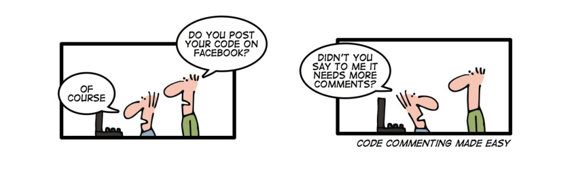

# JS Tricks

## 💪🏻 Motivation

This document is a cheatsheet for JavaScript you will frequently encounter in modern projects and most contemporary sample code.

This guide is not intended to teach you JavaScript from the ground up, but to help developers with basic knowledge who may struggle to get familiar with modern codebases (or let's say to learn React for instance) because of the JavaScript concepts used.

Besides, I will sometimes provide personal tips that may be debatable but will take care to mention that it's a personal recommendation when I do so.

> **Note**: Most of the concepts introduced here are coming from a JavaScript language update (ES2015, often called ES6). You can find new features; it's very well done.

The primary goal of this list is to collect some crazy examples and explain how they work, if possible. Just because it's fun to learn something that we didn't know before.

If you are a beginner, you can use these notes to get a deeper dive into JavaScript. I hope these notes will motivate you to spend more time reading the specification.

If you are a professional developer, you can consider these examples as a great reference for all of the quirks and unexpected edges of our beloved JavaScript.

In any case, just read this. You're probably going to find something new.

# JS BOM

## Detect mobile browsers

```js
const isMobile = function () {
  const match = window.matchMedia('(pointer:coarse)');
  return match && match.matches;
};
```

## Check if the touch events are supported

```js
function touchSupported() {
  return 'ontouchstart' in window || (window.DocumentTouch && document instanceof window.DocumentTouch);
}
```

## Detect Internet Explorer browser

```js
const isIE = !!document.documentMode;
```

## Detect macOS browser

```js
const isMacBrowser = /Mac|iPod|iPhone|iPad/.test(navigator.platform);
```

## Check Local-Storage Support

```js
function is_localStorage_support() {
  try {
    return 'localStorage' in window && window.localStorage !=== null;
  } catch (error) {
    return false;
  }
}
```

## Document Notification

```js
let oldTitle = document.title;
document.title += '(5)'
```

## Change the website favicon

```js
const setFavicon = function (url = '') {
  // Find the current favicon element
  const favicon = document.querySelector('link[rel="icon"]');

  if (favicon) {
    // Update the new link
    favicon.href = url;
  } else {
    // Create new `link`
    const link = document.createElement('link');
    link.rel = 'icon';
    link.href = url;

    // Append to the `head` element
    document.head.appendChild(link);
  }
};

// Usage
setFavicon('/path/to/user/profile/icon.ico');
```

## Use an emoji as the favicon

```js
const emojiFavicon = function (emoji) {
  // Create a canvas element
  const canvas = document.createElement('canvas');
  canvas.height = 64;
  canvas.width = 64;

  // Get the canvas context
  const context = canvas.getContext('2d');
  context.font = '64px serif';
  context.fillText(emoji, 0, 64);

  // Get the custom URL
  const url = canvas.toDataURL();

  // Update the favicon
  setFavicon(url);
};

// Usage
emojiFavicon('🎉');
```

## Print The Page

```js
window.print()
```

## Detect dark mode

```js
const isDarkMode = window.matchMedia && window.matchMedia('(prefers-color-scheme: dark)').matches;
```

## Clear all cookies

```js
function clearCookies() {
  return document.cookie.split(';').forEach((c) => (document.cookie = c.replace(/^ +/, '').replace(/=.*/, `=;expires=${new Date().toUTCString()};path=/`)));
}
```

## Convert cookie to object

```js
const cookies = document.cookie
  .split(';')
  .map((item) => item.split('='))
  .reduce((acc, [k, v]) => (acc[k.trim().replace('"', '')] = v) && acc, {});
```

## Offline Online Network

```js
window.addEventListener('online', ()=> console.log("online"));
window.addEventListener('offline', ()=> console.log("offline"));
```

## Check Internet

```js
navigator.onLine    // false || true
```

# JS DOM

## Ready Function

```js
window.onload = function () {
  document.body.classList.remove('load');
};

// Recommended
window.addEventListener("DOMContentLoaded", () => {
 loadTheme(getCurrentTheme());
});
```

## Prevent User From Leaving Page

```js
window.onbeforeunload = function(e) {
  // window.open(document.URL,"_blank");
  return 'Dialog text here.';
};
```

## Prevent Right Click

```js
document.addEventListener('contextmenu', function(e){
  e.preventDefault();
})
```

## Scroll To Top

```js
function scrollToTop() {
  const c = document.documentElement.scrollTop || document.body.scrollTop;
  if (c > 0) {
    window.requestAnimationFrame(scrollToTop);
    window.scrollTo(0, c - c / 8);
  }
}

scrollToTop(); // Smooth-scrolls to the top of the page

//  or
document.documentElement.scrollTo({
  top: 0,
  left: 0,
  behavior: 'smooth'
});
```

## Smooth Scroll

```js
function smoothScroll(element) {
  document.querySelector(element)?.scrollIntoView({
    behavior: 'smooth'
  });
}

smoothScroll('#fooBar'); // scrolls smoothly to the element with the id fooBar
smoothScroll('.fooBar');
// scrolls smoothly to the first element with a class of fooBar
```

## Scroll to an element

```js
ele.scrollIntoView({ behavior: 'smooth' });
```

## Check if an element is a descendant of another

```js
const isDescendant = (child, parent) => parent.contains(child);
```

## Check if user scrolls to the bottom of the page

```js
function isAtBottom() {
  return document.documentElement.clientHeight + window.scrollY >= document.documentElement.scrollHeight;
}
```

## Get the position of an element relative to the document

```js
function getPosition(ele) {
  const r = ele.getBoundingClientRect()

  return {
    left: r.left + window.scrollX,
    top: r.top + window.scrollY
  }
}

getPosition(document.body); // { left: 0, top: 0 }
```

## Get the selected text

```js
function getSelectedText() {
  return window.getSelection().toString();
}
```

## Insert given HTML after an element

```js
function insertHtmlAfter(html, ele) {
  return ele.insertAdjacentHTML('afterend', html);
}
```

## Insert given HTML before an element

```js
function insertHtmlBefore(html, ele) {
  return ele.insertAdjacentHTML('beforebegin', html);
}
```

## Redirect to another page

```js
const goTo = (url) => (location.href = url);
```

## Reload the current page

```js
const reload = () => location.reload();
// Or
const reload = () => (location.href = location.href);
```

## Toggle an element

```js
function toggle(ele) {
  return ele.style.display === 'none' ? 'block' : 'none';
}
// Or
const toggle = (ele) => (ele.hidden = !ele.hidden);
```

## Select the text of a textarea automatically

```js
ele.addEventListener('focus', function (e) {
  // Select the text
  e.target.select();
});
```

## Select the text content of an element

```js
function selectText(ele) {
  const selection = window.getSelection();
  const range = document.createRange();
  range.selectNodeContents(ele);
  selection.removeAllRanges();
  selection.addRange(range);
}
```

## Replace broken images

```js
// Assume that I want to replace all images on the page
const images = document.querySelectorAll('img');

// Loop over them
[].forEach.call(images, function (ele) {
  ele.addEventListener('error', function (e) {
    e.target.src = '/path/to/404/image.png';
  });
});
```

## Remove all children of a node

```js
// 1. Empty the inner HTML (not recommended)
ele.innerHTML = '';

// Remove child nodes
while (node.firstChild) {
  node.removeChild(node.firstChild);
}
```

## Get the size of an image

```js
// Image is already loaded
const image = document.querySelector(...);
// Get the original size
const naturalWidth = image.naturalWidth;
const naturalHeight = image.naturalHeight;
// Get the scaled size
const width = image.width;
const height = image.height;

// Image is not loaded yet
const image = document.createElement('img');
image.addEventListener('load', function (e) {
  // Get the size
  const width = e.target.width;
  const height = e.target.height;
});
// Set the source
image.src = '/path/to/image.png';
```

### Use case

```html
<input type="file" id="avatar" />

<!-- Display the size -->
<div id="size" />
```

```js
const avatarEle = document.getElementById('avatar');
const sizeEle = document.getElementById('size');

avatarEle?.addEventListener('change', function (e) {
  // Get the selected file
  const file = e.target.files[0];

  const reader = new FileReader();
  reader.readAsDataURL(file);
  reader.addEventListener('loadend', function (e) {
    const src = e.target.result;

    calculateSize(src).then(function (data) {
      const width = data.width;
      const height = data.height;

      sizeEle.innerHTML = `${width} x ${height}`;
    });
  });
});
```

## Get size of the selected file

```js
const fileEle = document.getElementById('input-id');
const sizeEle = document.getElementById('div-id');

fileEle.addEventListener('change', function (e) {
  const files = e.target.files;
  if (files.length === 0) {
    // Hide the size element if user doesn't choose any file
    sizeEle.innerHTML = '';
    sizeEle.style.display = 'none';
  } else {
    // File size in bytes
    sizeEle.innerHTML = `${files[0].size} B`;

    // Display it
    sizeEle.style.display = 'block';
  }
});

// Display a readable size
// Convert the file size to a readable format
const formatFileSize = function (bytes) {
  const suffixes = ['B', 'kB', 'MB', 'GB', 'TB'];
  const i = Math.floor(Math.log(bytes) / Math.log(1024));
  return `${(bytes / Math.pow(1024, i)).toFixed(2)} ${suffixes[i]}`;
};

// Display the file size
sizeEle.innerHTML = formatFileSize(files[0].size);
```

## Get siblings of an element

```js
// Get the previous sibling
const prev = ele.previousSibling;

// Get the next sibling
const next = ele.nextSibling;

// Get all siblings
// Get the parent node
const parent = ele.parentNode;

// Filter the children, exclude the element
function siblings(ele) {
  return [].slice.call(ele.parentNode.children).filter((child) => child !== ele);
}
```

## Check if an element is visible in a scrollable container

```js
// The following functions return true if the ele element is visible in its scrollable container:
const isVisible = function (ele, container) {
  const eleTop = ele.offsetTop;
  const eleBottom = eleTop + ele.clientHeight;

  const containerTop = container.scrollTop;
  const containerBottom = containerTop + container.clientHeight;

  // The element is fully visible in the container
  return (
    (eleTop >= containerTop && eleBottom <= containerBottom) ||
    // Some part of the element is visible in the container
    (eleTop < containerTop && containerTop < eleBottom) ||
    (eleTop < containerBottom && containerBottom < eleBottom)
  );
};

// We also can perform the check based on the bounding rectangles of both element and container:
function isVisible(ele, container) {
  const { bottom, height, top } = ele.getBoundingClientRect();
  const containerRect = container.getBoundingClientRect();

  return top <= containerRect.top ? containerRect.top - top <= height : bottom - containerRect.bottom <= height;
}
```

## Mouse Position

```js
window.addEventListener("mousemove", function(e){
  console.log("Mouse position: Y " + e.clientY, ", X " + e.clientY, );
});
```

## Check if an element is in the viewport

```js
const isInViewport = function (ele) {
  const rect = ele.getBoundingClientRect();
  return (
    rect.top >= 0 &&
    rect.left >= 0 &&
    rect.bottom <= (window.innerHeight || document.documentElement.clientHeight) &&
    rect.right <= (window.innerWidth || document.documentElement.clientWidth)
  );
};
```

## Press Shift and Enter for a new line

```js
const ele = document.getElementById('textarea-id');

ele.addEventListener('keydown', function (e) {
  // Get the code of pressed key
  const keyCode = e.which || e.keyCode;

  // 13 represents the Enter key
  if (keyCode === 13 && !e.shiftKey) {
    // Don't generate a new line
    e.preventDefault();

    // Do something else such as send the message to back-end
    // ...
  }
});
```

## Detect if the caps lock is on

```js
<input type="text" id="textbox" />
<div id="message" />
```

```js
// 1.Use the getModifierState() function
// The getModifierState() function returns the state of given modifier key. It can let us know if the CapsLock key is pressed by calling getModifierState('CapsLock') from the event object.
const textboxEle = document.getElementById('textbox');
const messageEle = document.getElementById('message');

textboxEle.addEventListener('keydown', function (e) {
  const capsLockOn = e.getModifierState('CapsLock');

  // Update the content of message
  messageEle.innerHTML = capsLockOn ? 'Caps lock is ON' : '';

  // Show or hide the message based on the CapsLock state
  messageEle.style.display = capsLockOn ? 'block' : 'none';
});

// 2. Support the Shift key
// The caps lock is treated as ON if users press
// an uppercase letter without Shift
// or an lowercase letter with Shift

const textboxEle = document.getElementById('textbox');
const messageEle = document.getElementById('message');

textboxEle.addEventListener('keypress', function (e) {
  const isMac = /Mac/.test(navigator.platform);

  const keyCode = e.keyCode || e.which;

  // Is the _Shift_ key pressed?
  const shiftKey = e.shiftKey || keyCode === 16;

  // Get the pressed character
  const s = String.fromCharCode(keyCode);
  const capsLockOn =
    (s.toUpperCase() === s && s.toLowerCase() !== s && !(shiftKey && isMac)) ||
    (s.toUpperCase() !== s && s.toLowerCase() === s && shiftKey);

  messageEle.innerHTML = capsLockOn ? 'Caps lock is ON' : '';
  messageEle.style.display = capsLockOn ? 'block' : 'none';
});
```

## Detect clicks outside of an element

```js
document.addEventListener('click', function (evt) {
  const isClickedOutside = !ele.contains(evt.target);
  // `isClickedOutside` is true if the clicked target is outside of `ele`
});
```

## Check if an element is scrollable

```js
// The following function returns true if the ele element is scrollable.
const isScrollable = function (ele) {
  // Compare the height to see if the element has scrollable content
  const hasScrollableContent = ele.scrollHeight > ele.clientHeight;

  // It's not enough because the element's `overflow-y` style can be set as
  // * `hidden`
  // * `hidden !important`
  // In those cases, the scrollbar isn't shown
  const overflowYStyle = window.getComputedStyle(ele).overflowY;
  const isOverflowHidden = overflowYStyle.indexOf('hidden') !== -1;

  return hasScrollableContent && !isOverflowHidden;
};
```

# Helper Functions

## English Digits To Arabic Digits

```js
function toArabicDigits (num) {
  let id = ['٠', '١', '٢', '٣', '٤', '٥', '٦', '٧', '٨', '٩'];
  return num.toString().replace(/[0-9]/g, function (w) {
    return id[+w]
  });
}
```

## Integers to English words

```js
const numberToWords = function(num) {
  let result = toHundreds(num % 1000);
  const bigNumbers = ["Thousand", "Million", "Billion"];
  for (let i = 0; i < 3; ++i) {
    num = Math.trunc(num / 1000);
    result = num % 1000 !== 0 ? [toHundreds(num % 1000), bigNumbers[i], result].filter(Boolean).join(" ") : result;
  }
  return result.length === 0 ? "Zero" : result;
}function toHundreds(num) {
  const numbers = ["", "One", "Two", "Three", "Four", "Five", "Six", "Seven", "Eight", "Nine", "Ten",
    "Eleven", "Twelve", "Thirteen", "Fourteen", "Fifteen", "Sixteen", "Seventeen", "Eighteen", "Nineteen"];
  const tens = ["", "", "Twenty", "Thirty", "Forty", "Fifty", "Sixty", "Seventy", "Eighty", "Ninety"];
  const result = Array(3).fill("");
  let a = Math.trunc(num / 100), b = num % 100, c = num % 10;
  result[0] = a > 0 && `${numbers[a]} Hundred`;
  result[1] = b < 20 ? numbers[b] : tens[Math.trunc(b / 10)]
  result[2] = b >= 20 && `${numbers[c]}`;
  return result.filter(Boolean).join(" ");
}

numberToWords(123)            // -> One Hundred Twenty Three
numberToWords(1123456723)     // -> One Million Two Hundred Thirty Four Thousand Five Hundred Sixty Seven
```

## Collection is empty

```js
const isEmpty = val => val == null || !(Object.keys(val) || val).length;

isEmpty([]); // true
isEmpty({}); // true
isEmpty(''); // true
isEmpty([1, 2]); // false
isEmpty({ a: 1, b: 2 }); // false
isEmpty('text'); // false
isEmpty(123); // true - type is not considered a collection
isEmpty(true); // true - type is not considered a collection
```

## Create Your Own Query Selector Shorthand

```js
const $ = document.querySelector.bind(document);
const $$ = document.querySelectorAll.bind(document);

const mainContent = $('.main-content');
const externalLinks = $$('a[target="_blank"]');
```

## `size` (powerful length)

Gets the size of collection by returning its length for array-like values or the number of own enumerable string keyed properties for objects.

```js
function size(item) {
  return item.constructor === Object ? Object.keys(item).length : item.length;
}

size([1, 2, 3]) // => 3
size({ a: 1, b: 2 })  // => 2
size('pebbles') // => 7
```

## Convert URL parameters to object

```js
function getUrlParams(query) {
  return Array.from(new URLSearchParams(query)).reduce((p, [k, v]) => Object.assign({}, p, { [k]: p[k] ? (Array.isArray(p[k]) ? p[k] : [p[k]]).concat(v) : v }), {});
}

getUrlParams(location.search); // Get the parameters of the current URL
getUrlParams('foo=Foo&bar=Bar'); // { foo: "Foo", bar: "Bar" }

// Duplicate key
getUrlParams('foo=Foo&foo=Fuzz&bar=Bar'); // { foo: ["Foo", "Fuzz"], bar: "Bar" }
```

## Copy text to the clipboard

```js
const copyToClipboard = (str) => {
  const textarea = document.createElement('textarea');
  textarea.value = str;
  document.body.appendChild(textarea);
  textarea.select();
  document.execCommand('copy');
  document.body.removeChild(textarea);
};

// OR
// Create a fake textarea
const textAreaEle = document.createElement('textarea');

// Reset styles
textAreaEle.style.border = '0';
textAreaEle.style.padding = '0';
textAreaEle.style.margin = '0';

// Set the absolute position
// User won't see the element
textAreaEle.style.position = 'absolute';
textAreaEle.style.left = '-9999px';
textAreaEle.style.top = `${document.documentElement.scrollTop}px`;

// Set the value
textAreaEle.value = text;

// Append the textarea to body
document.body.appendChild(textAreaEle);

// Focus and select the text
textAreaEle.focus();
textAreaEle.select();

// Execute the "copy" command
try {
  document.execCommand('copy');
} catch (err) {
  // Unable to copy
} finally {
  // Remove the textarea
  document.body.removeChild(textAreaEle);
}
```

## Get type of a variable in string

```js
function getTypeOf(obj) {
  return Object.prototype.toString.call(obj).match(/\[object (.*)\]/)[1];
}

getTypeOf('hello world'); // String
getTypeOf(1000); // Number
getTypeOf(Infinity); // Number
getTypeOf(true); // Boolean
getTypeOf(Symbol()); // Symbol
getTypeOf(null); // Null
getTypeOf(undefined); // Undefined
getTypeOf({}); // Object
getTypeOf([]); // Array
getTypeOf(/[a-z]/g); // RegExp
getTypeOf(new Date(2021)); // Date
getTypeOf(new Error()); // Error
getTypeOf(function () {}); // Function
getTypeOf((a, b) => a + b); // Function
getTypeOf(async () => {}); // AsyncFunction
getTypeOf(document); // HTMLDocument
```

## check specified type

```js
// isObject
const isObject = a => a instanceof Object
// isArray
Array.isArray([1, 2, 3])
//  isBoolean
const isBoolean = arg => arg === !!arg
//  isDate
const isDate = d => d instanceof Date && !isNaN(d)
// isFinite
Number.isFinite(3)
isFinite(3)
// isInteger
Number.isInteger(3)
// isNaN
Number.isNaN(NaN)
isNaN(3)
// isNull
const isNull = val => val === null
// isNumber
const isNumber = a => typeof a === 'number'
// isString
const isString = a => typeof a === 'string'
//  is async function
function isAsyncFunction(val) {
  return Object.prototype.toString.call(val) === '[object AsyncFunction]';
}
```

## Logical xor operator

```js
// returns `true` if one of the arguments is truthy and the other is falsy

const xor = (a, b) => (a && !b) || (!a && b);

// Or
const xor = (a, b) => !(!a && !b) && !(a && b);

// Or
const xor = (a, b) => Boolean(!a ^ !b);
```

## Swap two variables

```js
[a, b] = [b, a];

// Or
a = [b, (b = a)][0];

// Or
a = ((x) => x)(b, (b = a));

// Or
// (only works with numbers)
a = b + ((b = a), 0);

a = b * ((b = a), 1);
```

# Colors

## Convert 3 digits color to 6 digits color

```js
function toFullHexColor(color) {
  return `#${(color.startsWith('#') ? color.slice(1) : color)
    .split('')
    .map((c) => `${c}${c}`)
    .join('')}`;
}

toFullHexColor('123'); // '#112233'
toFullHexColor('#123'); // '#112233'
toFullHexColor('#abc'); // '#aabbcc'
```

## Convert RGB Color To HEX

```js
const rgbToHex = (red, green, blue) => `#${((1 << 24) + (red << 16) + (green << 8) + blue).toString(16).slice(1)}`;

// Or
const rgbToHex = (red, green, blue) => `#${[red, green, blue].map((v) => v.toString(16).padStart(2, '0')).join('')}`;

rgbToHex(0, 255, 255); // '#00ffff'
```

## HEX To RGB

```js
function hexToRGB(hex) {
  let alpha = false, h = hex.slice(hex.startsWith('#') ? 1 : 0);
  if (h.length === 3) h = [...h].map(x => x + x).join('');
  else if (h.length === 8) alpha = true;
  h = parseInt(h, 16);
  return (
    'rgb' +
    (alpha ? 'a' : '') +
    '(' +
    (h >>> (alpha ? 24 : 16)) +
    ', ' +
    ((h & (alpha ? 0x00ff0000 : 0x00ff00)) >>> (alpha ? 16 : 8)) +
    ', ' +
    ((h & (alpha ? 0x0000ff00 : 0x0000ff)) >>> (alpha ? 8 : 0)) +
    (alpha ? `, ${h & 0x000000ff}` : '') +
    ')'
  );
};

hexToRGB('#27ae60ff'); // 'rgba(39, 174, 96, 255)'
hexToRGB('27ae60'); // 'rgb(39, 174, 96)'
hexToRGB('#fff'); // 'rgb(255, 255, 255)'
```

## Convert HEX To RGB

```js
function hexToRgb(hex) {
  return hex
    .replace(/^#?([a-f\d])([a-f\d])([a-f\d])$/i, (_, r, g, b) => `#${r}${r}${g}${g}${b}${b}`)
    .substring(1)
    .match(/.{2}/g)
    .map((x) => parseInt(x, 16));
}

hexToRgb('#00ffff'); // [0, 255, 255]
hexToRgb('#0ff'); // [0, 255, 255]
```

# Array

## different between `search` and `indexOf`

with search we can use regular expression but not start position unlike `indexOf` we can use start position but not regular expression

## Shuffle array

```js
const shuffle = ([...arr]) => {
  let m = arr.length;
  while (m) {
    const i = Math.floor(Math.random() * m--);
    [arr[m], arr[i]] = [arr[i], arr[m]];
  }
  return arr;
};

// or
const shuffle = (arr) =>
  arr
    .map((a) => ({ sort: Math.random(), value: a }))
    .sort((a, b) => a.sort - b.sort)
    .map((a) => a.value);

// Or
const shuffle = (arr) => arr.sort(() => 0.5 - Math.random());


shuffle([1, 2, 3, 4, 5, 6, 7, 8, 9, 10]); // [9, 1, 10, 6, 8, 5, 2, 3, 7, 4]
```

## Find the missing number in the array

```js
const findMissing = function(input) {
  let n = input.length + 1;let sum = 0;
  for (let i in input) {
    sum += input[i];
  }return Math.floor((n * (n + 1)) / 2) - sum;
};

findMissing([1, 2, 3, 4, 6, 7, 8, 9, 10] ) // > 5
```

## Sort an array of numbers

```js
const sort = (arr) => arr.sort((a, b) => a - b);

sort([1, 5, 2, 4, 3]); // [1, 2, 3, 4, 5]
```

## Search on array

includes(searchElement, fromIndex)

```js
const array1 = [1, 2, 3];

console.log(array1.includes(2));
// expected output: true
[1, 2, 3].includes(2)         // true
[1, 2, 3].includes(4)         // false
[1, 2, 3].includes(3, 3)      // false
[1, 2, 3].includes(3, -1)     // true
[1, 2, NaN].includes(NaN)     // true
["1", "2", "3"].includes(3)   // false
```

## `min` & `max` element on array

```js
Math.max.apply(null,arrayName) // max element on array
Math.max(...arrayName)    // max element on array

Math.min.apply(null,arrayName) // min element on array
Math.min(...arrayName)    // min element on array
```

## Check if an array is empty

```js
const isEmpty = (arr) => !Array.isArray(arr) || arr.length === 0;

isEmpty([]); // true
isEmpty([1, 2, 3]); // false
```

## Clone an array

```js
const clone = (arr) => arr.slice(0);
// Or
const clone = (arr) => [...arr];
// Or
const clone = (arr) => Array.from(arr);
// Or
const clone = (arr) => arr.map((x) => x);
// Or
const clone = (arr) => JSON.parse(JSON.stringify(arr));
// Or
const clone = (arr) => arr.concat([]);
```

## Convert an array of strings to numbers

```js
const toNumbers = (arr) => arr.map(Number);
// Or
const toNumbers = (arr) => arr.map((x) => +x);

toNumbers(['2', '3', '4']); // [2, 3, 4]
```

## Count the occurrences of a value in an array

```js
function countOccurrences(arr, val) {
  return arr.reduce((a, v) => (v === val ? a + 1 : a), 0);
}
// Or
function countOccurrences(arr, val) {
  return arr.filter((item) => item === val).length;
}

countOccurrences([2, 1, 3, 3, 2, 3], 2); // 2
countOccurrences(['a', 'b', 'a', 'c', 'a', 'b'], 'a'); // 3
```

## Count the occurrences of array elements

```js
function countOccurrences(arr) {
  return arr.reduce((prev, current) => ((prev[current] = ++prev[current] || 1), prev), {});
}

countOccurrences([2, 1, 3, 3, 2, 3]); // { '1': 1, '2': 2, '3': 3 }
countOccurrences(['a', 'b', 'a', 'c', 'a', 'b']); // { 'a': 3, 'b': 2, 'c': 1 }
```

## Create an array of numbers in the given range (Range Function)

```js
const range = (min, max) => [...Array(max - min + 1).keys()].map((i) => i + min);

// Or
const range = (min, max) =>
  Array(max - min + 1)
    .fill(0)
    .map((_, i) => min + i);

// Or
const range = (min, max) => Array.from({ length: max - min + 1 }, (_, i) => min + i);

range(5, 10); // [5, 6, 7, 8, 9, 10]
```

## Generate an array of alphabet characters

```js
const alphabet = 'abcdefghijklmnopqrstuvwxyz'.split('');

// Or
const alphabet = [...'abcdefghijklmnopqrstuvwxyz'];

// Or
const alphabet = Array(26)
  .fill(0)
  .map((_, i) => String.fromCharCode(i + 97));

// Or
const alphabet = [...Array(26).keys()].map((i) => String.fromCharCode(i + 97));

// Or
const alphabet = [...Array(26)].map((_, i) => (i + 10).toString(36));

// Or
const alphabet = String.fromCharCode(
  ...' '
    .repeat(26)
    .split('')
    .map((_, i) => i + 97)
).split('');
```

## Generate big numbers

```js
function randomBigInt(length = 16) {
 const hexString = Array(length)
  .fill()
  .map(() => Math.round(Math.random() * 0xf).toString(16))
  .join('');

 return BigInt(`0x${hexString}`);
}
```

## Get indices of a value in an array

get the index of occurrences values

```js
const indices = (arr, value) => arr.reduce((acc, v, i) => (v === value ? [...acc, i] : acc), []);

// Or
const indices = (arr, value) => arr.map((v, i) => (v === value ? i : false)).filter(Boolean);

indices(['h', 'e', 'l', 'l', 'o'], 'l'); // [2, 3]
indices(['h', 'e', 'l', 'l', 'o'], 'w'); // []
```

## Get the average of an array

```js
const average = (arr) => arr.reduce((a, b) => a + b, 0) / arr.length;
```

## Flatten an array

```js
const flat = (arr) =>
  [].concat.apply(
    [],
    arr.map((a) => (Array.isArray(a) ? flat(a) : a))
  );

// Or
const flat = (arr) => arr.reduce((a, b) => (Array.isArray(b) ? [...a, ...flat(b)] : [...a, b]), []);

// Or
// See the browser compatibility at https://caniuse.com/#feat=array-flat
const flat = (arr) => arr.flat();
```

## Get the intersection of arrays

```js
const getIntersection = (a, ...arr) => [...new Set(a)].filter((v) => arr.every((b) => b.includes(v)));

getIntersection([1, 2, 3], [2, 3, 4, 5]); // [2, 3]
getIntersection([1, 2, 3], [2, 3, 4, 5], [1, 3, 5]); // [3]

const intersection = (arr, ...args) =>
 arr.filter(item => args.every(arr => arr.includes(item)))
intersection([2, 1], [2, 3])  // => [2]
```

## Get union of arrays

```js
const union = (arr, ...args) => [...new Set(arr.concat(...args))]
union([2], [1, 2], [1, 2])  // => [2, 1]
```

## Get the sum of an array of numbers

```js
const sum = (arr) => arr.reduce((a, b) => a + b, 0);
```

## Get difference of arrays

```js
const sum = (arr_1, arr_2) =>arr_1.filter(x => !arr_2.includes(x));
```

## Get the unique values of an array

```js
const unique = (arr) => [...new Set(arr)];

// Or
const unique = (arr) => arr.filter((el, i, array) => array.indexOf(el) === i);

// Or
const unique = (arr) => arr.reduce((acc, el) => (acc.includes(el) ? acc : [...acc, el]), []);
```

## Merge two arrays

```js
// Merge but don't remove the duplications
const merge = (a, b) => a.concat(b);
const merge = (a, b) => [].concat(a, b);
// Or
const merge = (a, b) => [...a, ...b];

// Merge and remove the duplications
const merge = (a, b) => [...new Set(a.concat(b))];
// Or
const merge = (a, b) => [...new Set([...a, ...b])];
```

## Remove duplicate values in an array

```js
const removeDuplicate = (arr) => arr.filter((i) => arr.indexOf(i) === arr.lastIndexOf(i));

removeDuplicate(['h', 'e', 'l', 'l', 'o', 'w', 'o', 'r', 'l', 'd']); //  ['h', 'e', 'w', 'r', 'd']
```

# Date

## Format Duration (Millisecond)

```js
const formatDuration = ms => {
 if (ms < 0) ms = -ms;
 const time = {
  day: Math.floor(ms / 86400000),
  hour: Math.floor(ms / 3600000) % 24,
  minute: Math.floor(ms / 60000) % 60,
  second: Math.floor(ms / 1000) % 60,
  millisecond: Math.floor(ms) % 1000
 };
 return Object.entries(time)
  .filter(val => val[1] !== 0)
  .map(([key, val]) => `${val} ${key}${val !== 1 ? 's' : ''}`)
  .join(', ');
};

formatDuration(1001); // '1 second, 1 millisecond'
formatDuration(34325055574); // '397 days, 6 hours, 44 minutes, 15 seconds, 574 milliseconds'
```

## format seconds

```js
const formatSeconds = s => {
 const [hour, minute, second, sign] =
  s > 0
   ? [s / 3600, (s / 60) % 60, s % 60, '']
   : [-s / 3600, (-s / 60) % 60, -s % 60, '-'];

 return (
  sign +
  [hour, minute, second]
   .map(v => `${Math.floor(v)}`.padStart(2, '0'))
   .join(':')
 );
};

formatSeconds(200); // '00:03:20'
formatSeconds(-200); // '-00:03:20'
formatSeconds(99999); // '27:46:39'
```

## Calculate the number of difference days between two dates

```js
const diffDays = (date, otherDate) => Math.ceil(Math.abs(date - otherDate) / (1000 * 60 * 60 * 24));

diffDays(new Date('2014-12-19'), new Date('2020-01-01')); // 1839
```

## Calculate the number of months between two dates

```js
const monthDiff = (startDate, endDate) => Math.max(0, (endDate.getFullYear() - startDate.getFullYear()) * 12 - startDate.getMonth() + endDate.getMonth());

monthDiff(new Date('2020-01-01'), new Date('2021-01-01')); // 12
```

## Convert a date to `YYYY-MM-DD` format

```js
// `date` is a `Date` object
const formatYmd = (date) => date.toISOString().slice(0, 10);

formatYmd(new Date()); // 2020-05-06
```

## Convert seconds to `hh:mm:ss` format

```js
// `s` is number of seconds
const formatSeconds = (s) => new Date(s * 1000).toISOString().substr(11, 8);

// Or
const formatSeconds = (s) => new Date(s * 1000).toUTCString().match(/(\d\d:\d\d:\d\d)/)[0];

// Or
const formatSeconds = (s) => [parseInt(s / 60 / 60), parseInt((s / 60) % 60), parseInt(s % 60)].join(':').replace(/\b(\d)\b/g, '0$1');

formatSeconds(200); // 00:03:20
formatSeconds(500); // 00:08:20
```

## Extract year, month, day, hour, minute, second and millisecond from a date

```js
// `date` is a `Date` object
const extract = (date) =>
  date
    .toISOString()
    .split(/[^0-9]/)
    .slice(0, -1);

// `extract` is an array of [year, month, day, hour, minute, second, millisecond]
```

## Get the current quarter of a date

```js
const getQuarter = (d = new Date()) => Math.ceil((d.getMonth() + 1) / 3);
```

## Get the tomorrow date

```js
const tomorrow = ((d) => new Date(d.setDate(d.getDate() + 1)))(new Date());

// Or
const tomorrow = new Date(new Date().valueOf() + 1000 * 60 * 60 * 24);
```

## Get the yesterday date

```js
const yesterday = ((d) => new Date(d.setDate(d.getDate() - 1)))(new Date());

// Or
const yesterday = new Date(new Date().valueOf() - 1000 * 60 * 60 * 24);
```

## Check if a date is between two dates

```js
// `min`, `max` and `date` are `Date` instances
const isBetween = (date, min, max) => date.getTime() >= min.getTime() && date.getTime() <= max.getTime();
```

## Check if a date is today

```js
// `date` is a Date object
const isToday = (date) => date.toISOString().slice(0, 10) === new Date().toISOString().slice(0, 10);
```

## convert date to hijri

```js
function hijri(date) {
  const options = {
    year: 'numeric',
    month: 'long',
    day: 'numeric',
  };
  const dateC = typeof date === 'string' ? new Date(date) : new Date();
  return dateC.toLocaleString('ar' + '-u-ca-islamic', options);
}
```

# Events

## Create one time event handler

```js
const handler = (e) => {
  // Do something ...
  element.removeEventListener('click', handler);
};
element.addEventListener('click', handler);

// OR
const handler = function (e) {
    // The event handler
    // Do something ...

    // Remove the handler
    e.target.removeEventListener(e.type, handler);
};

ele.addEventListener('event-name', handler);
```

# Files

## Display a readable size(format File Size)

```js
const formatFileSize = function (bytes) {
    const suffixes = ['B', 'kB', 'MB', 'GB', 'TB'];
    const i = Math.floor(Math.log(bytes) / Math.log(1024));
    return `${(bytes / Math.pow(1024, i)).toFixed(2)} ${suffixes[i]}`;
};
```

## Download a `Base64-encoded` file

```js
function downloadBase64File(base64Data, filename) {
  var element = document.createElement('a');
  element.setAttribute('href', base64Data);
  element.setAttribute('download', filename);
  element.style.display = 'none';
  document.body.appendChild(element);
  element.click();
  document.body.removeChild(element);
}
```

## Convert a `Base64-encoded` string to a `File` object

```js
function base64StringToFile(base64String, filename) {
    var arr = base64String.split(','), mime = arr[0].match(/:(.*?);/)[1],
        bstr = atob(arr[1]), n = bstr.length, u8arr = new Uint8Array(n);
    while(n--){
        u8arr[n] = bstr.charCodeAt(n);
    }
    return new File([u8arr], filename, {type:mime});
}
```

## Extract an `Base64` Image's `File` Extension

```js
function extractImageFileExtensionFromBase64(base64Data){
 return base64Data.substring("data:image/".length, base64Data.indexOf(";base64"))
}
```

## `Base64` Image to `Canvas` with a `Crop`

```js
function image64toCanvasRef(canvasRef, image64, pixelCrop){
  const canvas = canvasRef // document.createElement('canvas');
  canvas.width = pixelCrop.width;
  canvas.height = pixelCrop.height;
  const ctx = canvas.getContext('2d');
  const image = new Image()
  image.src = image64
  image.onload = function() {
      ctx.drawImage(
        image,
        pixelCrop.x,
        pixelCrop.y,
        pixelCrop.width,
        pixelCrop.height,
        0,
        0,
        pixelCrop.width,
        pixelCrop.height
      )
    }
}

// Example usage:
const canvasReference = document.createElement('canvas') // or your own canvas
const base64ImageData = "" // fill in your own base64 image data here.
const myCrop = {
      x: 100,
      y: 100,
      width: 350,
     height: 350
}

image64toCanvasRef(canvasReference, base64ImageData, myCrop)
```

## Download a file

```html
<!-- 1. Use the download attribute -->
<a href="/path/to/file" download>Download</a>
```

```js
// 2. Trigger the click event
// Create a new link
const link = document.createElement('a');
link.download = 'file name';
link.href = '/path/to/file';
// Append to the document
document.body.appendChild(link);
// Trigger the click event
link.click();
// Remove the element
document.body.removeChild(link);

// 3. Download file with generated data
const data = JSON.stringify({ 'message': 'Hello Word' });
const blob = new Blob([data], { type: 'application/json' });
// Create new URL
const url = window.URL.createObjectURL(blob);
// Create a link and trigger the download
// Free the URL created above
window.URL.revokeObjectURL(url);
```

## Preview an image before uploading it

```js
const fileEle = document.getElementById('fileInput');
const previewEle = document.getElementById('preview-image');

// 1. Use the URL.createObjectURL() method
fileEle.addEventListener('change', function (e) {
 // Get the selected file
 const file = e.target.files[0];

 // Create a new URL that references to the file
 const url = URL.createObjectURL(file);

 // Set the source for preview element
 previewEle.src = url;
});
```

```js
// 2. Use the FileReader's readAsDataURL() method
fileEle.addEventListener('change', function (e) {
 // Get the selected file
 const file = e.target.files[0];

 const reader = new FileReader();
 reader.addEventListener('load', function () {
  // Set the source for preview element
  previewEle.src = reader.result;
 });

 reader.readAsDataURL(file);
});
```

# Form

## Get All Selected Values Of A Multiple Select

```js
function getSelectValues(select) {
  var result = [];
  var options = select && select.options;
  var opt;

  for (var i=0, iLen=options.length; i<iLen; i++) {
    opt = options[i];

    if (opt.selected) {
      result.push(opt.value || opt.text);
    }
  }
  return result;
}
```

## Serialize form data into a query string

```js
const serialize = function (formEle) {
 // Get all fields
 const fields = [].slice.call(formEle.elements, 0);

 return fields
  .map((ele) => {
   const name = ele.name;
   const type = ele.type;

   // We ignore
   // - field that doesn't have a name
   // - disabled field
   // - `file` input
   // - unselected checkbox/radio
   if (
    !name ||
    ele.disabled ||
    type === 'file' ||
    (/(checkbox|radio)/.test(type) && !ele.checked)
   ) {
    return '';
   }

   // Multiple select
   if (type === 'select-multiple') {
    return ele.options
     .map(function (opt) {
      return opt.selected
       ? `${encodeURIComponent(name)}=${encodeURIComponent(opt.value)}`
       : '';
     })
     .filter((item) => item)
     .join('&');
   }

   return `${encodeURIComponent(name)}=${encodeURIComponent(ele.value)}`;
  })
  .filter((item) => item)
  .join('&');
};
```

# Random

## Generate a random boolean

```js
const randomBoolean = () => Math.random() >= 0.5;
```

## Generate a random floating point number in given range

```js
const randomFloat = (min, max) => Math.random() * (max - min) + min;
```

## Generate a random integer in given range

```js
const randomInteger = (min, max) => Math.floor(Math.random() * (max - min + 1)) + min;
```

## Generate a random hex color

```js
const randomColor = () => `#${Math.random().toString(16).slice(2, 8).padEnd(6, '0')}`;

// Or
const randomColor = () => `#${(~~(Math.random() * (1 << 24))).toString(16)}`;
```

## Generate an array of random integers in a given range

```js
randomArrayInRange(1, 100, 10); // [11, 82, 41, 35, 76, 83, 43, 15, 60, 54]
```

## Get a random item from an array

```js
const randomItem = (arr) => arr[(Math.random() * arr.length) | 0];
```

## Get random items of an array

```js
const randomItems = (arr, count) => arr.concat().reduce((p, _, __, arr) => (p[0] < count ? [p[0] + 1, p[1].concat(arr.splice((Math.random() * arr.length) | 0, 1))] : p), [0, []])[1];


randomItems([1, 2, 3, 4, 5, 6, 7, 8, 9, 10], 3); // [4, 8, 5]
randomItems(['a', 'b', 'c', 'd', 'e', 'f', 'g', 'h', 'i', 'j'], 4); // ['e', 'c', 'h', 'j']
```

# String

## Convert a letter to associate emoji

```js
const letterToEmoji = (c) => String.fromCodePoint(c.toLowerCase().charCodeAt(0) + 127365);


letterToEmoji('a'); // 🇦
letterToEmoji('b'); // 🇧
```

## Convert a string to URL slug

```js
const slugify = (str) =>
    str
        .toLowerCase()
        .replace(/\s+/g, '-')
        .replace(/[^\w-]+/g, '');


slugify('Chapter One: Once upon a time...'); // 'chapter-one-once-upon-a-time'
```

## String is valid JSON

```js
function isValidJSON(str) {
  try {
    JSON.parse(str);
    return true;
  } catch (e) {
    return false;
  }
}
```

## Covert string to boolean

```js
let x = 'some-value';

// This doesn't look too nice
if (!!x) {
  // ...
}

// This is a lot more readable
if (Boolean(x)) {
  // ...
}
```

## Count the number of words in a string

```js
const countWords = (str) => str.trim().split(/\s+/).length;


countWords('Hello World'); // 2
countWords('Hello    World'); // 2
countWords('  Hello  World  '); // 2
```

## Get the number of a character in a string

```js
const characterCount = (str, char) => str.split(char).length - 1;

// Or
const characterCount = (str, char) => str.replace(new RegExp(String.raw`[^${char}]`, 'g'), '').length;


characterCount('192.168.1.1', '.'); // 3
characterCount('star wars', 's'); // 2
```

## Reverse a string

```js
const reverse = (str) => str.split('').reverse().join('');

// Or
const reverse = (str) => [...str].reverse().join('');

// Or
const reverse = (str) => str.split('').reduce((rev, char) => `${char}${rev}`, '');

// Or
const reverse = (str) => (str === '' ? '' : `${reverse(str.substr(1))}${str.charAt(0)}`);
```

## Truncate a string at full words

```js
const truncate = (str, max, suffix) => (str.length < max ? str : `${str.substr(0, str.substr(0, max - suffix.length).lastIndexOf(' '))}${suffix}`);

truncate('This is a long message', 20, '...'); // 'This is a long...'
```

## Capitalize a string

```js
const capitalize = str =>
  `${str.charAt(0).toUpperCase()}${str.slice(1).toLowerCase()}`

capitalize('FRED')  // => 'Fred'
```

# Numbers

## Check if a given integer is a prime number

```js
const isPrime = (n) =>
    n > 1 &&
    Array(Math.floor(Math.sqrt(n)) - 1)
        .fill(0)
        .map((_, i) => i + 2)
        .every((i) => n % i !== 0);
```

## Inverting integers

```js
const reverse = function(num) {
    let result = 0;
    while (num !== 0) {
      result = result * 10 + num % 10;
      // Math.trunc() method will remove the fractional part of the number and keep only the integer part
      num = Math.trunc(num / 10);
    }if (result > 2**31 || result < -(2**31)) return 0;
    return result;
};

reverse(123)  // -> 321
reverse(-123) // -> -321
```

## Check if a number is negative

```js
const isNegative = (n) => Math.sign(n) === -1;

// Or
const isNegative = (n) => n < 0;
```

## Check if a number is positive

```js
const isPositive = (n) => Math.sign(n) === 1;
```

## Check if a number is odd

```js
const isOdd = (n) => n % 2 !== 0;

// Or
const isOdd = (n) => !!(n & 1);

// Or
const isOdd = (n) => !Number.isInteger(n / 2);
```

# Style

## Set CSS style for an element

```js
ele.style.backgroundColor = 'red';
ele.style['backgroundColor'] = 'red';
ele.style['background-color'] = 'red';

// Add new style
el.style.cssText += 'background-color: red; color: white';
// Ignore previous styles
el.style.cssText = 'background-color: red; color: white';

// Remove a CSS style
ele.style.removeProperty('background-color');
```

# RegExp (Regular Expression)

## Password Pattern

```js
// Password (UpperCase, LowerCase, Number/SpecialChar and min 8 Chars
(?=^.{8,}$)((?=.*\d)|(?=.*\W+))(?![.\n])(?=.*[A-Z])(?=.*[a-z]).*$
```

## Email Pattern

```js
(/^[a-zA-Z0-9._-]+@[a-zA-Z0-9-]+(?:\.[a-zA-Z0-9-]+)*$/)
```

# Temperature

## Convert Celsius to Fahrenheit

```js
const celsiusToFahrenheit = (celsius) => (celsius * 9) / 5 + 32;
```

## Convert Fahrenheit to Celsius

```js
const fahrenheitToCelsius = (fahrenheit) => ((fahrenheit - 32) * 5) / 9;

fahrenheitToCelsius(59); // 15
fahrenheitToCelsius(32); // 0
```

# Js Function DOC


[image source](https://stfalcon.com/uploads/images/55c8bcff18b94.png)

## For user-focused documentation

- How-to & user guides
- Release notes
- Tutorials
- Reference documents
- Software design documents
- Explanations

## For developer-focused documentation

- Back-end release notes
- Test plans
- API documentation
- README
- Software requirements
- System documentation
- Code documentation (many developers use a web tool like GitHub for these purposes)
- Other technical documentation & technical specifications

## Main Structure

```js
/**
 * [someFunction description]
 * @param  {type} arg1 [description]
 * @param  {type} arg2 [description]
 * @return {type}      [description]
 */
var someFunction = function (arg1, arg2) {
 // Do something...
};
```

## Full Example With Return

```js
/**
 * Add two numbers together
 * @param  {Number} num1 The first number
 * @param  {Number} num2 The second number
 * @return {Number}      The total of the two numbers
 */
 function ar(num1, num2) {
 'use strict';
 return num1 + num2;
}

console.log(ar(1, 9));
```

## Second Example No Return

```js
/**
 * add array of classes to a given selector
 * @parm {String} selector  the element we want to add class to it
 * @parm {Array} options    the array of classes to be added
 * @return {void} Nothing
 * 
* ```js
* let close_btn = document.querySelector('.close');
* add_class(close_btn, ['close', 'colorful']);
* ```
**/
function add_class(selector, options) {
 'use strict';
 selector.classList.add(... options);
}

console.log(add_class('mo', [1, 2, 3]));
```

## Main Example With Comments

```js
/**
 * Toggle visibility of a content tab
 * @param  {String} selector Selector for the element
 * @param  {Node}   toggle   The element that triggered the tab
 */
var toggleVisibility = function (selector, toggle) {

 // If there's no selector, bail
 if (!selector) return;

 // Get the tab to show
 var elem = document.querySelector(selector);
 if (!elem) return;

 // Show the element
 elem.classList.add('active');

 // If a toggle element was provided, add an .active class for styling
 if (toggle) {
 toggle.classList.add('active');
 }

 // Bring the newly visible element into focus
 elem.focus()

 // If elem.focus() didn't work, add tabindex="-1" and try again
 // (elements that aren't focusable by default need a tabindex)
 if (document.activeElement.matches(selector)) return;
 elem.setAttribute('tabindex', '-1');
 elem.focus();

};
```

## Example With Author

```js
/**
 * Raises a number to exponent
 * @author mohamed taysser <mohamedtaysser983@gmail.com>
 * @param {number} value - The base to raise
 * @param {number} exponent - The exponent
 * @return {number} - The exponent power
 */
function poooow(value, exponent) {
 return value ** exponent;
} 

poooow(2, 5)
```

## With Default Parameter

```js
/**
 *@param {(string|string[])} [name=mohammed] - String or multiple strings
 * @returns {void} no return
 */
 function functionOptionalDefault(name = 'mohammed') {
 console.log('Hi ' + name);
}

functionOptionalDefault();
```

## Multiple Type

```js
/**
 * @param {(string|string[])} [name=mohammed] - String or multiple strings
 */
function myMethod(name) {}
```

## Callback Functions Example

```js
/**
 * myCallback is callback function defined
 *
 * @callback myCallback
 * @param {string} parameters string
 */

/**
 * Callback handles certain operations
 * @param {myCallback} myCallback - Function with callback example
 */
function functionCallbackExample(myCallback) {
 // code
};

```

## Documenting a JavaScript file

```js
/**
 * @file 
 * Provides some feature.
 *
 * The extra line between the end of the @file docblock
 * and the file-closure is important.
 */
 
// Vanilla JS Goes Here ⭐
document.addEventListener("DOMContentLoaded", function() {
 // your page initialization code here
 // the DOM will be available here
});
```

# API

## Custom axios

```js
// a file called axios and import it
const axios = {
  get(url) {
    return fetch(url)
      .then(res => res.json())
      .then(data => ({ data }));
  }
}

export { axios };
```

# Tricks

# [`wtfjs`](https://github.com/denysdovhan/wtfjs)

## ✍🏻 Notation

`// ->` is used to show the result of an expression. For example:

```js
1 + 1; // -> 2
```

`// >` means the result of console.log or another output. For example:

```js
console.log("hello, world!"); // > hello, world!
```

`//` is just a comment used for explanations. Example:

```js
// Assigning a function to foo constant
const foo = function() {};
```

## baNaNa

```js
"b" + "a" + +"a" + "a"; // -> 'baNaNa'
```

This is an old-school joke in JavaScript, but remastered. Here's the original one:

```js
"foo" + +"bar"; // -> 'fooNaN'
```

### 💡 Explanation

The expression is evaluated as `'foo' + (+'bar')`, which converts `'bar'` to not a number.

## Math with `true` and `false`

```js
true + true; // -> 2
(true + true) * (true + true) - true; // -> 3
```

### 💡 Explanation

We can coerce values to numbers with the Number constructor. It's quite obvious that true will be coerced to 1:

```js
Number(true); // -> 1
```

The unary plus operator attempts to convert its value into a number. It can convert string representations of integers and floats, as well as the non-string values `true`, `false`, and `null`. If it cannot parse a particular value, it will evaluate to `NaN`. That means we can coerce `true` to 1 easier:

```js
+true; // -> 1
```

When you're performing addition or multiplication, the ToNumber method is invoked. According to the specification, this method returns:

> If `argument` is `true`, return 1. If argument is `false`, return +0.

## Precision of `0.1 + 0.2`

A well-known joke. An addition of 0.1 and 0.2 is deadly precise:

```js
0.1 + 0.2; // -> 0.30000000000000004
0.1 + 0.2 === 0.3; // -> false
```

### 💡 Explanation

The answer for the [Is floating point math broken?](https://stackoverflow.com/questions/588004/is-floating-point-math-broken) question on StackOverflow:

The constants 0.2 and 0.3 in your program will also be approximations to their true values. It happens that the closest double to 0.2 is larger than the rational number 0.2 but that the closest double to 0.3 is smaller than the rational number 0.3. The sum of 0.1 and 0.2 winds up being larger than the rational number 0.3 and hence disagreeing with the constant in your code.

This problem is so known that there is even a website called [0.30000000000000004.com](http://0.30000000000000004.com/). It occurs in every language that uses floating-point math, not just JavaScript.

## Comparison of three numbers

```js
1 < 2 < 3; // -> true
3 > 2 > 1; // -> false
```

### 💡 Explanation

Why does this work that way? Well, the problem is in the first part of an expression. Here's how it works:

```js
1 < 2 < 3; // 1 < 2 -> true
true < 3; // true -> 1
1 < 3; // -> true

3 > 2 > 1; // 3 > 2 -> true
true > 1; // true -> 1
1 > 1; // -> false
```

We can fix this with Greater than or equal operator `(>=)`:

```js
3 > 2 >= 1; // true
```

## Funny math

Often the results of arithmetic operations in JavaScript might be quite unexpected. Consider these examples:

```js
 3  - 1  // -> 2
 3  + 1  // -> 4
'3' - 1  // -> 2
'3' + 1  // -> '31'

'' + '' // -> ''
[] + [] // -> ''
{} + [] // -> 0
[] + {} // -> '[object Object]'
{} + {} // -> '[object Object][object Object]'

'222' - -'111' // -> 333

[4] * [4]       // -> 16
[] * []         // -> 0
[4, 4] * [4, 4] // NaN
```

### 💡 Explanation

What's happening in the first four examples? Here's a small table to understand addition in JavaScript:

```js
Number  + Number  -> addition
Boolean + Number  -> addition
Boolean + Boolean -> addition
Number  + String  -> concatenation
String  + Boolean -> concatenation
String  + String  -> concatenation
```

What about other examples? A `ToPrimitive` and `ToString` methods are being implicitly called for `[]` and `{}` before addition. Read more about evaluation process in the specification:

- [`The Addition Operator (+)`](https://www.ecma-international.org/ecma-262/#sec-addition-operator-plus)
- [`ToPrimitive(input [,PreferredType])`](https://www.ecma-international.org/ecma-262/#sec-toprimitive)
- [`ToString(argument)`](https://www.ecma-international.org/ecma-262/#sec-tostring)

Notably, `{} + []` here is the exception. The reason why it differs from `[] + {}` is that, without parenthesis, it is interpreted as a code block and then a unary `+`, converting `[]` into a number. It sees the following:

```js
{
  // a code block here
}
+[]; // -> 0
```

To get the same output as `[] + {}` we can wrap it in parenthesis.

```js
({} + []); // -> [object Object]
```

## Strings aren't instances of `String`

```js
"str"; // -> 'str'
typeof "str"; // -> 'string'
"str" instanceof String; // -> false
```

### 💡 Explanation

The `String` constructor returns a string:

```js
typeof String("str"); // -> 'string'
String("str"); // -> 'str'
String("str") == "str"; // -> true
```

Let's try with a `new`:

```js
new String("str") == "str"; // -> true
typeof new String("str"); // -> 'object'
```

Object? What's that?

```js
new String("str"); // -> [String: 'str']
```

More information about the String constructor in the specification [The String Constructor](https://www.ecma-international.org/ecma-262/#sec-string-constructor)

## Calling functions with backticks

Let's declare a function which logs all params into the `console`:

```js
function f(...args) {
  return args;
}
```

No doubt, you know you can call this function like this:

```js
f(1, 2, 3); // -> [ 1, 2, 3 ]
```

But did you know you can call any function with backticks?

```js
f`true is ${true}, false is ${false}, array is ${[1, 2, 3]}`;
// -> [ [ 'true is ', ', false is ', ', array is ', '' ],
// ->   true,
// ->   false,
// ->   [ 1, 2, 3 ] ]
```

### 💡 Explanation

Well, this is not magic at all if you're familiar with Tagged template literals. In the example above, `f` function is a tag for template literal. Tags before template literal allow you to parse template literals with a function. The first argument of a tag function contains an array of string values. The remaining arguments are related to the expressions. Example:

```js
function template(strings, ...keys) {
  // do something with strings and keys…
}
```

This is the [magic behind](http://mxstbr.blog/2016/11/styled-components-magic-explained/) famous library called 💅 [styled-components](https://www.styled-components.com/), which is popular in the React community.

Link to the specification: [Tagged Templates](https://www.ecma-international.org/ecma-262/#sec-tagged-templates)

## Dots and spreading

Interesting examples could be composed with spreading of arrays. Consider this:

```js
[...[..."..."]].length; // -> 3
```

### 💡 Explanation

Why 3? When we use the [spread operator](http://www.ecma-international.org/ecma-262/6.0/#sec-array-initializer), the `@@iterator` method is called, and the returned iterator is used to obtain the values to be iterated. The default iterator for string spreads a string into characters. After spreading, we pack these characters into an array. Then we spread this array again and pack it back to an array.

A `'...'` string consists with three `.` characters, so the length of resulting array is `3`.

Now, step-by-step:

```js
[...'...']             // -> [ '.', '.', '.' ]
[...[...'...']]        // -> [ '.', '.', '.' ]
[...[...'...']].length // -> 3
```

Obviously, we can spread and wrap the elements of an array as many times as we want:

```js
[...'...']                 // -> [ '.', '.', '.' ]
[...[...'...']]            // -> [ '.', '.', '.' ]
[...[...[...'...']]]       // -> [ '.', '.', '.' ]
[...[...[...[...'...']]]]  // -> [ '.', '.', '.' ]
// and so on …
```

## Insidious `try..catch`

What will this expression return? 2 or 3?

```js
(() => {
  try {
    return 2;
  } finally {
    return 3;
  }
})();
```

The answer is 3. Surprised?

### 💡 Explanation

see: [`The try Statement`](https://www.ecma-international.org/ecma-262/#sec-try-statement)

## Tricky arrow functions

Consider the example below:

```js
let f = () => 10;
f(); // -> 10
```

Okay, fine, but what about this:

```js
let f = () => {};
f(); // -> undefined
```

### 💡 Explanation

You might expect `{}` instead of `undefined`. This is because the curly braces are part of the syntax of the arrow functions, so `f` will return undefined. It is however possible to return the `{}` object directly from an arrow function, by enclosing the return value with brackets.

```js
let f = () => ({});
f(); // -> {}
```

## Arrow functions can not be a constructor

Consider the example below:

```js
let f = function() {
  this.a = 1;
};
new f(); // -> f { 'a': 1 }
```

Now, try do to the same with an arrow function:

```js
let f = () => {
  this.a = 1;
};
new f(); // -> TypeError: f is not a constructor
```

### 💡 Explanation

Arrow functions cannot be used as constructors and will throw an error when used with `new`. Because they have a lexical `this`, and do not have a `prototype` property, so it would not make much sense.

## `arguments` and arrow functions

Consider the example below:

```js
let f = function() {
  return arguments;
};
f("a"); // -> { '0': 'a' }
```

Now, try do to the same with an arrow function:

```js
let f = () => arguments;
f("a"); // -> Uncaught ReferenceError: arguments is not defined
```

### 💡 Explanation

Arrow functions are a lightweight version of regular functions with a focus on being short and lexical `this`. At the same time arrow functions do not provide a binding for the `arguments` object. As a valid alternative use the `rest parameters` to achieve the same result:

```js
let f = (...args) => args;
f("a");
```

see: [Arrow functions](https://developer.mozilla.org/en-US/docs/Web/JavaScript/Reference/Functions/Arrow_functions) at MDN.

## `Math.max()` less than `Math.min()`

I find this example hilarious:

```js
Math.min() > Math.max(); // -> true
Math.min() < Math.max(); // -> false
```

### 💡 Explanation

This is a simple one. Let's consider each part of this expression separately:

```js
Math.min(); // -> Infinity
Math.max(); // -> -Infinity
Infinity > -Infinity; // -> true
```

Why so? Well, `Math.max()` is not the same thing as `Number.MAX_VALUE`. It does not return the largest possible number.

`Math.max` takes arguments, tries to convert the to numbers, compares each one and then returns the largest remaining. If no arguments are given, the result is `−∞`. If any value is `NaN`, the result is `NaN`.

The opposite is happening for `Math.min` . `Math.min` returns `∞`, if no arguments are given.

## Default behavior `Array.prototype.sort()`

Imagine that you need to sort an array of numbers.

```js
[10, 1, 3].sort(); // -> [ 1, 10, 3 ]
```

### 💡 Explanation

The default sort order is built upon converting the elements into strings, then comparing their sequences of UTF-16 code units values.

see[`Array.prototype.sort(comparefn)`](https://www.ecma-international.org/ecma-262/#sec-array.prototype.sort)

### Hint ⭐

Pass `compareFn` if you try to sort anything but string.

```js
[10, 1, 3].sort((a, b) => a - b); // -> [ 1, 3, 10 ]
```

## `arguments` binding

Consider this function:

```js
function a(x) {
  arguments[0] = "hello";
  console.log(x);
}

a(); // > undefined
a(1); // > "hello"
```

### 💡 Explanation

`arguments` is an Array-like object that contains the values of the arguments passed to that function. When no arguments are passed, then there's no `x` to override.

## Double dot

Let's try to coerce a number to a string:

```js
27.toString() // > Uncaught SyntaxError: Invalid or unexpected token
```

Maybe we should try with two dots?

```js
27..toString(); // -> '27'
```

### 💡 Explanation

It's just a language grammar limitation.

The `.` character presents an ambiguity. It can be understood to be the member operator, or a decimal, depending on its placement.

The specification's interpretation of the `.` character in that particular position is that it will be a decimal. This is defined by the numeric literal syntax of ECMAScript.

You must always use parenthesis or an addition dot to make such expression valid.

```js
(27).toString(); // -> '27'
// or
27..toString(); // -> '27'
```

- [`Usage of toString in JavaScript on StackOverflow`](https://stackoverflow.com/questions/6853865/usage-of-tostring-in-javascript/6853910#6853910)
- [`Why does 10..toString() work, but 10.toString() does not?`](https://stackoverflow.com/questions/13149282/why-does-10-tostring-work-but-10-tostring-does-not/13149301#13149301)

# 📚 Other resources

- [`wtfjs.com`](http://wtfjs.com/) — a collection of those very special irregularities, inconsistencies and just plain painfully unintuitive moments for the language of the web.
- [`Wat`](https://www.destroyallsoftware.com/talks/wat) — A lightning talk by Gary Bernhardt from CodeMash 2012
- [`What the... JavaScript?`](https://www.youtube.com/watch?v=2pL28CcEijU) — Kyle Simpsons talk for Forward 2 attempts to "pull out the crazy" from JavaScript. He wants to help you produce cleaner, more elegant, more readable code, then inspire people to contribute to the open source community.
- [`Zeros in JavaScript`](http://zero.milosz.ca/) — a comparison table of ==, ===, + and * in JavaScript.
- <https://raganwald.com/2016/11/30/anamorphisms-in-javascript.html>
- <https://www.digitalocean.com/community/tutorials/understanding-javascript-promises>
- <https://github.com/you-dont-need/You-Dont-Need-JavaScript>
- <https://github.com/denysdovhan/wtfjs>
- <https://github.com/mbeaudru/modern-js-cheatsheet>

## Glossary

### Scope

The context in which values and expressions are "visible," or can be referenced. If a variable or other expression is not "in the current scope," then it is unavailable for use.

Source: [`MDN`](https://developer.mozilla.org/en-US/docs/Glossary/Scope)

### Variable mutation

A variable is said to have been mutated when its initial value has changed afterward.

```js
var myArray = [];
myArray.push("firstEl") // myArray is being mutated
```

A variable is said to be immutable if it can't be mutated.

[`Check MDN Mutable article`](https://developer.mozilla.org/en-US/docs/Glossary/Mutable) for more details.

### Anamorphisms

functions that map from some object to a more complex structure containing the type of the object. For example, mapping from an integer to a list of integers.

```js
function downToOne(n) {
  const list = [];

  for (let i = n; i > 0; --i) {
    list.push(i);
  }

  return list;
}

downToOne(5) // => [ 5, 4, 3, 2, 1 ]
```

### Catamorphisms

functions that map from some complex structure containing values down to values.

```js
function product(list) {
  let product = 1;

  for (const n of list) {
    product *= n;
  }

  return product;
}

product(downToOne(5)) // => 120
```

# 🤝 Supporting

Hi! I work on this project in my spare time, in addition to my primary job. I hope you enjoy reading it. If you do, please, consider supporting me 🙏.

Every single donation is important. Your donation is gonna make a clear statement: My work is valued.

🙏 Thank you for your support! 🙏

## Pay attention to grammar

Ensure your list is grammatically correct, typo free and has no Markdown formatting errors.
