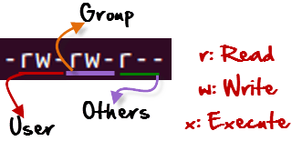

# Network + Cyber Security Essional

## Other

- `show ip route`
- `show ip dhcp pool`
- `show ip dhcp binding`
- `show mac address-table`
- `show vlan`
- `show spanning-tree`

### window Terminal

- `ipconfig /all`
- `arp -a`
- `ping 2001:abcd:1999:more::1`

## Open Router Port With Configure

    enable

    configure terminal

    interface gigabitEthernet 0/0

    ip address 192.168.30.1 255.255.255.0

    no shutdown

## Create DHCP Server

    ip dhcp pool alex

    network 192.168.30.0 255.255.255.0

    default-router 192.168.30.1

    dns-server  8.8.8.8

## Connect To External Network Like `we`

    interface serial 0/0/0

    ip address 41.0.0.1 255.255.255.252

    no shutdown

    do wr

## Static Route

    ip route 192.168.1.0 255.255.255.0 serial 0/0/1
    
    ip route 192.168.1.0 255.255.255.0 60.0.0.2

## vlan

### Create vlan

    vlan 10

    name sales

    exit

### Add pc To vlan

    interface fastEthernet 0/1

    switchport access vlan 10

    # range select
    interface range fastEthernet 0/1-3

    # range and single select
    interface range fastEthernet 0/1, fastEthernet 0/6-8

### Switch Port To Trunk

    interface fastEthernet 0/2

    switchport mode trunk

### Change Priority

    spanning-tree vlan 1 priority 4096

## ip V6

### on router

    ipv6 unicast-routing

    interface gigabitEthernet 0/0

    ipv6 enable

    ipv6 address 2001:abcd:5522:af11::1/64

    no shutdown

## Management Protocol

### SNMP

set password for use

    snmp-server community password_123 rw

### NTP

    ntp server 192.168.16.52

    # mean we will use authentication to change time
    ntp authenticate

    # it take 30 sec to synchronize in all the network
    ntp authentication-key 1 md5 password_123

    do show clock

### telnet

    # 5 virtual command line (from 0 to 4 is 5)
    line vty 0 4

    # use the username and password
    login locale

    exit

    # 0 : no permission, 1 : less permission, 15 : all permission
    username admin privilege 15 password password_123

### CDP

    show cdp neighbors

### banner

> **motd** : message of the day

    banner motd # message to appear #

# MS Course

## to setup the main server

1. turn off the firewall (localserver on left)
2. add static ip to the server (open network sharing on click network icon on task bar)
   1. 192.168.1.100
   2. 255.255.255.0
   3. 192.168.1.1
   4. 127.0.0.1
3. restart the server
4. add new role (dashboard on left)
   1. check that the static ip for server are chosen
   2. check active directory domain server
   3. press ad freather
   4. prees install
5. restart the server
6. on notification you will find a prompit click it
7. choose `add a new forest` and type the domain name
8. contine the steps it's easy

## on windows 10

1. add static ip
   1. 192.168.1.200
   2. 255.255.255.0
   3. 192.168.1.1
   4. 192.168.1.100
2. pc > properties > remote setting > change name

# redhat

    cmd option arg_1 arg_2

    ls -a[all fle even hidden] -l[long details] -h[human readable size]
    dir
    pwd
    clear
    su
    date
    cal
    who
    whoami
    whereis
    echo
    history
    man -f[file source] -k[search for keyword]
    password [change password in root mode]
    touch file1 file2

    cp -r source destination      [copy]
    mv    file_name     [cut or rename]
    rm    file_name     [remove]
    cat   file_name     [show, change file content]
    more  file_name     [show file content]
    less  file_name     [show file content]
    mkdir dir_name      [make dir]
    rmdir -r dir_name   [remove dir]

    tail -n 3           [print last n line]
    head -n 3           [print first n line]

    pinfo               only in redhat  like man

## `/` root dir

    /bin/   : essential running command
    /sbin/  : system command (storage, ...)
    /boot/  : necessary files for booting
    /lib/   : needed library for system
    /lib64/ : needed library for 64-bit system
    /tmp/   : temporary files
    /var/   : changeable files size (log, ...)
    /home/  : user home dir (dir for each user)
    /root/  : root home dir
    /etc/   : system configuration files
    /dev/   : devices on system

## vim

                                                                         k
      Move around:  Use the cursor keys, or "h" to go left,            h   l
                    "j" to go down, "k" to go up, "l" to go right.       j
    Close this window:  Use ":`q<Enter>`".
    Get out of Vim:  Use ":qa!`<Enter>`" (careful, all changes are lost!).

    Jump to a subject:  Position the cursor on a tag (e.g. bars) and hit CTRL-].
    With the mouse:  ":set mouse=a" to enable the mouse (in xterm or GUI).
                        Double-click the left mouse button on a tag, e.g. bars.
            Jump back:  Type CTRL-O.  Repeat to go further back.

    Get specific help:  It is possible to go directly to whatever you want help
                        on, by giving an argument to the :help command.
                        Perpend something to specify the context:  help-context

    Command-line command        Esc
    Insert mode command         i
    Insert mode + new line      o
    delete line                 dd
    delete char                 x
    cut line                    c
    copy line                   yy
    undo                        y
    last line                   G
    first line                  g
    quit                        :q
    quit and save               :wq
    Regular expression          /   + enter
    perform copy with n number     n y

    See help-summary for more contexts and an explanation.

    Search for help:  Type ":help word", then hit CTRL-D to see matching
                        help entries for "word".
                        Or use ":helpgrep word". :helpgrep

    Getting started:  Do the Vim tutor, a 30-minute interactive course for the
                        basic commands, see vimtutor.
                        Read the user manual from start to end: usr_01.txt

    Vim stands for Vi IMproved.  Most of Vim was made by Bram Moolenaar, but only
    through the help of many others.  See credits.

### redierct

an example is `log` file

    ls >  ls.txt     # replace
    ls >> ls.txt     # append

### pip line `|`

take the output of command one and use it as input for command two 

### other type pr terminal

    bash    the default one, to use `bash` 
    shell   to use `sh`

### grouping

    cmd ; cmd ; cmd .....

### wildcard

    one char
    file?
    file1 file2 file3 file4

    all char
    file*
    file1 file2 file3 file4

    all char
    file[1-3]
    file1 file2 file3

## users

    useradd
    usermod
    userdel

    # change sell
    # list all shell : cat /etc/sells 
    usermod -s /bin/sh username
    usermod -c 'comment as full name' -u 2000 -e '2021-10-20' username

    # -L : lock user
    # -U : unlock user

    # delete user without it's home dir
    userdel  username
    ## it's home dir still
    ls -ld /home/username
    ### to remove it
    rm -rf /home/username

    # delete user with home dir
    userdel -r username

    groupadd

    # add user to primary group
    useradd -g pr_group username

    groupmod
    groupdel

    # delete user from all group and add him to new secandary group
    usermod -G new_group username

    # append user to a new secandary group
    usermod -aG new_group username

files

    /etc/passwd

    cat /etc/passwd
        ....
        # username x:password  1005:UID    1007:Group_ID   home dir    bash used
        username:x:1005:1007::/home/username:/bin/bash
        ....

    /etc/shadow

    cat /etc/shadow

    # if password start with ! mean user is locked

    # set password
    passwd username

    /etc/group

    cat /etc/shadow

    group_name:x:1005:username

## permission

- first char is file type (file is `-`, dir is `d`)