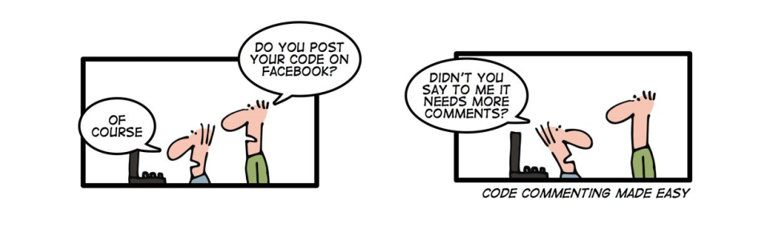

# how to write doc :joy: :smile: for js function


[image source](https://stfalcon.com/uploads/images/55c8bcff18b94.png)

## For user-focused documentation

- How-to & user guides
- Release notes
- Tutorials
- Reference documents
- Software design documents
- Explanations

## For developer-focused documentation

- Back-end release notes
- Test plans
- API documentation
- README
- Software requirements
- System documentation
- Code documentation (many developers use a web tool like GitHub for these purposes)
- Other technical documentation & technical specifications 

# main structure

```js
/**
 * [someFunction description]
 * @param  {type} arg1 [description]
 * @param  {type} arg2 [description]
 * @return {type}      [description]
 */
var someFunction = function (arg1, arg2) {
    // Do something...
};
```

## full example with return

```js
/**
 * Add two numbers together
 * @param  {Number} num1 The first number
 * @param  {Number} num2 The second number
 * @return {Number}      The total of the two numbers
 */
 function ar(num1, num2) {
    'use strict';
    return num1 + num2;
}

console.log(ar(1, 9));
```

## second example no return

```js
/* global console */

/**
 * add array of classes to a given selector
 * @parm {String} selector  the element we want to add class to it
 * @parm {Array} options    the array of classes to be added
 * @return {void} Nothing
 * 
* ```js
* let close_btn = document.querySelector('.close');
* add_class(close_btn, ['close', 'colorful']);
* ```
**/
function add_class(selector, options) {
    'use strict';
    selector.classList.add(... options);
}

console.log(add_class('mo', [1, 2, 3]));
```

## main example with comments

```js
/**
 * Toggle visibility of a content tab
 * @param  {String} selector Selector for the element
 * @param  {Node}   toggle   The element that triggered the tab
 */
var toggleVisibility = function (selector, toggle) {

    // If there's no selector, bail
    if (!selector) return;

    // Get the tab to show
    var elem = document.querySelector(selector);
    if (!elem) return;

    // Show the element
    elem.classList.add('active');

    // If a toggle element was provided, add an .active class for styling
    if (toggle) {
        toggle.classList.add('active');
    }

    // Bring the newly visible element into focus
    elem.focus()

    // If elem.focus() didn't work, add tabindex="-1" and try again
    // (elements that aren't focusable by default need a tabindex)
    if (document.activeElement.matches(selector)) return;
    elem.setAttribute('tabindex', '-1');
    elem.focus();

};
```

## example with author

```js
/**
 * Raises a number to exponent
 * @author Valentino Gagliardi <valentinoDOTvalentinog.com>
 * @param {number} value - The base to raise
 * @param {number} exponent - The exponent
 * @return {number} - The exponent power
 */
function poooow(value, exponent) {
  return value ** exponent;
} 

poooow(2, 5)
```

## with default parameter

```js
/**
 *@param {(string|string[])} [name=Kiran] - String or multiple strings
 * @returns {void} no return
 */
 function functionOptionalDefault(name) {
    if (!name) {
        name = 'Kiran';
    }
    console.log('Hi ' + name);
}

functionOptionalDefault();
```

## multiple type

```js

/**
 * @param {(string|string[])} [name=mohammed] - String or multiple strings
 */
function mymethod(name) {}
```

## callback functions example

```js


/**
 * mycallback is callback function defined
 *
 * @callback mycallback
 * @param {string} parameters string
 */

/**
 * Callback handles certain operations
 * @param {mycallback} mycallback - Function with callback example
 */
function functioncallbackexample(mycallback) {
    // code
};

```

## resources

- [valentinog](https://www.valentinog.com/blog/jsdoc/)
- [cloudhadoop](https://www.cloudhadoop.com/2018/09/jsdoc-javascript-documentation-function.html)

## Tag order

```text
@global

@typedef
@var
@name
@namespace
@constructor
@callback
@event
@function

@augments
@lends

@type
@prop

@param
@return

@throws
@fires
@listens

@ingroup
@deprecated
@see
@todo
@ignore
```

## Documenting a JavaScript file

```js
/**
 * @file 
 * Provides some feature.
 *
 * The extra line between the end of the @file docblock
 * and the file-closure is important.
 */
    
(function ($) {

  "use strict";

})();
```

## Documenting behaviors

```js
/**
 * Attaches the table drag behavior to tables.
 *
 * @type {Drupal~behavior}
 * 
 * @prop {Drupal~behaviorAttach} attach
 *   Specific description of this attach function goes here.
 * @prop {Drupal~behaviorDetach} detach
 *   Specific description of this detach function goes here.
 */
Drupal.behaviors.tableDrag = {
  attach: function (context, settings) {
    // ...
  },
  detach: function (context, settings, trigger) {
    // …
  }
};
```

## Documenting usual constructs

```js
/**
 * Holds JavaScript settings and other information for Drupal.
 *
 * @namespace
 */
var Drupal = {
   // ...
  /**
   * Holds behaviors for Drupal.
   *
   * @namespace
   */
  'behaviors': {},
  // ...
};

/**
 * Returns the value of foo for the current widget.
 *
 * Description of this ordinary function in the Drupal namespace goes here.
 *
 * @return
 *   The value of foo in the current widget.
 */
Drupal.getCurrentFoo = function () {
  // ...
};

/**
 * Constructs a table drag object.
 * 
 * Provides the ability to drag to manipulate a table and its fields.
 * 
 * @constructor
 *
 * @param {HTMLTableElement} table
 *   DOM object for the table to be made draggable.
 * @param {object} tableSettings
 *   Settings for the table.
 */
Drupal.tableDrag = function (table, tableSettings) {
  // ...
}

/**
 * Hides the columns containing weight and parent form elements.
 *
 * @fires event:columnschange
 *
 * @see Drupal.tableDrag.showColumns
 */
Drupal.tableDrag.prototype.hideColumns = function() {
  // ...

  /**
   * Indicates that columns have changed in a table.
   *
   * @param {string} type
   *   Type of change: 'show' or 'hide'.
   *
   * @event columnschange
   */

  $('table.tableDrag-processed').trigger('columnschange', 'hide');
  // ...
};

/**
 * Shows the columns containing weight and parent form elements.
 *
 * @fires columnschange
 * 
 * @see Drupal.tableDrag.hideColumns
 */
Drupal.tableDrag.prototype.showColumns = function() {
  // This event is documented in Drupal.tableDrag.hideColumns
  $('table.tabledrag-processed').trigger('columnschange', 'hide');
};

```
