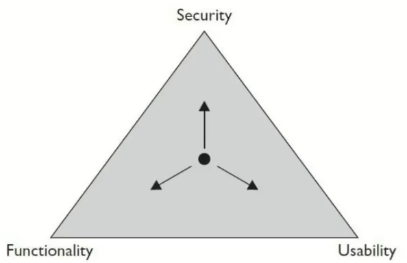
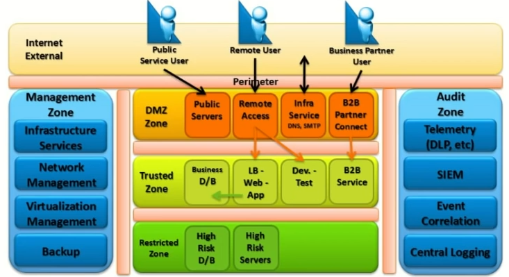

# Technawi Notes (CEH v9) 💻

## Course Content 📔

1. Introduction To Ethical Hacking (Basic & Essential)
2. Building Your Testing Lab
3. Foot printing & Reconnaissance
4. Scanning Network
5. Enumeration
6. System Hacking
7. Malware Threats
8. Sniffing
9. Social Engineering
10. Denial Of Service
11. Session Hijacking
12. Hacking Web Server
13. Hacking Web Application
14. SQL Injection
15. Hacking Wireless Network
16. Hacking Mobile Platform
17. Evading Ids, Firewalls & Honeypots
18. Cloud Computing
19. Cryptography
20. Buffer Overflow

# Introduction To Ethical Hacking 👾

**Information Security** is a state of well-being of information and infrastructure in which the possibility of theft, tempering and disruption of information and service is kept low or tolerable

## Elements Of Information Security

1. Confidentiality (only authorized people can seen content or enter system)
2. Integrity       (only authorized people can seen update or edit content)
3. Availability
4. Authenticity
5. Non Repudiation   (non-denial)

## Strength Of System

for example: two way authentication that need to enter email & password then send code to email and enter it which reduce usability of the application

## Essential Terminology

1. Hack Value       (the value or benefits of hack system)
2. Vulnerability    (weak point)
3. Exploit          (code or way use to hack system)
4. Payload          (code or method)
5. Zero Day Attack  (vulnerability not fixed yet)
6. Daisy Chaining   (used hacked information to hack another system 😜)
7. Doxing           (collect information about organization from social media)
8. Bot

## Information Security Threats & Attacks

    Attack = Motive + Method + Vulnerability

### Top Information Security Attack Vectors

- Cloud Computing Threats
- Advanced Persistent Threats
- Malwares
- Mobile Threats
- Botnet (install bot on many devices)
- Insider Attacks (inside organization)

### Information Security Category 💀

1. Network Threats (like know network device that work, sniffing)
2. Host Threats    (stole session, send malware)
3. Applications Threats (web attack, buffer overflow)

## Type Of Attack On System

1. Os Attack (uninstall updated)
2. Mis Configurations Attack (admin, admin)
3. Applications Level Attack
4. Shrink Warp Code Attack (use code already written like framework, library)

## Information Warfare

concept involving the use and management of information and communication technology in pursuit of a competitive advantage over opponent

can be explain as the war between companies, countries and more that seeks to use the best of information, any of them has defensive team to protect and offensive team to attack

-----

## Hacking Concepts

- **hacking** process of exploiting vulnerability to gain unauthorized access to system or resources
- **hacker** highly skilled computer expert capable of breaking into computer systems and networks using bugs and exploits

### Hacker Classifications

1. White Hat Hackers
2. Black Hat Hackers
3. Gray Hat Hacker
4. Suicide Hackers
5. Script Kiddies
6. Cyber Terrorists (politics)
7. State Sponsored
8. Hacktivist (active online, searching for hack for any goals)

### Hacking Phases

1. Reconnaissance | Footprint (active phase or passive phase)
2. Scanning And Enumeration
3. Gaining Access (now we are hack)
4. Maintaining Access (like back door)
5. Covering Tracks (remove any evidence that system is hack)

## Ethical Hacking

term used to describe hacking performed by company or individual to help identify potential threats on a computer or network

it focus on simulating techniques used by attackers to verify the existence of exploitable vulnerabilities in the target system

it necessary because it allow to counter attacks from malicious hackers by following the methods used by them to hack the system

## Vulnerability Assessment

process that define, identifies and classifies the security logs in a computer, network or a communication infrastructure

### Types Of Vulnerability Assessment

1. Active Assessments (use tools to get information about working devices)
2. Passive Assessments(use tools to get the information transmitted on network)
3. Host Base Assessments (software install o device to get information about it)
4. Internal Assessments (finding Vulnerability inside organization)
5. External Assessments (finding Vulnerability outside organization)
6. Application Assessments (scan any application for Vulnerability)
7. Network Assessments
8. Wireless Network Assessments

### Vulnerability Assessment Phases

1. Acquisition (find a previous Vulnerability)
2. Identification (meeting with employee)
3. Analyzing
4. Evaluation (determine how to use Vulnerability and it's serious)
5. Reporting

## Vulnerability Research

process by which security flaws in technology are identified and helps to identify and eliminate security flaws that might overwise be exploited by malicious hackers. it can but doesn't allow involve reverse engineering, code analysis, static analysis, ...

### Vulnerability Classified Base On

1. Severity Level   [how it serious Height, Low, Medium]
2. Exploit Range    [working area Local | Remote]

## Penetration Testing

simulated attack on a computer system that looks for security weakness, potentially gaining access to the computer's feathers and data

### Penetration Testing Classes

1. White Box (know all information about target organization)
2. Gray Box  (know some information about target organization)
3. Black Box (don't know any information about target organization)

### Penetration Testing Phases

1. Pre Attack
2. Attack
3. Post Attack

## Security Audit

Ensure that the company or organization follows the general safety standards

### Penetration Testing  Methodology

1. OWASP
2. OSSTMM
3. ISSSAF
4. EC-Council LPT

## Information Security Controls

### Information Assurance (IA)

assurance that the information and information's systems is protected during usage, processing, storage and transmission

### Information Security Management Program

program design to enable any business to reduce the risk

### Threads Modeling

risk assessment approach for analyzing security of an application by capturing and analyzing all information that effect the security of an application

### Enterprise Information Security Architecture (EISA)

aet of requirements, process, principles and models that determine the structure and behavior of information system

### Network Security Zoning

allows an organization to manage a secure environment by selecting the appropriate security levels for different zones of internet and internet networks also it helps to mentor and control inbound and outbound traffic

### Information Security Policy

define the basic security requirements and rules to be implements in order to protect and secure in formation security

### Physical Security

first layer od protection in any organization and it involves protection of organizational assets from both environmental (fire) and man made threats (war)

### Incident Management

set of defined process to identify, analyse prioritize and resolve security incidents to restore normal service operations as quickly as possible and to prevent future recurrence of the incident

[netcraft](https://www.netcraft.com/)
[shodan](https://www.shodan.io/)
[bayt](https://www.bayt.com/en/egypt/)

GHDB [google hacking database]

1. <https://www.hackersforcharity.org/>
2. <https://www.exploit-db.com/>
