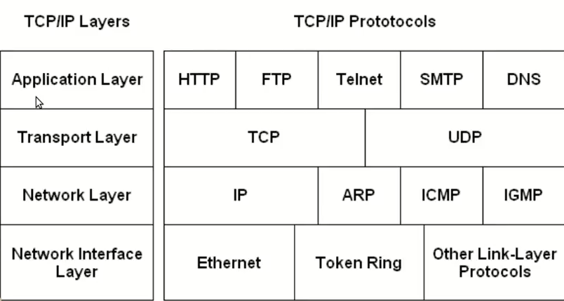
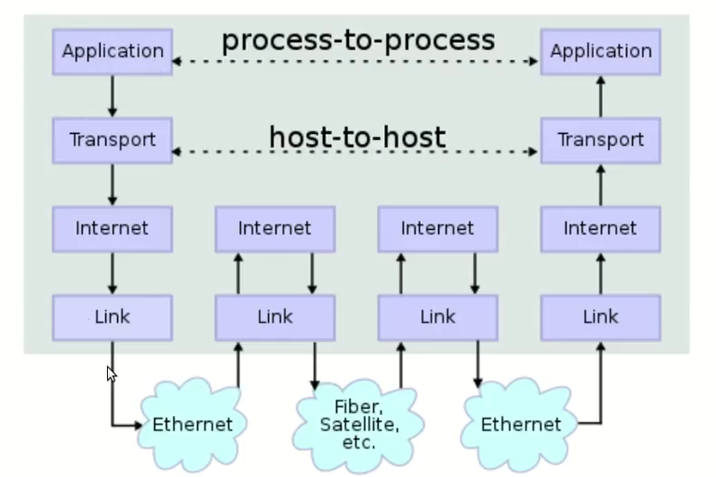
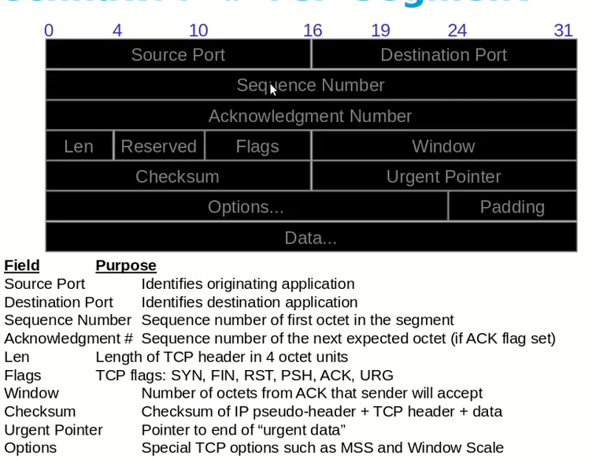
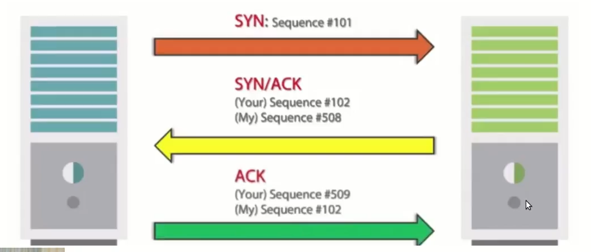
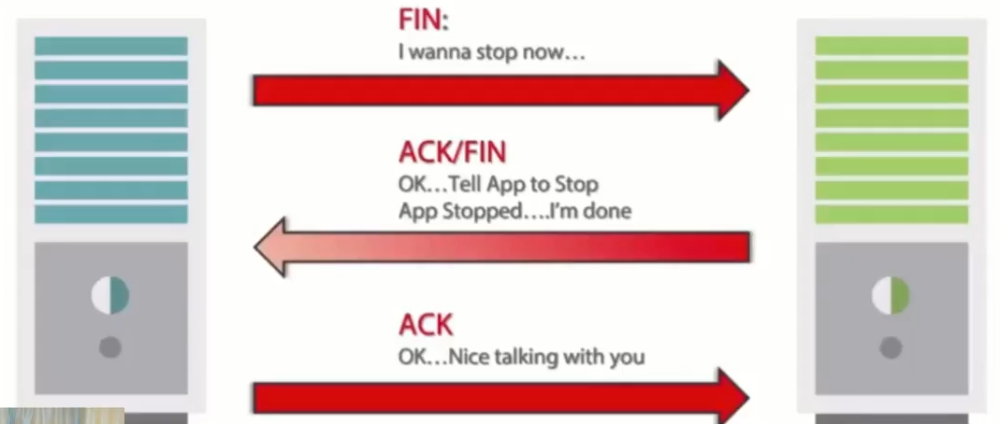
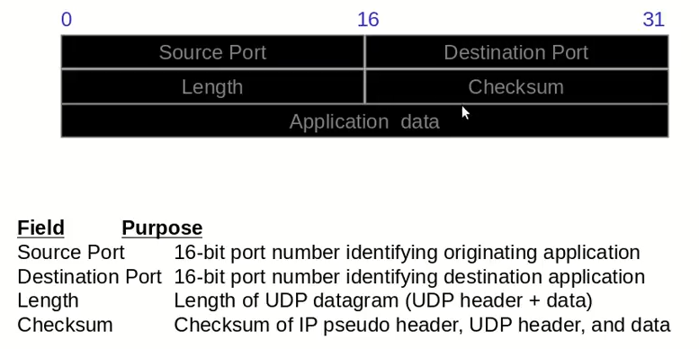
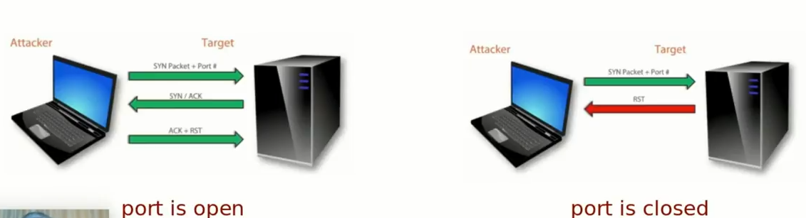
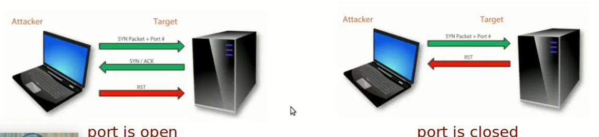
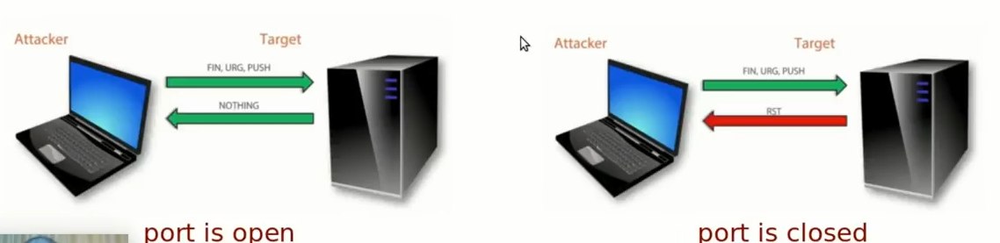

# Technawi Notes (CEH v9 updated to v10 in 3 module)

## Course Content 📔

1. Introduction To Ethical Hacking (Basic & Essential)
2. Building Your Testing Lab
3. Foot printing & Reconnaissance
4. Scanning Network
5. Enumeration
6. System Hacking
7. Malware Threats
8. Sniffing
9. Social Engineering
10. Denial Of Service
11. Session Hijacking
12. Hacking Web Server
13. Hacking Web Application
14. SQL Injection
15. Hacking Wireless Network
16. Hacking Mobile Platform
17. Evading Ids, Firewalls & Honeypots
18. Cloud Computing
19. Cryptography
20. Buffer Overflow

# Introduction To Ethical Hacking 👾

**Information Security** is a state of well-being of information and infrastructure in which the possibility of theft, tempering and disruption of information and service is kept low or tolerable

## Elements Of Information Security

1. Confidentiality (only authorized people can seen content or enter system)
2. Integrity       (only authorized people can seen update or edit content)
3. Availability
4. Authenticity
5. Non Repudiation   (non-denial)

## Strength Of System

for example: two way authentication that need to enter email & password then send code to email and enter it which reduce usability of the application


## Essential Terminology

1. Hack Value       (the value or benefits of hack system)
2. Vulnerability    (weak point)
3. Exploit          (code or way use to hack system)
4. Payload          (code or method)
5. Zero Day Attack  (vulnerability not fixed yet)
6. Daisy Chaining   (used hacked information to hack another system 😜)
7. Doxing           (collect information about organization from social media)
8. Bot

## Information Security Threats & Attacks

    Attack = Motive + Method + Vulnerability

### Top Information Security Attack Vectors

- Cloud Computing Threats
- Advanced Persistent Threats
- Malwares
- Mobile Threats
- Botnet (install bot on many devices)
- Insider Attacks (inside organization)

### Information Security Category 💀

1. Network Threats (like know network device that work, sniffing)
2. Host Threats    (stole session, send malware)
3. Applications Threats (web attack, buffer overflow)

## Type Of Attack On System

1. Os Attack (uninstall updated)
2. Mis Configurations Attack (admin, admin)
3. Applications Level Attack
4. Shrink Warp Code Attack (use code already written like framework, library)

## Information Warfare

concept involving the use and management of information and communication technology in pursuit of a competitive advantage over opponent

can be explain as the war between companies, countries and more that seeks to use the best of information, any of them has defensive team to protect and offensive team to attack

-----

## Hacking Concepts

- **hacking** process of exploiting vulnerability to gain unauthorized access to system or resources
- **hacker** highly skilled computer expert capable of breaking into computer systems and networks using bugs and exploits

### Hacker Classifications

1. White Hat Hackers
2. Black Hat Hackers
3. Gray Hat Hacker
4. Suicide Hackers
5. Script Kiddies
6. Cyber Terrorists (politics)
7. State Sponsored
8. Hacktivist (active online, searching for hack for any goals)

### Hacking Phases

1. Reconnaissance | Footprint (active phase or passive phase)
2. Scanning And Enumeration
3. Gaining Access (now we are hack)
4. Maintaining Access (like back door)
5. Covering Tracks (remove any evidence that system is hack)

## Ethical Hacking

term used to describe hacking performed by company or individual to help identify potential threats on a computer or network

it focus on simulating techniques used by attackers to verify the existence of exploitable vulnerabilities in the target system

it necessary because it allow to counter attacks from malicious hackers by following the methods used by them to hack the system

## Vulnerability Assessment

process that define, identifies and classifies the security logs in a computer, network or a communication infrastructure

### Types Of Vulnerability Assessment

1. Active Assessments (use tools to get information about working devices)
2. Passive Assessments(use tools to get the information transmitted on network)
3. Host Base Assessments (software install o device to get information about it)
4. Internal Assessments (finding Vulnerability inside organization)
5. External Assessments (finding Vulnerability outside organization)
6. Application Assessments (scan any application for Vulnerability)
7. Network Assessments
8. Wireless Network Assessments

### Vulnerability Assessment Phases

1. Acquisition (find a previous Vulnerability)
2. Identification (meeting with employee)
3. Analyzing
4. Evaluation (determine how to use Vulnerability and it's serious)
5. Reporting

## Vulnerability Research

process by which security flaws in technology are identified and helps to identify and eliminate security flaws that might overwise be exploited by malicious hackers. it can but doesn't allow involve reverse engineering, code analysis, static analysis, ...

### Vulnerability Classified Base On

1. Severity Level   [how it serious Height, Low, Medium]
2. Exploit Range    [working area Local | Remote]

## Penetration Testing

simulated attack on a computer system that looks for security weakness, potentially gaining access to the computer's feathers and data

### Penetration Testing Classes

1. White Box (know all information about target organization)
2. Gray Box  (know some information about target organization)
3. Black Box (don't know any information about target organization)

### Penetration Testing Phases

1. Pre Attack
2. Attack
3. Post Attack

## Security Audit

Ensure that the company or organization follows the general safety standards

### Penetration Testing  Methodology

1. OWASP
2. OSSTMM
3. ISSSAF
4. EC-Council LPT

## Information Security Controls

### Information Assurance (IA)

assurance that the information and information's systems is protected during usage, processing, storage and transmission

### Information Security Management Program

program design to enable any business to reduce the risk

### Threads Modeling

risk assessment approach for analyzing security of an application by capturing and analyzing all information that effect the security of an application

### Enterprise Information Security Architecture (EISA)

aet of requirements, process, principles and models that determine the structure and behavior of information system

### Network Security Zoning

allows an organization to manage a secure environment by selecting the appropriate security levels for different zones of internet and internet networks also it helps to mentor and control inbound and outbound traffic


### Information Security Policy

define the basic security requirements and rules to be implements in order to protect and secure in formation security

### Physical Security

first layer od protection in any organization and it involves protection of organizational assets from both environmental (fire) and man made threats (war)

### Incident Management

set of defined process to identify, analyse prioritize and resolve security incidents to restore normal service operations as quickly as possible and to prevent future recurrence of the incident

# Building Your Testing Lab 💻

    watch videos 😜

# Foot printing & Reconnaissance 👀

## Foot printing & Reconnaissance Module Content

- Footprinting Concepts
- Footprinting Methodology
- Footprinting Tools
- Footprinting Countermeasuers
- Footprinting Pentesting

## What Is Footprinting

also know as Reconnaissance, the technique used for gathering information about computer systems an d the entities they belong to.

to get information, hacker might use various tools and technology. this information is very useful to hacker who trying to crack a whole system

Footprinting can reveal system vulnerabilities and improve the ease with which they can be exploit like social engineering

consider the **most important phase** of ethical hacking as:

- allow attacker know about security posture for target
- reduce attacker focus area
- allow attacker to identify vulnerabilities
- allow attacker to draw the map for the target network infrastructure

### Footprinting Types

- **Passive Footprinting** : collect information without direct interacting with the target
- **Active Footprinting** : collect information by interacting with the target with any mean

### Footprinting Objects

help attackers to collect information suck as:

- Network Information (ip's, OS)
- System Information (working services)
- Organization Information (phones, address)

### OSINT

stands for `open source intelligence` which reefer to any unclassified information and includes anything freely or publicly available on the web

sources includes:

- Social Networks
- Forums
- Business Website
- Blogs
- Videos
- New Sources

OSINT is one of many INTs (intelligence) disciplines employed by government intelligence agents such as:

- HUMINT (human intelligence: gathering intelligence by interacting with people)
- SIGINT (signal intelligence: gathering data from sensors)
- GEOINT (geospatial intelligence : gathering data from satellites)

## Footprinting Methodology

- Search Engin Footprinting
- Advanced Google Hacking
- Social Network Footprinting
- Website Footprinting
- Email Footprinting
- Competitive Intelligence
- WHOIS Footprinting
- DNS Footprinting
- Network Footprinting
- Social Engineering Footprinting

## Search Engin Footprinting

data collected such that:

- Technology Platforms
- Employee Details
- Login Pages
- Intranet Portals

### general examples

- [wikipedia](https://en.wikipedia.org/wiki/Main_Page)
- [google](https://www.google.com/)
- [bing](https://www.bing.com/)
- [netcraft](https://www.netcraft.com/)
- [shodan](https://www.shodan.io/)

### jops examples

- [bayt](https://www.bayt.com/en/egypt/)
- [linkedin](https://www.linkedin.com/)

### people example

- [linkedin](https://www.linkedin.com/)
- [pipl](https://pipl.com/)

### geolocation

- google map
- wikipedia
- bing map

### finance services

- google finance
- yahoo finance

### advanced google hacking

see googling file 😉

GHDB [google hacking database]

- [hackers for charity](https://hackersforcharity.org/)
- [exploit-db](https://www.exploit-db.com/)

## Website Footprinting

collect data such that:

- used software & it's version
- used OS
- suv directory & parameters
- filename, paths, database fields name or query
- scripting platform & CMS details
- contact details

### Attacker can use

- Burp suit
- zaproxy
- paros proxy
- firebug
- wappalzer

**Mirroring** the target like [HTTrack](https://www.httrack.com/) (website copier) into local system giving the attacker the opportunity to browse it offline so attacker can find the directory structure for the website and search for valuable data from the copy.

HTTrack found as CLI tool on kali linux

also attacker can:

- examine html source code to find data like comment, address
- examine cookies to find data on them
- use web spiders (GSA email spider, [web data extractor](http://www.webextractor.com/)) to perform automate searches on the target website and collect data like employee names and more for social engineering
- use internet archives to see archived versions like [archive.org](https://archive.org/)

## Email Footprinting

analyze email header like:

- [ip address location](https://www.ipaddresslocation.org/)
- [ip location](https://www.iplocation.net/)

## Competitive Intelligence

process of identify, gathering, analyzing, verifying and using information about competitive from resources such as internet

sources:

- company website and employment ads
- search engin
- press releases and annual reports
- journals, conference and newsletters
- social engineering
- customer & vendor reviews

## WHOIS Footprinting

query and respond protocol that is widely used for querying databases that stor the registered users or assignees of internet resource such as domain name, IP address block or autonomous system. but it also used for a wider range of other information

WHOIS database are maintained by **Regional Internet Register** (RIR) and contact personal information of domain owners

WHOIS query return:

- Domain Name Details (email, address)
- Contact Details Of Domain Owner
- Domain Name Services
- NetRange
- Domain Name Creation Date & Expiry Date
- Domain Name Last Update

also `whois`, `nslookup`, `dig` available as CLI in kali linux

an example is [whois domain tools](https://whois.domaintools.com/)

## DNS Footprinting

domain name servers are the internet equivalent of phone book. they maintain a directory of domain names and translate them to internet protocol (IP) address

it provide an important information about location and type of servers

attacker can gather DNS information to determine key host in the network and can perform social engineering attacks

see [network-tools webwiz](https://network-tools.webwiz.net/) form ore tools

## Network Footprinting

network range information assists attacker to crate a map of the target, also find IP range using ARIN [whois database search tool](https://www.whois.com/whois/arin.net)

traceroute (CLI tool) works on the concept of ICMP protocol and use TTL field in the header of ICMP packets to discover the routers on the path to target host

attacker conduct traceroute to extract information about:

- network topology
- trusted routers
- firewall location

## Social Engineering Footprinting

the art od exploiting human behavior to extract confidential information. it depend on the act that people are unaware of their valuable information and are careless about protect it do attacker attempt to gather:

- credit card details & SSN
- usernames & passwords
- security product i use
- OS & software version
- network layout information
- IP address & name of servers

### Social Engineering Techniques

- Eavesdropping
- Shoulder Surfing
- Dumpster Diving
- Impersonation

## Footprinting Tools

watch videos for more details 😜

- maltego (on kali linux)
- fierce (on kali linux)
- FOCA (has GUI in windows)
- recon-NG
- dnsrecon (on kali linux)
- dnsmap (on kali linux)
- dnstracer (on kali linux)
- dnsenum (on kali linux)
- dnswalk (on kali linux)
- metagoofil
- the harvester (on kali linux)
- Dmitry (on kali linux)
- [sublist3r](https://github.com/aboul3la/Sublist3r)

## `recon-ng`

full featured web Reconnaissance framework written in python. complete with independent modules database interaction, interactive help and command completion

recon-ng has a look and feel and even command flow similar to the metasploit framework

found on kali linux

### comes with

- 77 recon modules
- 2 discovery modules
- 2 exploitation modules
- 8 reporting modules
- 2 import modules

### recon-ng schema

- domains
- companies
- netblocks
- locations
- vulnerability
- ports
- contacts
- credentials
- leaks
- pushpins
- profiles

# Scanning Network

## Scanning Network Module Content

- What Is Scanning
- Type Of Scanning
- Scanning Objects
- TCP/IP Suite
- Scanning Methodology
- Ping Sweeps
- Port Scanning
- Scanning Techniques
- Scanning Tools
- Vulnerability Scanning
- Proxy Serves & Anonymizers
- IP Spoofing
- Scanning Pen-Testing

## What Is Scanning

network scanning refer to use the computer ti gather information regarding computing system. it's mainly used for security assessment, system maintenance, and also for performing attacks by hackers

it's one of the components of intelligence gathering an attacker uses to create a profile of the target organization

### Used To Identify

- Live Host & Their Systems
- Open & Closed Ports
- Running Services
- Vulnerability In Network

### Type Of Scanning

- Network Scanning
  - Find Live Hosts
  - Possibly Identify Working OS
  - Pick Up IP Address
- Port Scanning
  - It's Endpoint Of Communication In An Operating System. Port Number Is Away To Identify Specific Process To Which An Internet Or Other Network Message To Be Forwarded When It Arrive A Server
  - Exist 65535 Ports, But Focus On First 1023 (That They Services)
  - Each Port Has One Service Running On It
- Vulnerability Scanning
  - Identify Possible Threats To OS, Apps, ...
  - Identify Vulnerability on OS, Apps, ...

## Scanning Objects & Goals

- Live Hosts
- IP Address
- Open & Closed Ports
- OS & Architecture
- Vulnerability & Threats
- Security Risk & Services

## TCP/IP Suite

the TCP/IP Suite is the conceptual and set of communications protocols used on the internet and similar computer network

it provide end-to-end data communication specifying how dada should be packetized, addressed, transmitted, routed and received

this functionality is organized into four abstraction layers which are used to sort all related protocols according to the scope of networking invoked.

- Application Layer
- Transport Layer
- Internet Layer
- Network Access Layer

## TCP Protocol

reliable, connection-oriented delivery service:

- connection-oriented mean that a connection must be established before hosts can exchange data
- reliable is achieved by assigning a sequence number to each segment transmitted
- TCP peer, the two nodes using TCP to communicate, acknowledge when they receive data
- a TCP segment is the protocol data unit (PDU) consisting of the TCP header & TCP payload also know as segment. for each TCP segment sent containing data, the receiving host must return a acknowledgement (ACK). if ACK is not received within time the TCP segment is retransmitted

### TCP/IP Protocols



### TCP/IP Dataflow



### TCP Segment



### TCP Communication Flags

- URG (Urgent) data contained in the packet should be processed immediately
- FIN (Finish) there will be no more transmissions
- RST (Reset) reset a connection
- PSH (Push) send all buffered data immediately
- ACK (Acknowledgement) acknowledgement the receipt of packet
- SYN (Synchronize) initiates a connection between hosts

### TCP 3 Way Handshake



### TCP Session Termination



## UDP Protocol

provide a connectionless datagram service that offers unreliable, best-effort delivery of data transmitted in messages. this mean that neither the arrival of datagrams nor the correct sequencing of delivered packages is guaranteed. so it doesn't retransmitted lost data

UDP message consist of UDP header & UDP payload. also knw as a message

applications use UDP if they don't require an acknowledgement of receipt of data and they typically transmit small amounts of data at one time. NetBIOS name service, NetBIOS datagram service and SNMP are examples of services and applications that use UDP



## Scanning Methodology

steps:

- Check For Live Systems
- Check For Open Ports
- Scanning Beyond IDS
- Banner Grabbing
- Scanning For Vulnerability
- Draw Network Diagrams
- Prepare Proxies
- Scanning Pen-Testing

## Check For Live Systems

### `ICMP` scanning

- ping scan invokes sending `ICMP ECHO` request to a host. if the host is a live
- it's used for locating active devices or determining if `ICMP` passing through a **firewall**.


### ping sweeps

use to determine the live hosts from a range of IP addresses by sending `ICMP ECHO` request to multiple hosts. if a host is a live it will return `ICMP ECHO` reply

attacker calculate subnet masks using subnet calculators to identify the number of hosts present in subnet. then they using ping sweep to create an inventory of live systems in the subnet

tools:

- angry IP scanner
- Namp

```shell
# get IP of PC
ipconfig
# then
ping IP_Address
```

## Port Scanning

Port Scanning is vital par. organization or regular users use port scans to probe systems for open ports and their respective services

if we think oc PC as hallway of doors, port scanning can be compared with walking through the hallway looking for open doors

penetration tester use this data to find entry ways into the computer

Port Scanning is part of **active reconnaissance** phase, a vital part of ant penetration test

### Scanning TCP services

- open TCP scanning methods
  - TCP connect/full open scan
- stealth TCP scanning methods
  - half open scan
  - inverse TCP flat scan
  - Xmas scan
  - FIN scan
  - NULL scan
  - ACK flag probe scan
- spoofed TCP scanning methods
  - IDLE scan
- scanning UDP services
  - UDP scanning

### TCP connect scan

perform full 3 way handshake to detect open ports, then send RST packet. no need to have privileged access as it completes a TCP connection so apparent when application connection logs are examined (this bad)



### Half-open Scan

TCP SYN scan gather information about open ports without completing the TCP handshake process. when open port is identified the TCP handshake is reset before it can be completed

the TCP SYN scan never actually create a TCP session so it logged by the destination host application. and hence it's a quiet sca

but it need privileged access to the system



### xmas-scan

attackers send a TCP packet to remote device with FIN, URG, PUSH flags set. since no TCP session are established, they are quiet stealthy

it work only wo OS with RFC 793 TCP/IP implementation (linux) which mean that it dose't work on windows OS

### Inverse TCP scan

attackers send TCP packet to remote device with TCP flag(FIN or URG or PUSH) set or with no flag. since no TCP sessions are established, they are quiet stealthy

also it work only wo OS with RFC 793 TCP/IP implementation (linux) which mean that it dose't work on windows OS
it's know as FIN, URG, PUSH scan based on the flag set in the TCP packet or null scan if no flag set


### ACK flag scan

attacker send TCP packets with ACK flag set to the remote devices, when they analyze the header information (TTL, WINDOW fields) of received RST packets to find whether the port is open or closed

also, this type can used to check the filtering system of the target

attackers send ACK packet with random sequence number, no response mean the port is filtered and RST response mean the port is not filtered

in TTL base ACK flag scanning, if the TTL value of the RST packet on particular port is less than 64, then the port is open

in WINDOW base ACK flag scanning, if WINDOW value of RST packet on particular port is not zero, then the port is open

```shell
# TTL based ACK scan
host 192.168.0.12 port 22: F:RST -> ttl: 40 win: 0

# WINDOW based ACK scan
host 192.168.0.12 port 22: F:RST -> ttl: 64 win: 512
```

### IDLE scan

it's a TCPport scan method used to send a spoofed source address to a computer to find out what services are available and offers bind scanning of remote host

this accomplished by impersonating other computer. no packet send from own IP address, instead another host used canned as **Zombie**

the first step in executing an IP ID idle scan is to find an appropriate zombie. it need to assign IP ID packet incrementally on a global basis

choosing a network near your source address, or near by target produces better results

## Port Scanning Countermeasures

- firewalls configured to look for SYN scans
- IDS should detect Namp/Snort
- open only required ports
- filter ICMP messages
- test your own network
- keep firewalls & IDS updated/patched

## Port Scanning Tools

- Hping2/Hping3
- Namp
- NtScan Tools Pro
- SuperScan

## Namp

watch videos 😉

## Banner Grabbing

Banner are refer as text message that received from host. usually contain about a service such as version number

Banner Grabbing is a process to collect details regarding any remote PC on a network and the services running on it's open ports

identify the OS used on the remote host allows the attackers to figure out vulnerabilities the system process and the exploits that might work on that system to further carry out additional attacks

### Type of Banner Grabbing

- Active Banner Grabbing: by sending specially crafted packets to remote OS, then compare he responses with a database to determine the OS
- Passive Banner Grabbing:
  - from error messages
  - sniffing the network traffic
  - from web pages extension

### Banner Grabbing Tools

- Namp
- curl
- telnet
- netcat
- dimtry

### Banner Grabbing countermeasures

- misdirection / fake banner
- IIS lockdown tool
- server mask
- turn off unused services
- change the serverSignature (`http.conf`)
- speaking `http.conf:mod_header`

## Vulnerability Scanning

process for identifying vulnerability and weakness of systems and networks, in order to determine how those systems can be exploited

this can be done by using special softwares and tools that can scan the systems and networks a their own database to identify the vulnerability

types of scanning:

- Network Scanning
- Web App Scanning

### Vulnerability Scanners Component

```shell
# ------------------            -------------             ----------------             -----------------
# | User Interface |    --->    | Scan Engin |    --->    | Scan Database |   --->     | Report Module |
# ------------------            -------------             ----------------             -----------------
```

### Vulnerability Scanners Tools

- nessus (need to install on kali, paid 😧 after 7 days)
- openVAS (need to install on kali)
- nexpose
- MBSA
